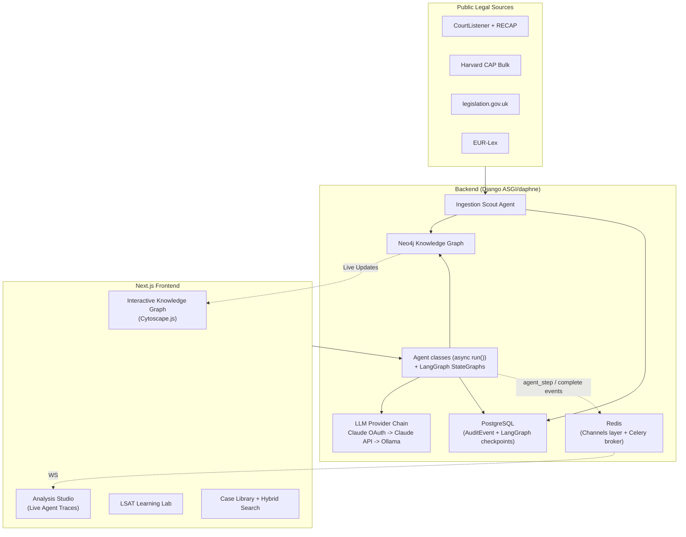
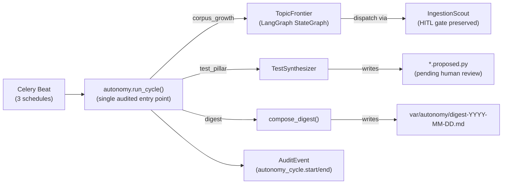

# Law AI Architecture

## High-Level Overview

**Key Design Decisions**:
- **Agent Orchestration**: plain Python classes with `async def run(input: dict) -> BaseModel` for single-agent work (no CrewAI — see below); LangGraph `StateGraph` engines (`LegalWorkflow`, `TopicFrontier`) for stateful, checkpointed, multi-node workflows. Cross-agent fan-out (`LegalAnalyst` + `PrecedentHunter` on `POST /api/analysis`) is a plain `asyncio.gather` in `analysis/urls.py`, not a general-purpose orchestrator — see the Data Flow Example below.
- **Knowledge Representation**: Neo4j as single source of truth for legal relationships.
- **Retrieval**: lexical fulltext search (Neo4j fulltext indexes) plus one-hop `CITES` graph expansion — no vector similarity yet. `agents_runtime/tools/graph_rag.py`'s own docstring is explicit that embeddings are a separate, unstarted spec (no embedding column exists on `:Case`).
- **Durability**: `LegalWorkflow` and `TopicFrontier` runs persist via `AsyncPostgresSaver`, keyed by `thread_id`, so a backend restart can resume an in-flight workflow instead of losing it (NFR-RESILIENCE-1).
- **Privacy**: Claude (subscription OAuth token, then `ANTHROPIC_API_KEY`) is the **default** product-runtime LLM as of spec 034 ([ADR 0005](adr/0005-claude-default-runtime.md)); pinning `LLM_PROVIDER_CHAIN=ollama` keeps everything on-prem and is **required** for data under a confidentiality obligation that forbids third-party processing. Every call — on any tier — is logged through `core.provenance` as an `llm_call` `AuditEvent`, naming the provider/model that actually served it and every tier that was skipped or failed.

---

## Component Responsibilities

| Component | Responsibility | Key Files |
|-----------|-----------------|-----------|
| **Ingestion Scout** | Fetch → parse (Eyecite citations) → extract entities → route by confidence: ≥0.7 auto-commits to Neo4j, below quarantines to the Postgres `pending_review` table (JSONL fallback if Postgres is unreachable) | `backend/law_ai/ingestionapp/services/scout.py`, `ingestionapp/models.py` |
| **Agent classes** | Specialized legal reasoning: `LegalAnalyst` (IRAC, delegates to `LegalWorkflow` by default), `PrecedentHunter` (honest zero-result stub pending real retrieval, [BL-20260511-06](../BACKLOG.md)), `LSATContentAuthor` (LSAT item drafting). `LogicWeaver`, `Educator`, and a general-purpose `Orchestrator` are named in the original design but have no code — registration for each is commented out in `registry.py`. See [docs/agent-roles.md](agent-roles.md) for the full live/planned breakdown. | `backend/law_ai/agents_runtime/crews/`, `agents_runtime/registry.py` |
| **LLM Provider Chain** | Ordered chain (`claude_code` → `anthropic_api` → `ollama`, `LLM_PROVIDER_CHAIN`): the first configured provider that answers wins, each failure is recorded, and total failure raises `LLMUnavailableError` rather than fabricating an answer. `ChatProviderChain` adapts the same chain into a real LangChain `BaseChatModel` for LangGraph nodes. Every call writes an `llm_call` `AuditEvent` before returning. | `backend/law_ai/core/llm/{router,providers,base,langchain}.py` |
| **LangGraph Workflows** | Compiled `StateGraph` engines: `LegalWorkflow` (`retrieve → analyze → cite_check`, the default engine behind `LegalAnalyst`) and `TopicFrontier` (`scan_graph → prioritize → dispatch → summarize`, the autonomy loop's corpus-growth cycle). Both resumable by `thread_id` against the checkpointer. | `backend/law_ai/agents_runtime/graphs/{legal_workflow,topic_frontier}.py` |
| **LangGraph Checkpointer** | `AsyncPostgresSaver` by default (`LANGGRAPH_CHECKPOINTER=postgres` against `settings.POSTGRES_URL`); `redis` and in-process `memory` (tests) are also selectable. Schema is idempotently self-healed on backend boot. `langgraph`, `langgraph-checkpoint-postgres`, and `langgraph-checkpoint-redis` are core backend dependencies (spec 035), not an optional extra. | `backend/law_ai/agents_runtime/graphs/runtime.py`, `agents_runtime/checkpointer.py` |
| **GraphRAG Tool** | Retrieval for `LegalWorkflow`'s `retrieve` node: lexical top-K via Neo4j fulltext indexes (`case_text_fulltext`, `statute_section_text_fulltext`), then one-hop `CITES` graph expansion so authorities the seed cases rely on surface even without a text match. Every passage carries source/date/confidence attribution; every Cypher round-trip is logged via `provenance.log_graph_query`. | `backend/law_ai/agents_runtime/tools/graph_rag.py` |
| **Analysis Request Flow** | `POST /api/analysis` → `AnalysisView.post()` → `_run_analysis()` runs `LegalAnalyst` and `PrecedentHunter` concurrently via `asyncio.gather`, emitting a per-agent `agent_step` WebSocket event as each finishes and a terminal `complete` event after both. There is no separate orchestrator component — this function *is* the routing layer for the endpoint. | `backend/law_ai/analysis/urls.py` |
| **API Layer** | DRF views for analysis, graph queries, ingestion, LSAT (+ Channels consumers for agent streaming) | `backend/law_ai/{analysis,graph,lsat,agentsapi,ingestionapp}/` |
| **Frontend** | Interactive graph, real-time agent streaming, LSAT practice, library | `frontend/app/` + `components/GraphViewer.tsx` |
| **Provenance / Audit** | Every LLM call, tool use, and retrieval logged as an `AuditEvent` row (Postgres), with a JSONL fallback (`core.audit_jsonl`) for async contexts or DB failure | `backend/law_ai/audit/models.py`, `core/provenance.py`, `core/audit_jsonl.py` |
| **Prompt Registry / Phoenix Sync** | Spec 036: every prompt file (versioned runtime `*.v<N>.md`, `legal_workflow/*.md` node prompts, and the repo-root AO-SDLC chain as `sdlc_*`) is enumerated by a registry and mirrored one-way into the self-hosted Arize Phoenix prompt store (`make sync-prompts` → `manage.py sync_prompts`); file versions become Phoenix `v<N>` tags, files stay canonical, each run logs a `prompt_sync` provenance event | `backend/law_ai/agents_runtime/prompts/{registry,phoenix}.py` |
| **Tracing / OpenInference** | Spec 037: `phoenix.otel.register` sets `openinference.project.name` so traces land in `PHOENIX_PROJECT_NAME`; three explicitly-named instrumentors (`Django` for the root request span, `LangChain` for OpenInference `LLM` spans off `ChatProviderChain`, `httpx` with no header hooks) turn what were 499 orphan `UNKNOWN` spans into one request = one trace tree. `logged_node` adds a `CHAIN` span per LangGraph node without touching its audit write; `phoenix_trace_url` resolves the project's base64 id lazily and never blocks a request. Prompt/completion text is off by default and on in `settings/dev.py` (`PHOENIX_TRACE_CONTENT`) | `backend/law_ai/core/telemetry.py`, `core/provenance.py`, `agents_runtime/graphs/legal_workflow.py` |
| **Playground Credential Bridge** | Spec 038: the Phoenix playground runs prompts on the product's tier-1 Claude OAuth credential via an internal-only sidecar (`claude-oauth-proxy`) that swaps Phoenix's placeholder `x-api-key` for the `Bearer` + `oauth-2025-04-20` pair; the token stays in `.env` and never enters the Phoenix container. Playground calls bypass provenance (BL-20260811-33) | `backend/scripts/claude_oauth_proxy.py`, `docker-compose.yml` |
| **Evaluation** | LegalBench harness (pinned to Ollama regardless of the default chain, so scores stay comparable over time) + custom legal reasoning tests | `backend/law_ai/eval/` |
| **Autonomy Loop** | Scheduled cycles (corpus growth, test synthesis, digest) controlled by `AUTONOMY_ENABLED` kill-switch; single audited entry point via `law_ai.core.autonomy.run_cycle`; every cycle emits paired provenance events | `backend/law_ai/core/autonomy.py`, `backend/law_ai/celery.py`, `agents_runtime/crews/test_synthesizer.py`, `agents_runtime/graphs/topic_frontier.py` |

---

## Data Flow Example: "Analyze this case + find precedents"

1. User uploads a case or selects one from the library → `POST /api/analysis` with `AnalysisRequest` (`text`, optional `jurisdiction`/`case_id`, `use_langgraph` defaulting to `true`, optional client-chosen `stream_id` for WebSocket correlation).
2. `AnalysisView.post()` calls `_run_analysis()`, which runs `LegalAnalyst.run()` and `PrecedentHunter.run()` **concurrently** via `asyncio.gather` — there is no separate orchestrator component in front of them.
3. `LegalAnalyst`: with `use_langgraph=true` (the default), it delegates to `LegalWorkflow`, whose `retrieve` node calls the GraphRAG tool (lexical fulltext + one-hop `CITES` expansion) and whose `analyze`/`cite_check` nodes call `ChatProviderChain` (Claude OAuth → Claude API → Ollama). With `use_langgraph=false`, it calls the provider chain directly with a JSON response schema, skipping retrieval entirely.
4. `PrecedentHunter` currently returns zero precedents at confidence `0.0` with `degraded=True` on every call — no Cypher or graph retrieval is implemented yet ([BL-20260511-06](../BACKLOG.md)). This is a deliberate honest-refusal stub (constitution §4/§13: never fabricate case law), not a bug.
5. As each agent finishes, `_run_step` emits an `agent_step` WebSocket event over the client-supplied `stream_id` (via the Redis-backed Channels layer); a terminal `complete` event follows once both agents have returned.
6. The response returns `confidence` (mean of the *non-degraded* agents' confidences), `requires_human_review` (true when confidence `< 0.7`, either agent is `degraded`, or the analyst sets `requires_review`), the `IRACOutput`, and the `PrecedentList`. There is no "project workspace" or graph write-back here — `DerivedDocument` ([docs/data-model.md](data-model.md)) is the schema-level home reserved for AI-generated outputs, but nothing under `analysis/` writes one back to Neo4j yet.
7. The full trace — prompts, tool calls, retrieval stats, the provider/model that actually served each call, latency — is written as an `AuditEvent` per LLM call and per agent call (`provenance.log_agent_call` / the `llm_call` event from the provider chain), with a JSONL fallback if Postgres is unreachable.

---

## Autonomy Loop (Spec 018)

The autonomy loop runs inside the same Docker Compose stack as the main API. It is disabled by default (`AUTONOMY_ENABLED=false`) per [docs/constitution.md](constitution.md) §12 invariant I3 (kill-switch).

Both `TopicFrontier` and `TestSynthesizer` call out to the LLM through the same provider chain as everything else (`core.llm`, Claude-first, Ollama last), scoped to the `ollama`-tier model via a `models={"ollama": ...}` override rather than a separate transport. Neither is a CrewAI `Crew`/`Agent`/`Task` — see [Technology Choices Rationale](#technology-choices-rationale) below.

See [ADR 0003](adr/0003-autonomy-orchestrator.md) for the full design rationale and the six invariants (I1–I6). Note that ADR 0003's compliance-check row asserting "no closed-source fallback" predates spec 034/[ADR 0005](adr/0005-claude-default-runtime.md) and is superseded by it; ADR 0003's own decision (the autonomy orchestrator's design) is unaffected.

The `baseline.json` for LegalBench regression tracking will be committed after the first green harness run; its commit SHA will be recorded in [docs/legalbench.md](legalbench.md) `## Baseline scores`.

---

## Technology Choices Rationale

- **Neo4j over pure vector DB**: Legal reasoning is heavily relational (citations, overruling, same-jurisdiction, same-issue). Graph traversals are more precise than embedding similarity alone — and no embedding index exists yet regardless, so this is also the *only* retrieval path currently implemented (see `agents_runtime/tools/graph_rag.py`).
- **Plain agent classes, not CrewAI**: `crewai` is a declared dependency in `backend/pyproject.toml` but is never imported anywhere in `backend/law_ai` — every agent (`LegalAnalyst`, `PrecedentHunter`, `TestSynthesizer`, `LSATContentAuthor`) is a hand-written class exposing `async def run(input: dict) -> BaseModel` — the plain convention [CLAUDE.md](../CLAUDE.md)'s own non-negotiables section requires — not CrewAI's `Agent`/`Task`/`Crew` API. The `crews/` directory name is a naming holdover, not a statement about the library in use.
- **LangGraph for stateful, checkpointed workflows**: `LegalWorkflow` and `TopicFrontier` are compiled `StateGraph`s with a durable `AsyncPostgresSaver` checkpointer (spec 035 promoted `langgraph` and the Postgres/Redis checkpoint backends from an optional extra to core dependencies), giving resumable runs and an audit trail per node — essential for legal review, not available from a bare LLM call.
- **Claude-first provider chain, Ollama as the durable local-only fallback**: `LLM_PROVIDER_CHAIN=claude_code,anthropic_api,ollama` is the default as of spec 034 ([ADR 0005](adr/0005-claude-default-runtime.md)) — answer quality on IRAC analysis, issue-spotting, and LSAT authoring was the binding constraint on a local-only model. `LLM_PROVIDER_CHAIN=ollama` remains a fully supported pin and is required, not optional, for confidentiality-bound data; the LegalBench harness stays pinned to Ollama independent of this default so benchmark scores don't drift with provider changes.
- **Cytoscape.js**: Best-in-class performance for large interactive graphs (10k+ nodes) with excellent React integration.

See [docs/data-model.md](data-model.md) for the full Neo4j schema and [docs/agent-roles.md](agent-roles.md) for detailed, per-agent live/planned status.
