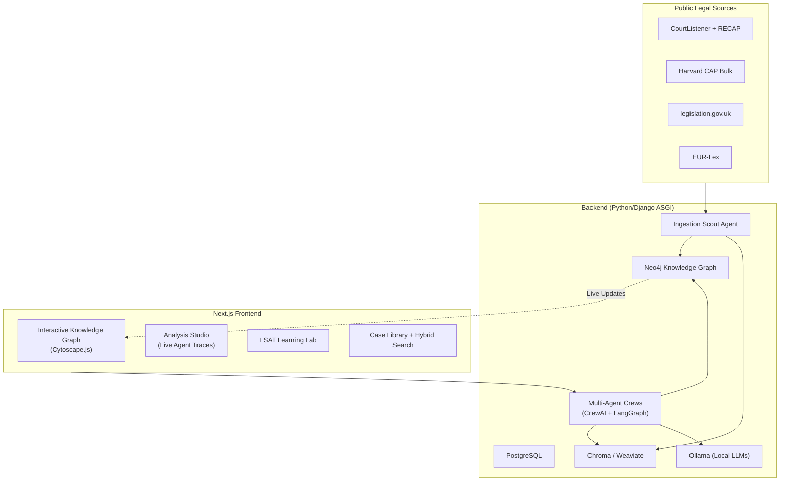

# LawGraph AI Architecture

## High-Level Overview

**Key Design Decisions**:
- **Agent Orchestration**: Hybrid CrewAI (fast role-based) + LangGraph (stateful + auditable)
- **Knowledge Representation**: Neo4j as single source of truth for legal relationships
- **Retrieval**: Hybrid GraphRAG (Cypher traversals + vector similarity)
- **Privacy**: Ollama local by default; full audit trail of every LLM call

---

## Component Responsibilities

| Component              | Responsibility                                                                 | Key Files |
|------------------------|----------------------------------------------------------------------------------|-----------|
| **Ingestion Scout**    | Fetch → Parse (Eyecite) → Extract (Blackstone + LLM) → Commit to Neo4j          | `backend/app/ingestion/`, `agents/crews/ingestion_scout/` |
| **Agent Crews**        | Specialized legal reasoning (Analyst, Precedent Hunter, Logic Weaver, Educator) | `backend/app/agents/crews/` |
| **Orchestrator**       | LangGraph state machine, routing, HITL gates, provenance logging                | `backend/app/agents/graphs/orchestrator.py` |
| **GraphRAG Engine**    | Hybrid retrieval (vector + Cypher) + community summaries                        | `backend/app/agents/tools/graph_rag.py` |
| **API Layer**          | Django REST Framework views for analysis, graph queries, ingestion, LSAT (+ Channels consumers for agent streaming) | `backend/lawgraph/{analysis,graph,lsat,agentsapi,ingestionapp}/` |
| **Frontend**           | Interactive graph, real-time agent streaming, LSAT practice, library            | `frontend/app/` + `components/GraphViewer.tsx` |
| **Evaluation**         | LegalBench harness + custom legal reasoning tests                               | `backend/app/eval/` |

---

## Data Flow Example: "Analyze this case + find precedents"

1. User uploads case or selects from library → `POST /api/analysis`
2. Orchestrator creates LangGraph run → routes to `LegalAnalyst` + `PrecedentHunter` in parallel
3. `LegalAnalyst` produces IRAC + structured output (grounded via GraphRAG)
4. `PrecedentHunter` runs Cypher query for analogous cases + vector similarity
5. Results streamed to frontend via WebSocket
6. User approves → results committed to project workspace + graph updated
7. Full trace (prompts, tool calls, retrievals) saved in `provenance` table

---

## Technology Choices Rationale

- **Neo4j over pure vector DB**: Legal reasoning is heavily relational (citations, overruling, same-jurisdiction, same-issue). Graph traversals are more precise than embedding similarity alone.
- **CrewAI + LangGraph**: CrewAI gives fast, readable role-based crews. LangGraph gives production-grade state, checkpointing, and time-travel debugging (essential for legal audit).
- **Ollama default**: Keeps all sensitive legal data on-prem. Supports quantized models for consumer hardware.
- **Cytoscape.js**: Best-in-class performance for large interactive graphs (10k+ nodes) with excellent React integration.

See `docs/data-model.md` for full Neo4j schema and `docs/agent-roles.md` for detailed agent specs.