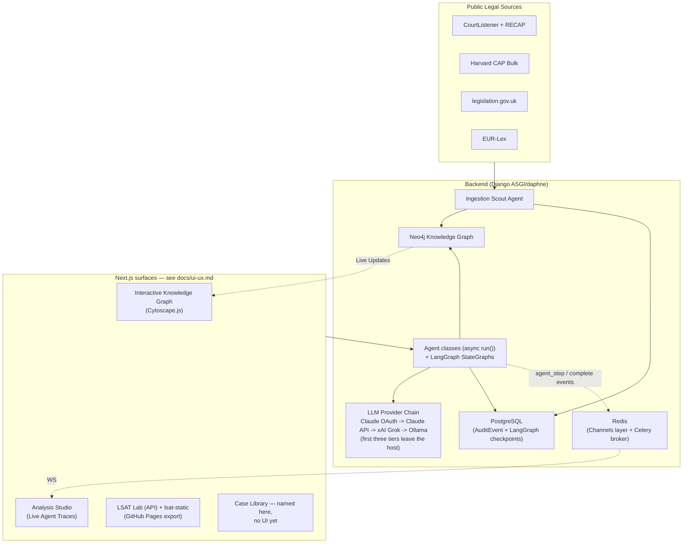
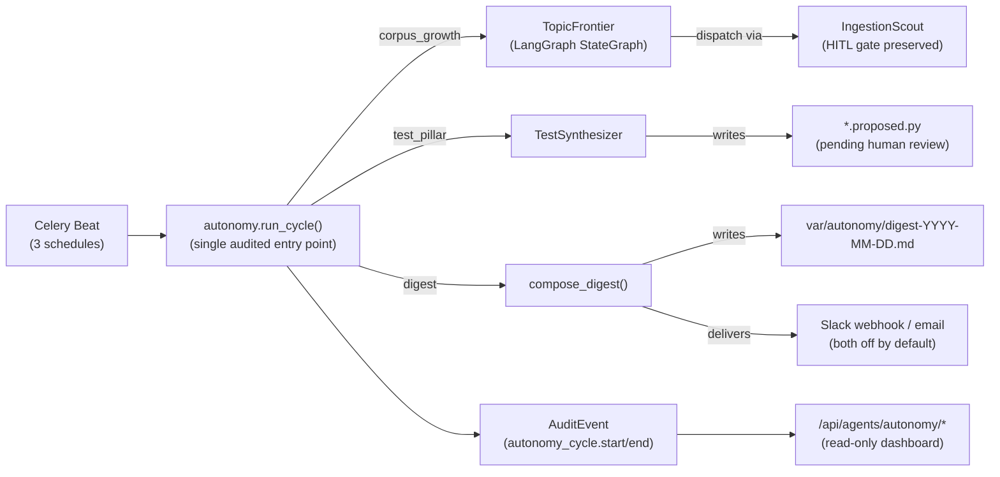

# Law AI Architecture

## High-Level Overview

**Key Design Decisions**:
- **Agent Orchestration**: plain Python classes with `async def run(input: dict) -> BaseModel` for single-agent work (no CrewAI — see below); LangGraph `StateGraph` engines (`LegalWorkflow`, `TopicFrontier`) for stateful, checkpointed, multi-node workflows. Cross-agent fan-out (`LegalAnalyst` + `PrecedentHunter` on `POST /api/analysis`) is a plain `asyncio.gather` in `analysis/urls.py`, not a general-purpose orchestrator — see the Data Flow Example below.
- **Knowledge Representation**: Neo4j as single source of truth for legal relationships.
- **Retrieval**: lexical fulltext search (Neo4j fulltext indexes) fused with a local-embedding vector top-K by reciprocal-rank fusion, then one-hop `CITES` graph expansion. The embedding leg (BL-20260810-17) is `nomic-embed-text` over Ollama, indexed by `008_vector_indexes.cypher`; it is skipped — and the coverage note says so — when the index or the embedder is absent.
- **Durability**: `LegalWorkflow` and `TopicFrontier` runs persist via `AsyncPostgresSaver`, keyed by `thread_id`, so a backend restart can resume an in-flight workflow instead of losing it (NFR-RESILIENCE-1).
- **Privacy**: Claude (subscription OAuth token, then `ANTHROPIC_API_KEY`) is the **default** product-runtime LLM as of spec 034 ([ADR 0005](adr/0005-claude-default-runtime.md)), with xAI Grok as tier 3 since spec 050 ([ADR 0007](adr/0007-xai-runtime-provider.md)) — so **two** third parties now sit in the default chain ahead of the local tier; pinning `LLM_PROVIDER_CHAIN=ollama` keeps everything on-prem and is **required** for data under a confidentiality obligation that forbids third-party processing. Every call — on any tier — is logged through `core.provenance` as an `llm_call` `AuditEvent`, naming the provider/model that actually served it and every tier that was skipped or failed.

---

## Component Responsibilities

| Component | Responsibility | Key Files |
|-----------|-----------------|-----------|
| **Ingestion Scout** | Fetch → parse (Eyecite citations) → extract entities → route by confidence: ≥0.7 auto-commits to Neo4j, below quarantines to the Postgres `pending_review` table (JSONL fallback if Postgres is unreachable). Confidence is not the only gate: an adapter that declares `requires_human_approval` forces quarantine for every document it returns — see [Source adapter contract](#source-adapter-contract) | `backend/law_ai/ingestionapp/services/scout.py`, `ingestionapp/models.py`, `ingestionapp/sources/base.py` |
| **Agent classes** | Specialized legal reasoning: `LegalAnalyst` (IRAC, delegates to `LegalWorkflow` by default), `PrecedentHunter` (hybrid GraphRAG retrieval over `:Case`/`CITES`, zero results stay `degraded=True`), `LSATContentAuthor` (LSAT item drafting). `LogicWeaver`, `Educator`, and a general-purpose `Orchestrator` are named in the original design but have no code — registration for each is commented out in `registry.py`. See [docs/agent-roles.md](agent-roles.md) for the full live/planned breakdown. | `backend/law_ai/agents_runtime/crews/`, `agents_runtime/registry.py` |
| **LLM Provider Chain** | Ordered chain (`claude_code` → `anthropic_api` → `xai` → `ollama`, `LLM_PROVIDER_CHAIN`; the `xai` tier is inert until an operator runs `make xai-login`, [ADR 0007](adr/0007-xai-runtime-provider.md)): the first configured provider that answers wins, each failure is recorded, and total failure raises `LLMUnavailableError` rather than fabricating an answer. `ChatProviderChain` adapts the same chain into a real LangChain `BaseChatModel` for LangGraph nodes. `llm.astream()` streams the same chain token by token, per-transport (Anthropic SSE, xAI SSE, Ollama NDJSON), with the fallback rule described under [Technology Choices Rationale](#technology-choices-rationale). Every call writes an `llm_call` `AuditEvent` before returning, carrying the serving provider/model, latency, and the token counts the transport reported — plus a `cost_usd` when `LLM_PRICE_TABLE` prices that model — so hosted-tier spend is attributable per agent. | `backend/law_ai/core/llm/{router,providers,base,langchain}.py` |
| **LangGraph Workflows** | Compiled `StateGraph` engines: `LegalWorkflow` (`retrieve → analyze → cite_check`, the default engine behind `LegalAnalyst`) and `TopicFrontier` (`scan_graph → prioritize → dispatch → summarize`, the autonomy loop's corpus-growth cycle). Both resumable by `thread_id` against the checkpointer. | `backend/law_ai/agents_runtime/graphs/{legal_workflow,topic_frontier}.py` |
| **LangGraph Checkpointer** | `AsyncPostgresSaver` by default (`LANGGRAPH_CHECKPOINTER=postgres` against `settings.POSTGRES_URL`); `redis` and in-process `memory` (tests) are also selectable. Schema is idempotently self-healed on backend boot. `langgraph`, `langgraph-checkpoint-postgres`, and `langgraph-checkpoint-redis` are core backend dependencies (spec 035), not an optional extra. | `backend/law_ai/agents_runtime/graphs/runtime.py`, `agents_runtime/checkpointer.py` |
| **GraphRAG Tool** | Retrieval for `LegalWorkflow`'s `retrieve` node: lexical top-K via Neo4j fulltext indexes (`case_text_fulltext`, `statute_section_text_fulltext`) fused by reciprocal rank with a vector top-K over `case_embedding_vec`, then one-hop `CITES` graph expansion so authorities the seed cases rely on surface even without a text match. Every passage carries source/date/confidence attribution; every Cypher round-trip is logged via `provenance.log_graph_query`. Optionally biased by a matter's **boost set** (BL-20260817-05): pass `matter_id` (or `boost_case_ids`) in the workflow state and the authorities a human already verified on that matter are stable-promoted to the front, with `boosted_count`/`boost_source` recorded on the coverage envelope and named in its caveat — a boost is a declared bias, never a silent one, and only HITL-verified authorities qualify. | `backend/law_ai/agents_runtime/tools/graph_rag.py`, `backend/law_ai/core/llm/embeddings.py` |
| **Analysis Request Flow** | `POST /api/analysis` → `AnalysisView.post()` → `_run_analysis()` runs `LegalAnalyst` and `PrecedentHunter` concurrently via `asyncio.gather`, emitting a per-agent `agent_step` WebSocket event as each finishes and a terminal `complete` event after both. There is no separate orchestrator component — this function *is* the routing layer for the endpoint. | `backend/law_ai/analysis/urls.py` |
| **API Layer** | DRF views for analysis, graph queries, ingestion, LSAT (+ Channels consumers for agent streaming) | `backend/law_ai/{analysis,graph,lsat,agentsapi,ingestionapp}/` |
| **LSAT content types** | Four section types, all file-backed under `lsat/services/data/` and loaded through Pydantic loaders: **LR / RC / LG** keyed multiple-choice questions (`bank.py` over `lr_bank.json`, `rc_bank.json`, `lg_bank.json`, with `passages.json` for RC/LG context and `concepts.json` for the catalog), per-question solve guides (`guides.py`, row below), and **WS — Argumentative Writing** (`writing.py` over `writing_prompts.json` + `writing_rubrics.json`, [spec 047](../specs/047-lsat-continuous-curriculum/spec.md)). WS holds prompts, not keyed questions: `GET /api/lsat/writing/prompts` serves `public_prompt_view`, which withholds the annotated model response until the learner submits, while the rubric ships in full so a draft can be self-scored offline. `POST /api/lsat/writing/evaluate` runs `LSATWritingEvaluator` for formative, rubric-scored feedback — never promoted into the bank, labelled with the serving `model` and `prompt_version`, and audited as an `lsat_writing_evaluate` event. See [docs/agent-roles.md](agent-roles.md). | `backend/law_ai/lsat/services/{bank,guides,writing}.py`, `lsat/services/data/`, `lsat/urls.py` |
| **LSAT solve guides** | File-backed per-question solve guides ([spec 045](../specs/045-lsat-solving-aids/spec.md)): ordered hint steps with typed diagram payloads (sequence boards, grids, symbolic notation, argument maps, passage maps), served spoiler-stripped at `GET /api/lsat/questions/<id>/guide` and revealed progressively by `SolveAssist` in the Lab. LLM-drafted guides (`LSATSolveGuideAuthor`) are HITL-gated through the proposals queue. | `backend/law_ai/lsat/services/guides.py`, `frontend/components/lsat/` |
| **Frontend (platform)** | Dark-only Next.js 16 app: Agent Ops, Analysis Studio, Knowledge Graph (Cytoscape), LSAT Lab, Settings. App shell (masthead / rail / sidebar / inspector) + module catalog + instance-scoped settings resolver ([spec 040](../specs/040-app-shell/spec.md)). Tailwind v4, **no shadcn/ui**. Design-system target: `frontend/ui/` ([spec 039](../specs/039-design-system/spec.md), [ADR 0006](adr/0006-first-party-design-system.md)) | `frontend/app/(app)/`, `frontend/components/shell/`, `frontend/lib/{modules,scope,settings}/` |
| **LSAT static site** | Serverless practice export (HITL-approved `content.json`), Next.js `output: 'export'`, hand-written semantic CSS tokens. Not on `make dev` — see [LSAT static delivery channel](#lsat-static-delivery-channel) and [docs/lsat-static.md](lsat-static.md) | `lsat-static/`, `backend/law_ai/lsat/management/commands/lsat_export.py` |
| **ocrmd plug-in** | Scanned physical books in. Two *receiver* doors in [ocrmd](https://github.com/bamr87/ocrmd)'s sink contract (`GET` descriptor / `POST` envelope): the LSAT intake (page text → `LSATSourceExtractor` → gates → HITL queue) and a per-matter door (page → `MatterArtifact` kind `document`, `source=ocrmd`). Plus the scanner itself as an optional library (`ENABLE_OCRMD`, opt-in build) that OCRs an upload here — OCR only, no model call from inside the dependency (§4). See [Scanned-page intake](#scanned-page-intake-the-ocrmd-plug-in-spec-053) | `backend/law_ai/ingestionapp/services/ocrmd_plugin.py`, `lsat/services/ocr_intake.py`, `matters/services/scanned.py`, `ingestionapp/urls.py` |
| **Provenance / Audit** | Every LLM call, tool use, and retrieval logged as an `AuditEvent` row (Postgres), with a JSONL fallback (`core.audit_jsonl`) for async contexts or DB failure | `backend/law_ai/audit/models.py`, `core/provenance.py`, `core/audit_jsonl.py` |
| **Evaluation** | LegalBench harness (pinned to Ollama regardless of the default chain, so scores stay comparable over time) + custom legal reasoning tests | `backend/law_ai/eval/` |
| **Autonomy Loop** | Scheduled cycles (corpus growth, test synthesis, digest) controlled by `AUTONOMY_ENABLED` kill-switch; single audited entry point via `law_ai.core.autonomy.run_cycle`; every cycle emits paired provenance events | `backend/law_ai/core/autonomy.py`, `backend/law_ai/celery.py`, `agents_runtime/crews/test_synthesizer.py`, `agents_runtime/graphs/topic_frontier.py` |

---

## Data Flow Example: "Analyze this case + find precedents"

1. User uploads a case or selects one from the library → `POST /api/analysis` with `AnalysisRequest` (`text`, optional `jurisdiction`/`case_id`, `use_langgraph` defaulting to `true`, optional client-chosen `stream_id` for WebSocket correlation).
2. `AnalysisView.post()` calls `_run_analysis()`, which runs `LegalAnalyst.run()` and `PrecedentHunter.run()` **concurrently** via `asyncio.gather` — there is no separate orchestrator component in front of them.
3. `LegalAnalyst`: with `use_langgraph=true` (the default), it delegates to `LegalWorkflow`, whose `retrieve` node calls the GraphRAG tool (lexical fulltext + one-hop `CITES` expansion) and whose `analyze`/`cite_check` nodes call `ChatProviderChain` (Claude OAuth → Claude API → xAI Grok → Ollama). With `use_langgraph=false`, it calls the provider chain directly with a JSON response schema, skipping retrieval entirely.
4. `PrecedentHunter` runs the same hybrid `GraphRAGRetriever` as `LegalWorkflow` (lexical fulltext over `:Case` plus one hop of `CITES` expansion) and maps each returned row onto a `Precedent` carrying its `source_url`, court, year, `retrieval_mode`, ingestion `source` and the node's own `confidence`. Nothing on this path is model-generated, so nothing can be a fabricated case (constitution §4/§13). An empty result set — or an unreachable graph — stays `degraded=True` at confidence `0.0` with a summary that says "not in this corpus", never "no such precedent"; the retriever's coverage note is relayed verbatim in `coverage_note`. Confidence is derived from the result count, halved when the requested jurisdiction is absent, and capped at `0.8`.
5. While `LegalAnalyst` generates, it relays its deltas over the same `stream_id` as `analysis_token` events (BL-20260905-11) — the IRAC pass is the slow one (56-103s on the xAI tier), and this is what makes the wait visible. As each agent finishes, `_run_step` emits an `agent_step` WebSocket event over the client-supplied `stream_id` (via the Redis-backed Channels layer); a terminal `complete` event follows once both agents have returned.
6. The response returns `confidence` (mean of the *non-degraded* agents' confidences), `requires_human_review` (true when confidence `< 0.7`, either agent is `degraded`, or the analyst sets `requires_review`), the `IRACOutput`, and the `PrecedentList`. There is no "project workspace" or graph write-back here — `DerivedDocument` ([docs/data-model.md](data-model.md)) is the schema-level home reserved for AI-generated outputs, but nothing under `analysis/` writes one back to Neo4j yet.
7. The full trace — prompts, tool calls, retrieval stats, the provider/model that actually served each call, latency — is written as an `AuditEvent` per LLM call and per agent call (`provenance.log_agent_call` / the `llm_call` event from the provider chain), with a JSONL fallback if Postgres is unreachable.

---

## Autonomy Loop (Spec 018)

The autonomy loop runs inside the same Docker Compose stack as the main API. It is disabled by default (`AUTONOMY_ENABLED=false`) per [docs/constitution.md](constitution.md) §12 invariant I3 (kill-switch).

### Source adapter contract

Every ingest source the autonomy loop may reach is a `SourceAdapter` subclass registered in `SOURCE_REGISTRY` ([backend/law_ai/ingestionapp/sources/base.py](../backend/law_ai/ingestionapp/sources/base.py)). The class declares five pieces of metadata — `name` (the registry key that must also appear in `AUTONOMY_ALLOWED_SOURCES`), `jurisdiction`, `license`, `requires_human_approval`, and `rate_limit_rps` — plus an optional `extractor` class for sources whose documents are not court opinions. Adapters return `RawDoc`s and MUST NOT write to Neo4j themselves; `IngestionScout.run_and_commit` stays the single writer of `:Case` nodes (constitution §12 invariant I1).

`requires_human_approval` is the adapter-level HITL gate ([spec 018](../specs/018-autonomous-framework/spec.md) NFR-HITL-1, enforced by [spec 020](../specs/020-enforce-hitl-quarantine/spec.md) / [spec 023](../specs/023-hitl-quarantine-enforcement/spec.md)). When it is `True`, `TopicFrontier`'s `dispatch` node passes `force_quarantine=True` into `run_and_commit` for every document from that adapter (`agents_runtime/graphs/topic_frontier.py`), so the document lands in `PendingReview` regardless of its extraction confidence, and the cycle's summary carries `human_approval_required=True`. In `run_and_commit` (`ingestionapp/services/scout.py`) `force_quarantine` **wins over** `force_commit` — the flag the human-approval path (spec 029) uses to commit an already-reviewed item — so an approval-required source can never be auto-committed, not even through the approval endpoint's own bypass. The confidence threshold and `ENABLE_HUMAN_APPROVAL_GATES` are independent of this: turning the global gate off logs an `hitl_gate_disabled` provenance event but still cannot release a `force_quarantine` document.

See [docs/data-sources.md](data-sources.md#autonomy-source-adapters) for the adapters that ship today and the upstream clients they wrap.

### Autonomy dashboard (read-only)

`/autonomy` in the frontend reads three panels off `/api/agents/autonomy/*` (`backend/law_ai/agentsapi/autonomy_views.py`): LegalBench accuracy over time from the eval harness's `history.jsonl`, the five lowest-coverage modules from `coverage.xml`, and the ten newest `PendingReview` rows. Every panel is a view — none of them starts a cycle, approves a document, or calls a model — and each reports absence explicitly, because both files are CI artifacts a fresh checkout does not have (BL-20260511-03).

The same read-only rule covers `GET /api/agents/proposed-tests` (`AgentProposedTestsView` in `backend/law_ai/agentsapi/urls.py`), which lists the `*.proposed.py` files `TestSynthesizer` has written and no human has ruled on yet — `{count, files: [{name, path, module, size, mtime, skip_marked}], available}`, rendered by `ProposedTestReview` on Agent Ops. The directory it globs is fixed (`backend/tests/autonomy/proposed/`) and no path parameter is accepted; promoting a proposal is a human edit in a PR, never an API call (BL-20260511-17).

Both `TopicFrontier` and `TestSynthesizer` call out to the LLM through the same provider chain as everything else (`core.llm`, Claude-first, Ollama last), scoped to the `ollama`-tier model via a `models={"ollama": ...}` override rather than a separate transport. Neither is a CrewAI `Crew`/`Agent`/`Task` — see [Technology Choices Rationale](#technology-choices-rationale) below.

### Scanned-page intake (the ocrmd plug-in, spec 053)

[ocrmd](https://github.com/bamr87/ocrmd) is a separate program — a webcam or folder of photographs becomes cross-checked Markdown, every page read twice and every disagreement marked. Law AI meets it at two seams, both in `backend/law_ai/ingestionapp/services/ocrmd_plugin.py`:

- **Inbound, as a receiver.** ocrmd's outbound path is a small contract: one URL per destination, `GET` answering with a *descriptor* (what the receiver is, which typed options it takes) and `POST` taking an *envelope* (the page's reconciled text, its provenance — document, page, page id, both agreement scores, the flag count, a link back to the image — the book's catalogue entry, the operator's options). Law AI opens two doors: `/api/lsat/intake/ocr`, where `LSATSourceExtractor` transcribes the questions on the page and every draft passes the spec-024 gates into the HITL queue, and `/api/matters/<slug>/intake/ocrmd`, where the page becomes a `document` artifact on the caller's own matter. Both answer in the contract's terms — `summary`, `items`, `warnings` — so the scanner's UI shows what happened; the matter door is idempotent on page id + region, because "did that go through?" is answered by pressing the button again. The scanner sends the text, never the photograph: a receiver with the picture and a vision model would re-read the page single-pass and overrule the cross-check.
- **Embedded, as a library.** With the `ocrmd` extra installed (`INSTALL_OCRMD=1` at build time) and `ENABLE_OCRMD=true`, `POST /api/ingestion/ocrmd/scan` and `manage.py ocrmd_scan` run `ocrmd.api.Library(root=OCRMD_ROOT, provider=None)` over an upload and route each page to a door. `provider=None` is the design decision: ocrmd's own vision pass would call Anthropic from inside a dependency and bypass `law_ai.core.llm`, and the chain has no image path yet (BL-20260907-13). So the embedded scanner produces **one** reading, labels it so (`llm_model` empty, `status: unverified`, a "one reading only" caveat on every routed page), and the cross-checked path remains a scanner rig posting to the doors.

Nothing on either seam writes a graph node. A scanned page is the user's material, not a public source; the case for a `:SourceDocument` node is BL-20260907-15.

See [ADR 0003](adr/0003-autonomy-orchestrator.md) for the full design rationale and the six invariants (I1–I6). Note that ADR 0003's compliance-check row asserting "no closed-source fallback" predates spec 034/[ADR 0005](adr/0005-claude-default-runtime.md) and is superseded by it; ADR 0003's own decision (the autonomy orchestrator's design) is unaffected.

The `baseline.json` for LegalBench regression tracking will be committed after the first green harness run; its commit SHA will be recorded in [docs/legalbench.md](legalbench.md) `## Baseline scores`.

---

## LSAT static delivery channel

The LSAT module ships through two surfaces: the API-backed Lab inside the Next.js platform (`/lsat`, live data from `/api/lsat/*`) and a serverless static export published to GitHub Pages from `lsat-static/`. The static channel is a build-time snapshot, never a client of the API — that is what lets it run offline, unauthenticated, and with no backend at all.

The flow is five steps:

1. **Source of truth** — the bank and its companions live as JSON under `backend/law_ai/lsat/services/data/` (`lr_bank.json`, `rc_bank.json`, `lg_bank.json`, plus concepts, passages, solve guides, writing prompts/rubrics and the library). Every file is loaded through the canonical Pydantic loaders in `lsat/services/`, so only loader-valid content can leave the repo.
2. **Export** — `manage.py lsat_export --out var/lsat_site` ([backend/law_ai/lsat/management/commands/lsat_export.py](../backend/law_ai/lsat/management/commands/lsat_export.py)) snapshots the whole HITL-approved module into one `content.json` stamped with `schema_version` (currently `3`, bumped by specs 046/047/048 as guides, writing and the library were added). Ordering is stable, so re-exporting an unchanged bank is byte-identical apart from `generated_at`.
3. **Publish into the site directory** — `make lsat-export` runs that command in the backend container and copies `backend/var/lsat_site/content.json` to the committed `lsat-static/content.json`. The artifact is committed on purpose: the Pages build has no database and no backend. Forgetting the step is caught either way: [refresh-lsat-content.yml](../.github/workflows/refresh-lsat-content.yml) re-runs the export whenever a change under `backend/law_ai/lsat/services/data/` lands on `main`, commits `content.json` when the payload actually moved (`generated_at` excluded from the comparison) and then dispatches the Pages build, because a push made with `GITHUB_TOKEN` triggers no workflow of its own (BL-20260702-11).
4. **Drift gate** — [tests/test_lsat_site.py](../tests/test_lsat_site.py) (root structural suite, `smoke` marker; CI job "Run root structural suite") fails when a source bank file changes without a matching `make lsat-export`, so the published site can never silently lag the approved content. `make test-lsat-static` runs the site's own Vitest suite in a `node:20-alpine` container (`lsat-static/` has no compose service because nothing in the dev stack serves it).
5. **Deploy** — [.github/workflows/deploy-lsat-pages.yml](../.github/workflows/deploy-lsat-pages.yml) triggers on pushes to `main` that touch `lsat-static/**` (source-bank paths are deliberately not listed — a bank edit reaches the site only via step 3), runs `npm ci` + `npm run build` with `PAGES_BASE_PATH=/<repo>` for `output: 'export'`, measures the built export in a real browser, and uploads `lsat-static/out` to Pages.

**One-time repo setup**: Settings → Pages → Source: **GitHub Actions**. Nothing else is provisioned; there is no server, no runtime secret, and no per-deploy configuration.

Two more targets keep the two UIs from drifting: `make ui-sync` mirrors the shared primitives (`frontend/ui/base.css`, the roving-focus helper, the LSAT timer + its store, the SolveAssist contract test) into `lsat-static/`, and `make lsat-static-build` builds the export locally the way Pages does. Details, directory layout and the spec history are in [docs/lsat-static.md](lsat-static.md); the operator-facing quickstart stays in [lsat-static/README.md](../lsat-static/README.md).

---

## Technology Choices Rationale

- **Neo4j over pure vector DB**: Legal reasoning is heavily relational (citations, overruling, same-jurisdiction, same-issue). Graph traversals are more precise than embedding similarity alone, so the graph stays the substrate; the vector index (BL-20260810-17) lives *inside* Neo4j as one leg of the hybrid rather than in a separate store, which keeps a single source of truth and lets the same query expand along `CITES` (see `agents_runtime/tools/graph_rag.py`).
- **Plain agent classes, not CrewAI**: `crewai` is a declared dependency in `backend/pyproject.toml` but is never imported anywhere in `backend/law_ai` — every agent (`LegalAnalyst`, `PrecedentHunter`, `TestSynthesizer`, `LSATContentAuthor`) is a hand-written class exposing `async def run(input: dict) -> BaseModel` — the plain convention [CLAUDE.md](../CLAUDE.md)'s own non-negotiables section requires — not CrewAI's `Agent`/`Task`/`Crew` API. The `crews/` directory name is a naming holdover, not a statement about the library in use.
- **LangGraph for stateful, checkpointed workflows**: `LegalWorkflow` and `TopicFrontier` are compiled `StateGraph`s with a durable `AsyncPostgresSaver` checkpointer (spec 035 promoted `langgraph` and the Postgres/Redis checkpoint backends from an optional extra to core dependencies), giving resumable runs and an audit trail per node — essential for legal review, not available from a bare LLM call.
- **Two entry points to the provider chain, on purpose** (BL-20260811-28): plain agent classes in `agents_runtime/crews/` call `law_ai.core.llm.agenerate()` / `generate()` directly; LangGraph and LCEL code (`LegalWorkflow`) goes through `ChatProviderChain`, the LangChain `BaseChatModel` wrapper. Both write the same `llm_call` provenance event through the same router, so the audit trail is identical either way. Consolidating the crews onto `ChatProviderChain` was considered and rejected: the router entry point takes a `response_schema` that the LangChain adapter has no field for (`LegalAnalyst` and `LSATContentAuthor` rely on it for structured JSON), it returns an `LLMResult` carrying `model_label`, `provider`, `usage` and `fell_back` where a `BaseChatModel` returns an `AIMessage` the crews would have to unwrap, and `LLMUnavailableError` handling would need re-wrapping — all to buy LangChain callbacks and LCEL composition that plain `run(input) -> BaseModel` agents do not use. **Rule of thumb**: reach for `ChatProviderChain` when the call site is a LangGraph node or an LCEL chain; reach for `core.llm.agenerate` everywhere else.
- **Claude-first provider chain, Ollama as the durable local-only fallback**: `LLM_PROVIDER_CHAIN=claude_code,anthropic_api,xai,ollama` is the default as of specs 034 and 050 ([ADR 0005](adr/0005-claude-default-runtime.md), [ADR 0007](adr/0007-xai-runtime-provider.md)) — answer quality on IRAC analysis, issue-spotting, and LSAT authoring was the binding constraint on a local-only model. `LLM_PROVIDER_CHAIN=ollama` remains a fully supported pin and is required, not optional, for confidentiality-bound data; the LegalBench harness stays pinned to Ollama independent of this default so benchmark scores don't drift with provider changes.
- **Streaming falls back before the first token and never after it** (BL-20260811-20): `llm.astream()` walks the same chain as `llm.agenerate()`, but the two halves of a streamed call have different rules. A tier that fails *before* it emits a delta is recorded and skipped exactly like a buffered failure, so a dead Claude tier still degrades to Grok or Ollama. A tier that fails *after* one is not retried anywhere: the caller — and, on the WebSocket path, a human watching text appear — has already seen part of an answer, and restarting on a lower tier would splice two different models' reasoning into one paragraph with no seam visible to the reader. That failure raises `LLMStreamInterrupted` carrying the partial text, so the caller chooses between discarding it and labelling it truncated (constitution §13: an honest partial beats a seamless fabrication). Streaming is opt-in per call site because a caller that parses the reply as JSON — the LSAT factory executors, `coerce_text` — cannot consume partial text. One `llm_call` event is still written when the stream ends, marked `streamed: true` and carrying `partial_chars` when it broke.
- **Cytoscape.js**: Best-in-class performance for large interactive graphs (10k+ nodes) with excellent React integration.
- **Two UI apps, one upcoming token file**: the platform (`frontend/`) and the static LSAT export (`lsat-static/`) currently style independently. [docs/ui-ux.md](ui-ux.md) is the inventory; spec 039 lifts tokens into `frontend/ui/` so both consume one palette without adding shadcn or Storybook.

See [docs/data-model.md](data-model.md) for the full Neo4j schema, [docs/agent-roles.md](agent-roles.md) for detailed, per-agent live/planned status, and [docs/ui-ux.md](ui-ux.md) for every user-facing surface.
