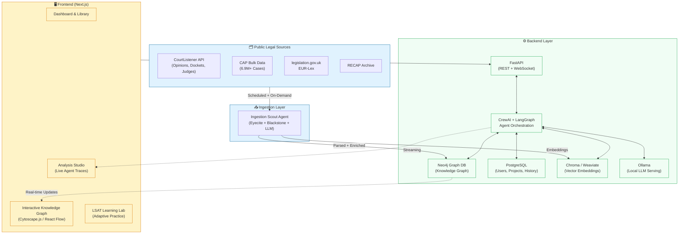

# Law AI

> The original April 2026 technical proposal, kept as a historical record — its architecture section is out of date, so read architecture.md for the current system.

**AI Agent Orchestration for Legal Intelligence**

*Technical Proposal & Architecture Document*

Empowering Lawyers & Future Lawyers with Intelligent Agents,  
Knowledge Graphs, and Open Legal Data

**April 29, 2026**  
*Version 1.0 • Open Source Initiative*

---

> **Superseded content notice (added 2026-08-11).** This is the original technical proposal (referenced as such in [AGENTS.md](../../AGENTS.md)) and is kept intact below as a historical record — it is not a living reference doc. Its **"Technical Architecture" section is materially out of date** and should not be used to understand the current system:
>
> - **Backend framework**: the diagram and stack table below say **FastAPI**. Django replaced FastAPI as the HTTP/orchestration layer (ADR [0001](../adr/0001-adopt-django-backend.md)); the real backend is Django 5 (ASGI/daphne) + DRF + Channels + Celery. FastAPI has zero presence in `backend/law_ai/`.
> - **LLM runtime**: the diagram and stack table below say **Ollama** only. Per [docs/constitution.md](../constitution.md) §1 (spec 034, shipped 2026-08-11), the product-runtime LLM is now the ordered chain `LLM_PROVIDER_CHAIN=claude_code,anthropic_api,xai,ollama` (xAI added by spec 050, 2026-09-04) — **Claude is the default**, Ollama is the local last-tier fallback (required, not optional, only when a confidentiality obligation forbids third-party processing).
> - **Vector store**: **Chroma/Weaviate** are presented below as a live "Backend Layer" component for hybrid semantic + graph retrieval. Neither is implemented: Weaviate has zero footprint in the codebase; `chromadb` is a declared dependency with zero current usage. Retrieval today is lexical fulltext + graph (`CITES`) traversal only.
> - **Auth**: **Supabase/Keycloak** are presented below as the auth layer. The only implemented authentication is `law_ai.core.auth.ApiKeyAuthentication`; there is no RBAC/SSO/SAML.
> - **Agent roster**: the "Core Agent Crews" table below presents Logic Weaver and a standalone Orchestrator/Educator as already built. They are not — see [docs/agent-roles.md](../agent-roles.md) for the current "Current Agents (MVP)" vs. "Planned Agents (Post-MVP)" split.
>
> For the real, current architecture, see [docs/architecture.md](../architecture.md), [docs/constitution.md](../constitution.md) §1–§2, and [AGENTS.md](../../AGENTS.md). The rest of this document (problem statement, roadmap narrative, references) is left as originally written.

---

## Executive Summary

**Law AI** is a groundbreaking open-source platform that integrates advanced AI agent orchestration with a robust backend knowledge repository to revolutionize how legal professionals and law students interact with, analyze, and master legal content.

By leveraging **multi-agent systems** (powered by CrewAI and LangGraph), **hybrid GraphRAG retrieval**, interactive knowledge graphs, and seamless integration with public legal datasets, Law AI transforms passive research into dynamic, intelligent workflows.

**Target users** include practicing lawyers seeking efficient case analysis and precedent mapping, as well as aspiring lawyers preparing for the LSAT and building foundational skills through adaptive, AI-guided learning modules. All AI outputs are persistently stored, versioned, and organized within a queryable backend, ensuring auditability, reproducibility, and continuous knowledge accumulation.

### Core Differentiators

- **Multi-agent orchestration** for complex legal reasoning (IRAC analysis, precedent hunting, logic validation)
- **Interactive, auto-updating knowledge graphs** visualizing citations, holdings, and doctrinal connections
- **Native integration** with open legal corpora (CourtListener, Caselaw Access Project, Pile-of-Law, LegalBench)
- **Privacy-first local LLM deployment** (Ollama) with optional cloud scaling
- **Dedicated LSAT/Bar prep engine** with grounded explanations and skill diagnostics
- **Fully open-source stack** ensuring transparency, customizability, and community-driven evolution

---

## The Challenge: Legal Information Overload & Fragmented Tools

Modern legal practice and education face unprecedented complexity: millions of cases, evolving statutes across jurisdictions, intricate citation networks, and the cognitive load of synthesizing arguments under time pressure.

Existing tools (Westlaw, LexisNexis, even emerging AI like Harvey) are **proprietary, expensive, black-box**, and often lack deep orchestration or persistent organizational memory. Law students struggle with fragmented resources for LSAT prep, while practitioners waste hours on repetitive research tasks that could be augmented intelligently.

**Opportunity**: The explosion of open legal data (Harvard CAP, Free Law Project's CourtListener with 99%+ US precedential opinions, RECAP archives, legislation.gov.uk, EUR-Lex) combined with mature open-source AI agent frameworks (CrewAI, LangGraph) and graph databases (Neo4j) creates a unique moment to build a **democratized, transparent, agent-orchestrated legal OS**.

---

## Solution Overview: Law AI Platform

Law AI is a full-stack web application with three tightly integrated layers:

1. **Intelligent Backend Repository**  
   PostgreSQL for structured metadata & user data, **Neo4j** for rich relationship modeling (cases → citations → holdings → doctrines → jurisdictions), Chroma/Weaviate for semantic embeddings, and persistent storage of every agent output, trace, and insight.

2. **AI Agent Orchestration Layer**  
   **CrewAI** for role-based collaborative crews and **LangGraph** for stateful, auditable workflows. Specialized agents handle ingestion, analysis, precedent discovery, logical validation, and education. All orchestrated with human-in-the-loop checkpoints and full provenance tracking.

3. **Modern Interactive Frontend**  
   **Next.js** dashboard featuring draggable knowledge graph visualizations (Cytoscape.js), real-time agent monitoring, hybrid search, document annotation studio, and an immersive LSAT Learning Lab with adaptive practice and AI tutoring grounded in LegalBench tasks.

---

## Technical Architecture

The following diagram illustrates the end-to-end architecture, emphasizing data flows from public sources through agent processing into the persistent knowledge graph and user-facing applications.

**Figure 1: Law AI Architecture** — Public data flows through specialized AI agent crews into a persistent Neo4j-powered knowledge graph + vector store, powering an interactive Next.js frontend with real-time visualizations and learning tools.

---

## Key Components

### Backend & Data Layer

- **Neo4j (Community Edition)**: Core knowledge graph with nodes for `Case`, `Statute`, `Holding`, `Citation`, `Jurisdiction`, `LegalConcept`, `Party`, `Judge`. Edges capture `CITES`, `OVERRULES`, `HAS_HOLDING`, `APPLIES_IN`, `DISTINGUISHED_BY`, etc. Enables powerful Cypher traversals for precedent chains and doctrinal evolution.

- **PostgreSQL**: User accounts, projects/workspaces, agent run histories, LSAT performance metrics, document metadata.

- **Vector Database (Chroma or Weaviate)**: Embeddings of case texts, summaries, and holdings for hybrid semantic + graph retrieval (GraphRAG).

- **Ingestion Pipeline**: Scheduled jobs using CourtListener API + bulk CAP downloads. Parsing with **Eyecite** (citation extraction), **Blackstone** (spaCy legal NLP), pdfplumber/Unstructured for PDFs. LLM-powered entity/relation extraction into Neo4j.

### AI Agent Layer (Orchestration)

We recommend a **hybrid approach**: **CrewAI** for intuitive role-based crews (fast iteration) + **LangGraph** for production-grade stateful workflows with checkpointing, time-travel debugging, and explicit audit trails — critical for legal accountability.

#### Core Agent Crews

| Agent Role              | Primary Responsibilities                              | Key Tools & Techniques                          | Output Artifacts                  |
|-------------------------|-------------------------------------------------------|--------------------------------------------------|-----------------------------------|
| **Ingestion Scout**     | Fetch, parse, extract entities/relations from public sources; update graph | CourtListener API, Eyecite, Blackstone, LLM NER/RE prompts | Structured nodes + edges + confidence scores |
| **Legal Analyst**       | IRAC briefs, issue spotting, argument mapping, risk assessment | GraphRAG retriever (Cypher + Vector), LegalBench tasks, structured output (Pydantic) | JSON IRAC + citations + risk matrix |
| **Precedent Hunter**    | Discover analogous cases, citation chains, distinguishing factors | Neo4j shortest-path / community detection, embedding similarity | Ranked precedents + natural language justification |
| **Logic Weaver**        | Build argument trees, detect fallacies, strength scoring | Custom reasoning prompts, LegalBench NLI/entailment tasks | Argument graph (support/attack edges) |
| **Educator (LSAT/Bar)** | Adaptive practice, explanations, skill gap analysis | Question bank + generator, performance DB, concept subgraph retriever | Explanations + linked cases + next drills |
| **Orchestrator**        | Route tasks, manage multi-agent workflows, state persistence, HITL gates | LangGraph state machines, checkpointing, human approval nodes | Executable plan + full execution trace |

**All outputs are versioned and stored** with full prompt/context provenance for auditability.

### Frontend & Visualization

- **Interactive Knowledge Graph**: Cytoscape.js or React Flow powered by live Neo4j queries. Users explore citation networks, expand doctrinal clusters, highlight paths between cases. Export subgraphs as images/PDFs.

- **Analysis Studio**: Split-pane interface — document viewer (with AI annotations) | agent chat/logs (real-time streaming) | structured output (IRAC, risk matrix) | linked graph view. All outputs saved as versioned artifacts.

- **LSAT Learning Lab**: Full-section timed simulations, immediate AI explanations citing specific rules/precedents, performance analytics (radar charts by question type: LR, RC, LG), personalized study plans.

- **Hybrid Search & Discovery**: Semantic + graph + metadata filters. Example: *"Show me all cases in 9th Circuit citing Chevron deference that were later distinguished."*

---

## Open Data Sources & Integration

Law AI is built exclusively on **open, publicly accessible legal data** to ensure accessibility and avoid vendor lock-in:

- **Free Law Project / CourtListener**: Primary real-time source for US opinions, dockets, RECAP archives (hundreds of millions of filings), judges, oral arguments. Robust REST API + bulk replication. [GitHub: freelawproject](https://github.com/freelawproject/)

- **Caselaw Access Project (Harvard)**: 6.9M+ unique cases, 36M+ pages (1658–2018). Bulk Parquet/JSON downloads available; search now via CourtListener.

- **Pile-of-Law (Hugging Face)**: 256GB curated legal corpus for domain adaptation/fine-tuning.

- **LegalBench & LegalBench-RAG**: 162-task collaborative benchmark for legal reasoning evaluation and RAG testing (HazyResearch/Stanford).

- **Additional**: legislation.gov.uk (UK statutes), EUR-Lex (EU), Supreme Court Database (SCDB), Cambridge Law Corpus (UK cases).

**Citation Parsing**: **Eyecite** (Free Law Project) — state-of-the-art open-source legal citation extractor, essential for building accurate citation graphs.

---

## LSAT & Skills Development Module

A dedicated **"Future Lawyer"** pathway transforms Law AI into a comprehensive study companion:

- **Adaptive practice engine** drawing from official-style questions (public domain explanations + LLM-generated variants validated via LegalBench-style reasoning tasks).

- **AI Tutor** that explains every answer choice with references to real cases or black-letter rules stored in the graph.

- **Skill diagnostics**: Tracks performance across Logical Reasoning subtypes (Flaw, Strengthen, Assumption, etc.), Reading Comprehension passages, Logic Games, and surfaces weak areas with targeted drills.

- **Concept Explorer**: Interactive subgraphs for core doctrines (e.g., "Causation in Tort") linking landmark cases, policy rationales, and modern applications.

- **Progress Gamification**: Streaks, badges, spaced-repetition scheduling integrated with the knowledge graph ("Revisit cases you struggled with last month").

---

## Implementation Roadmap

### Phase 1: MVP (Months 1–3)

- Core ingestion from CourtListener (SCOTUS + 3 Circuits) + bulk CAP import
- Basic Neo4j schema (Case, Citation, Holding nodes + CITES edges)
- Single Analyst Agent crew + simple RAG chat interface
- Next.js frontend: Library view + Cytoscape graph explorer + basic upload
- Docker Compose local dev environment (Ollama + all services)

### Phase 2: v1.0 (Months 4–6)

- Full multi-agent orchestration (LangGraph stateful workflows)
- Advanced GraphRAG with community summaries & global context
- Complete LSAT Lab with 4-section simulations and adaptive engine
- User workspaces, collaboration (shared graphs), export (PDF/Word)
- Public data scheduler + notification system for new opinions

### Phase 3: Expansion (Months 7–12)

- UK/EU jurisdiction support (legislation.gov.uk, EUR-Lex, BAILII)
- Fine-tuned legal LLM on Pile-of-Law + LegalBench eval loop
- Mobile PWA + browser extensions (highlight & analyze any legal text)
- Agent Marketplace (user-defined crews)
- Enterprise self-hosting packages with SSO, audit logging, SLAs

---

## Complete Open Source Technology Stack

| Layer              | Technologies & Libraries |
|--------------------|--------------------------|
| **Backend / API**  | Python, FastAPI, Pydantic, CrewAI, LangGraph, LangChain |
| **Databases**      | PostgreSQL, Neo4j Community, Chroma / Weaviate |
| **LLM Serving**    | Ollama (Llama 3.1 70B, Mistral, Phi-3), vLLM, Hugging Face |
| **NLP & Parsing**  | Blackstone (spaCy), Eyecite, pdfplumber, Unstructured.io |
| **Frontend**       | Next.js 15 (App Router), TypeScript, Tailwind, shadcn/ui, TanStack Query |
| **Visualization**  | Cytoscape.js, React Flow, D3.js, Recharts |
| **DevOps & Deployment** | Docker Compose, GitHub Actions, Vercel / Railway / Self-host (Coolify) |
| **Auth & Collaboration** | Supabase (self-hostable) or Keycloak, WebSockets for real-time |

---

## Challenges, Risks & Mitigations

- **Legal Accuracy & Hallucinations**  
  *Mitigation*: Strict GraphRAG grounding + mandatory source citations + LegalBench continuous evaluation of agents + prominent "AI Assistant – Not Legal Advice" disclaimers with human review workflows.

- **Data Volume & Freshness**  
  *Mitigation*: Incremental daily ingestion via CourtListener webhooks/API; start with high-impact jurisdictions (SCOTUS, CA, NY, TX, 9th Cir.); Neo4j handles millions of nodes efficiently.

- **Compute Costs (Local LLMs)**  
  *Mitigation*: Ollama on consumer GPUs for individuals; quantized models (4-bit/8-bit); optional Groq/HF Inference endpoints for speed. Self-hosting keeps data private.

- **LSAT Question Legality**  
  *Mitigation*: Use only public/official practice materials for core bank; generate unlimited variants with LLM and validate explanations against LegalBench tasks or expert review.

- **Adoption & Trust**  
  *Mitigation*: Open-source transparency builds trust; publish agent evaluation scores on LegalBench leaderboard; community governance model.

---

## Conclusion & Call to Action

**Law AI** represents a timely, feasible, and transformative opportunity to build the legal profession's first truly open, agent-orchestrated intelligence platform. By combining the richest open legal datasets with cutting-edge multi-agent frameworks and interactive knowledge graphs, we can dramatically lower barriers for practitioners and dramatically accelerate the training of the next generation of lawyers.

This proposal outlines a clear, phased path from MVP to production using **100% open-source components**. The architecture is modular, auditable, and designed for community contribution from day one.

**Next Steps**: We invite collaboration from legal technologists, AI researchers, law professors, and open-source contributors. Fork the repositories (to be published on GitHub under MIT/AGPL), join the Discord, and help shape the future of accessible legal AI.

> Together, we can weave the fabric of law into an intelligent, interconnected, and empowering system for all.

---

## Key References & Resources

- **Free Law Project**: https://free.law/ — CourtListener API & RECAP
- **Caselaw Access Project**: https://case.law/
- **Awesome Legal Data**: https://github.com/openlegaldata/awesome-legal-data
- **LegalBench**: https://hazyresearch.stanford.edu/legalbench/ (162 legal reasoning tasks)
- **CrewAI**: https://github.com/crewAIInc/crewAI
- **LangGraph**: https://github.com/langchain-ai/langgraph
- **Neo4j GraphRAG Legal Examples**: https://github.com/neo4j-product-examples/graphrag-contract-review
- **Pile of Law Dataset**: https://huggingface.co/datasets/pile-of-law/pile-of-law
- **Eyecite Citation Parser**: https://github.com/freelawproject/eyecite

---

*— End of Proposal —*

**Document Information**  
*This Markdown version replaces the original DOCX proposal. Architecture diagram converted to Mermaid for native rendering in GitHub, GitLab, VS Code, and Markdown viewers. All content preserved and enhanced for readability.*