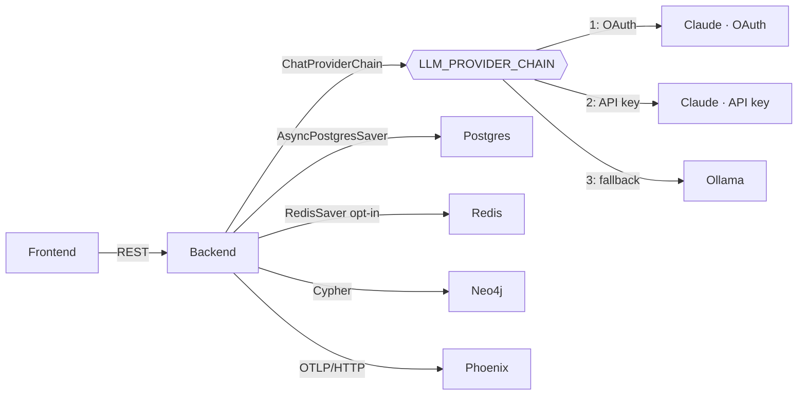

# Local AI Stack (Spec 010)

> Companion to [specs/010-local-ai-stack/](../specs/010-local-ai-stack/). This page is the operator-facing manual for running Law AI's LangGraph + Ollama + Phoenix substrate locally.

**LLM selection note.** This page documents the local *infrastructure* (Neo4j, Postgres, Redis, Ollama, Phoenix). It does not, by itself, determine which model answers a request: `LegalWorkflow`'s LLM is `ChatProviderChain`, which tries the constitution-§1 provider chain — Claude (OAuth), then Claude (API key), then xAI Grok, then Ollama — in that order (`LLM_PROVIDER_CHAIN`, default `claude_code,anthropic_api,xai,ollama`). Bringing this stack up does **not** make Ollama the default; it makes Ollama *available* as the chain's last tier. To guarantee every request stays local (required for data under a confidentiality obligation that forbids third-party processing — see [docs/constitution.md](constitution.md) §1), pin the chain explicitly:

```dotenv
LLM_PROVIDER_CHAIN=ollama
```

See [docs/llm-provider-chain.md](llm-provider-chain.md) for the whole chain and the hosted tiers.

## At a glance

| Component | Image / Module | Purpose | Default endpoint |
|-----------|---------------|---------|------------------|
| Ollama | `ollama/ollama:0.12.6` | Local LLM server — chain's last tier (opt in via `LLM_PROVIDER_CHAIN=ollama` for local-only) | `http://localhost:11434` |
| LangGraph | `law_ai.agents_runtime.graphs.legal_workflow` | 3-node `retrieve → analyze → cite_check` | (in-process) |
| Postgres | `postgres:16-alpine` | LangGraph checkpointer (reads `POSTGRES_URL`) + HITL queue — major version pinned, see [Bumping the Postgres major version](#bumping-the-postgres-major-version) | `localhost:5432` |
| Redis | `redis:7-alpine` | Optional checkpointer + cache | `localhost:6379` |
| Neo4j | `neo4j:5-community` | Knowledge graph | `localhost:7687` / UI `7474` |
| Phoenix | `arizephoenix/phoenix:12.9.0` | OTEL collector + trace UI | `localhost:6006` |
| Backend | `backend/law_ai/asgi.py` (Django ASGI via daphne) | API + agent host | `localhost:8000` |

Image tags are deliberately pinned in [docker-compose.yml](../docker-compose.yml) (not `:latest`) so dev and eval runs stay reproducible — bump them on purpose, not by drift.

## Architecture



`LegalWorkflow`'s default LLM factory builds a [`ChatProviderChain`](../backend/law_ai/core/llm/langchain.py) — a real LangChain `BaseChatModel` (spec 035) — rather than talking to Ollama directly. `langchain-core` and `langgraph-checkpoint-{postgres,redis}` are core backend dependencies (`backend/pyproject.toml`), not an optional extra.

Every node in `LegalWorkflow` is wrapped by [`@logged_node`](../backend/law_ai/core/provenance.py). That decorator records to two places:

1. The append-only JSONL audit store at `.audit/provenance.jsonl` (powers `/api/agents/runs`).
2. An OpenTelemetry span exported to Phoenix (when `PHOENIX_COLLECTOR_ENDPOINT` is set).

The trace id is shared across both stores, so any analysis returned from the API can be cross-referenced.

## Quickstart

```bash
# 1. Bring up the stack (pulls models in the background on first boot).
make local-ai-up

# 2. Wait until Phoenix + Ollama report healthy.
make local-ai-health      # hits /api/agents/health/local-ai

# 3. Run a workflow. With no Claude credentials in .env this falls through
#    to Ollama automatically; set LLM_PROVIDER_CHAIN=ollama to guarantee it
#    even when Claude credentials are present.
curl -s -X POST http://localhost:8000/api/analysis \
  -H "content-type: application/json" \
  -d '{"text":"What is the holding of Marbury v. Madison?","use_langgraph":true}' \
  | jq

# 4. Open the Phoenix UI to inspect the trace tree.
open http://localhost:6006
```

The response includes `phoenix_trace_url` and `langgraph_thread_id` — paste either into Phoenix or call `LegalWorkflow.get_state(thread_id)` to resume.

## Environment variables

| Variable | Default | Notes |
|----------|---------|-------|
| `LLM_PROVIDER_CHAIN` | `claude_code,anthropic_api,xai,ollama` | Ordered LLM provider list `ChatProviderChain` reads (constitution §1). Pin to `ollama` to force local-only. See [docs/llm-provider-chain.md](llm-provider-chain.md) for the hosted tiers. |
| `XAI_MODEL` | `grok-4.6` | Grok id every xAI-tier call uses. `make validate-xai` now lists the ids the subscription actually serves (`GET /v1/models`) and warns with a concrete `XAI_MODEL=…` when the configured one is not among them, instead of letting every request 404 (BL-20260904-05); a 404 probe also carries `available_models` on `/api/health`. |
| `XAI_INTERACTIVE_MODEL` | *(blank)* | Optional faster Grok id used **only** on user-facing calls (LSAT tutor, `/api/analysis` IRAC). Blank uses `XAI_MODEL` everywhere. Grok measured 5-10x the Claude tiers on this product's work (IRAC 56-103s), which is why `XAI_REQUEST_TIMEOUT_S` is 240s — acceptable for a batch fallback, poor for someone waiting. Measure a candidate against a real subscription before setting it: a non-reasoning variant trades IRAC quality for latency (BL-20260905-11). |
| `LLM_PRICE_TABLE` | `{}` | JSON object pricing the hosted tiers so every `llm_call` audit event carries `cost_usd` next to its token counts. Keyed by `provider/model`, `model`, or `provider` (checked in that order), each value `{"in_per_mtok": …, "out_per_mtok": …}`. Empty means tokens are still logged and cost is `null` (BL-20260811-21). |
| `LLM_PERMANENT_FAILURE_TTL_S` | `300` | How long the router remembers that a tier's credential was rejected (401/403) and skips it, instead of re-earning the same failure on every request. Per-process; `0` disables the memory. The skip reason shows up on `/api/health` as `last_permanent_error` (BL-20260811-23). |
| `LLM_FAIL_FAST_ON_PERMANENT` | `false` | When true, a permanent failure raises `LLMPermanentError` instead of falling through to a lower tier. Off by default because constitution §13 prefers an honest local answer to no answer. |
| `OLLAMA_BASE_URL` | `http://ollama:11434` | Override to `http://localhost:11434` for host runs. |
| `OLLAMA_DEFAULT_MODEL` | `mistral:7b-instruct-q4_K_M` | Bump to `llama3.1:8b-instruct-q4_K_M` on 64 GB+. |
| `OLLAMA_REQUEST_TIMEOUT_S` | `120.0` | Raise for very long contexts. Applies per attempt. |
| `OLLAMA_MAX_RETRIES` | `2` | Total attempts per Ollama call on transient failures (connect/read-timeout, 429, 5xx) with short exponential backoff; `1` disables retry. Ollama sits at the tail of the chain, so keep this low. |
| `OLLAMA_EMBED_MODEL` | `nomic-embed-text` | Local embedding model. Used by the LSAT factory's paraphrase dedup gate (BL-20260702-01), which embeds each draft's question text and rejects anything at/above `LSAT_FACTORY_EMBED_THRESHOLD` cosine to an existing item. Vectors are cached per bank revision under `var/lsat_factory/embeddings/`; when Ollama or the model is missing, intake falls back to token-Jaccard alone and records a warning on the ingest result. Set `LSAT_FACTORY_EMBED_DEDUP=false` to switch the gate off. |
| `LANGGRAPH_CHECKPOINTER` | `postgres` | `postgres` \| `redis` \| `memory`. Postgres reads `POSTGRES_URL` (not `DATABASE_URL`, spec 035). |
| `PHOENIX_COLLECTOR_ENDPOINT` | _(blank in `settings/base.py`; `docker-compose.yml` sets it to `http://phoenix:6006/v1/traces` for the `backend` service)_ | **Unset disables tracing entirely.** Blank it in `.env` to opt out even inside the compose stack. |
| `PHOENIX_UI_URL` | `http://localhost:6006` | Used to build deep-links in API responses. |
| `PHOENIX_PROJECT_NAME` | `law_ai` | Phoenix tab label. Also the OTEL `service.name` for every backend. |
| `OBSERVABILITY_BACKEND` | `phoenix` | `phoenix` \| `langfuse` \| `none` (BL-20260502-07). `none` hard-disables tracing regardless of the endpoints below; an unrecognised value is treated as `none` and warned about. |
| `LANGFUSE_HOST` / `LANGFUSE_PUBLIC_KEY` / `LANGFUSE_SECRET_KEY` | `http://localhost:3001` / blank / blank | Read only when `OBSERVABILITY_BACKEND=langfuse`. Both keys are required; the exporter posts to `<host>/api/public/otel/v1/traces` with Basic auth and deep-links to `<host>/trace/<id>`. Half-configured (host, no keys) disables tracing rather than exporting nowhere. |
| `OTEL_EXPORTER_OTLP_ENDPOINT` / `OTEL_EXPORTER_OTLP_HEADERS` | blank | Any other OTLP/HTTP collector. When set, the endpoint overrides the selected backend's own; headers use the OTLP `k=v,k=v` form. |
| `AUTONOMY_ENABLED` | `false` | **Kill-switch** for all scheduled autonomy loops (spec 018 §12 invariant I3). Set to `true` to activate. |
| `AUTONOMY_ALLOWED_SOURCES` | `[]` | Comma-separated list of source adapter names permitted for autonomous ingestion (e.g. `courtlistener,cap`). |
| `AUTONOMY_MAX_INGEST_PER_CYCLE` | `25` | Hard cap on documents ingested per corpus-growth cycle. |
| `AUTONOMY_DIGEST_DIR` | `backend/var/autonomy/` | Directory where daily digest files (`digest-YYYY-MM-DD.md`) are written. |
| `AUTONOMY_DIGEST_SLACK_WEBHOOK_URL` | _(blank)_ | Slack incoming-webhook URL for the daily digest (BL-20260511-05). Blank = no Slack delivery. **Secret**: the path segments are the credential, so only `host/…<8-hex fingerprint>` is written to the audit log. A digest over Slack's 40 000-character `text` cap is truncated with a pointer to the file. |
| `AUTONOMY_DIGEST_EMAIL_TO` | `[]` | Comma-separated recipients for the daily digest. Empty = no mail. |
| `AUTONOMY_DIGEST_EMAIL_FROM` | `law-ai-autonomy@localhost` | Envelope sender for the digest mail. |
| `EMAIL_BACKEND` | `django.core.mail.backends.console.EmailBackend` | Django mail backend. The console default prints the digest instead of sending it, so a half-configured deployment is visible rather than silent. |

## Hardware tiers

| Tier | RAM | Models | Configured today? |
|------|-----|--------|------------------|
| **Apple Silicon laptop** (default) | 32–64 GB unified | `mistral:7b-instruct-q4_K_M`, `llama3.1:8b-instruct-q4_K_M`, `nomic-embed-text` | ✅ |
| Linux + NVIDIA workstation | 64 GB + 24 GB VRAM | + `llama3.1:70b-q4_K_M`, optional vLLM | ✅ — `docker-compose.gpu.yml`, `make local-ai-up-gpu` (see below) |
| Server / multi-GPU | 128 GB + ≥48 GB VRAM | vLLM-first; Prom + Grafana | ✅ — `docker-compose.observability.yml`, `make local-ai-up-server` (see below) |

## Workstation tier: Linux + NVIDIA (`docker-compose.gpu.yml`)

An overlay, never the default. `make dev` on a laptop keeps the 7B/8B set and no `deploy.resources` block, because the NVIDIA container runtime does not exist on macOS and a 70B model does not fit in unified memory.

```bash
make local-ai-up-gpu     # postgres/redis/neo4j/ollama/phoenix, Ollama on the GPUs
make dev-gpu             # the whole stack on the overlay (what `make dev` is for laptops)
make logs-gpu            # follow the model pull
make local-ai-down-gpu
```

Prerequisite: the NVIDIA driver plus `nvidia-container-toolkit`, verified with `docker run --rm --gpus all nvidia/cuda:12.4.0-base-ubuntu22.04 nvidia-smi`. Without it compose fails at start with *could not select device driver "nvidia"*.

What the overlay changes:

| Change | Value | Why |
|--------|-------|-----|
| GPU reservation on `ollama` | `driver: nvidia, count: all` | The only thing that puts the weights on the card. Pin cards with `device_ids: ["0","1"]` instead of `count: all`. |
| `OLLAMA_DEFAULT_MODEL` on `backend` + `worker` | `llama3.1:70b-q4_K_M` | The setting the Ollama providers actually read. `DEFAULT_MODEL` in `settings/base.py` is dead weight — setting it changes nothing. |
| `OLLAMA_BOOTSTRAP_MODELS` | 70B first, then the laptop set | Entry #1 gates readiness in both `ollama-bootstrap.sh` and `ollama-healthcheck.sh`, so "healthy" means the model the backend will ask for is really there. |
| `start_period` | `7200s` | First boot pulls ~40 GB before the healthcheck can pass. |
| `mem_limit` | `48g`, `OLLAMA_KEEP_ALIVE=30m` | Weights stream through host RAM, and reloading a 70B costs minutes. |

Every knob is overridable through `GPU_`-prefixed variables (`GPU_OLLAMA_DEFAULT_MODEL`, `GPU_OLLAMA_BOOTSTRAP_MODELS`, `GPU_OLLAMA_KEEP_ALIVE`, `GPU_OLLAMA_NUM_PARALLEL`). The prefix is not cosmetic: compose interpolates `${OLLAMA_DEFAULT_MODEL:-…}` from your `.env`, which ships the laptop value, so an unprefixed spelling would quietly serve 7B on a workstation.

**LegalBench**: the harness stays pinned to Ollama, and this overlay changes which Ollama model answers. Scores from the GPU tier are not comparable with laptop-tier scores — record the model alongside the run.

### Optional vLLM server

```bash
make vllm-up      # http://localhost:8001/v1/models, Prometheus at /metrics
make vllm-down
```

Behind the compose `vllm` profile, so it is off unless asked for. Higher throughput than Ollama for batch work (continuous batching, paged attention) and multi-GPU via `VLLM_TENSOR_PARALLEL_SIZE` (one rank per card). Gated Hugging Face repos need `HUGGING_FACE_HUB_TOKEN` from an account that accepted the model license.

It is **not** a provider-chain tier: `law_ai.core.llm` has no OpenAI-compatible provider, and adding one is a constitution §1 decision rather than a compose change. Today it exists for benchmarking and side-by-side comparison.

## Server tier: Prometheus + Grafana (`docker-compose.observability.yml`)

BL-20260502-03, stacked on the GPU overlay. Metrics only — Phoenix stays the trace backend and `core.provenance` stays the audit trail; Prometheus answers *is the box keeping up*, not *what did the model say*.

```bash
make observability-up      # prometheus :9090 + grafana :3002 + redis exporter — runs anywhere
make observability-down
make local-ai-up-server    # the above + GPU overlay + vLLM + DCGM (needs NVIDIA)
make local-ai-down-server
```

Grafana is at `http://localhost:3002` (3000 is the Next dev server, 3001 is where a self-hosted Langfuse lands), logs in with `admin`/`admin` by default — change `GRAFANA_ADMIN_USER`/`GRAFANA_ADMIN_PASSWORD` before running this anywhere shared — and comes up with the datasource and the dashboard already provisioned from `infra/grafana/`. The dashboard is code: edit `infra/grafana/dashboards/local-ai.json`, not the UI (`allowUiUpdates: false`).

What each number in the BACKLOG item comes from:

| Metric | Source | Query |
|--------|--------|-------|
| Tokens/sec | vLLM's own `/metrics` | `sum(rate(vllm:generation_tokens_total[1m]))` |
| GPU utilization / memory | `dcgm-exporter` (profile `gpu-metrics`, NVIDIA only) | `DCGM_FI_DEV_GPU_UTIL`, `DCGM_FI_DEV_FB_USED` |
| Queue depth | `redis-exporter` with `REDIS_EXPORTER_CHECK_KEYS=celery,autonomy` | `redis_key_size{key=~"celery\|autonomy"}` |
| Inference queue | vLLM | `vllm:num_requests_running`, `vllm:num_requests_waiting` |

A Celery queue *is* a Redis list, which is why queue depth needs no Celery-specific exporter and works on a laptop with no GPU at all.

Ollama exposes no Prometheus endpoint (0.12.x), so there is no tokens/sec for the Ollama tier — that gap is exactly what vLLM covers on this tier. Per-call token counts and latency for **both** tiers are in the `llm_call` provenance events and in Phoenix.

Targets that legitimately do not exist (no GPU, no vLLM) show as DOWN on `http://localhost:9090/targets`. That is the intended signal rather than a hidden failure.

Multi-GPU: set `VLLM_TENSOR_PARALLEL_SIZE` to the number of cards (one rank each); `DCGM_FI_DEV_GPU_UTIL` is per-card, so the GPU panels show one series per `gpu` label without any further configuration.

## Air-gapped deployment (bundle + offline install)

BL-20260502-06. Two scripts, no network on the target host:

```bash
# On a CONNECTED machine, with the stack up and the images built:
make setup                       # build backend/worker/frontend images
docker compose pull              # make sure every pinned image is local
make local-ai-verify             # models fully pulled (a partial blob bundles as a partial blob)
make local-ai-bundle             # writes dist/  — tens of GB
make local-ai-bundle ARGS='--dry-run'   # print the plan first

# Copy dist/ to the air-gapped host (same repo checkout there), then:
scripts/offline-install.sh dist
OLLAMA_OFFLINE=1 make dev
make local-ai-verify
```

The bundle is:

| File | Contents |
|------|----------|
| `dist/ollama-models.tar` | The `ollama` named volume — blobs plus manifests, i.e. every model in `OLLAMA_BOOTSTRAP_MODELS` that was actually pulled. |
| `dist/images.tar` | `docker save` of every image `docker compose config --images` names, pinned ones and locally built ones alike. |
| `dist/images.txt` | That image list, so the receiving side can audit what it is about to load. |
| `dist/bundle.env` | Project name, volume name, Ollama image, creation timestamp. |
| `dist/SHA256SUMS` | Checksums over all of the above; `offline-install.sh` verifies them before touching anything. |

`dist/` is gitignored — these artifacts are far too large to commit.

Why `OLLAMA_OFFLINE=1` matters: `ollama-bootstrap.sh` normally runs `ollama pull` for every model at boot, and a pull is a *network* call even when the blob is already present (it checks the digest). On a disconnected host that hangs and retries. With the flag set, the script skips every pull and instead logs which models are present and which are `MISSING from the offline bundle`, while the healthcheck keeps gating on the gate model — so a short bundle fails loudly instead of serving a stack that cannot answer.

Redistribution: the bundle carries model weights. Llama models are under the **Llama Community License** (see the Licensing table below) and Mistral under Apache-2.0. Moving a bundle between organisations is redistribution — check the licence before handing one over.

Partial bundles: `--models-only` and `--images-only` split the two halves when only one of them changed, which turns a routine model refresh into a few GB instead of the whole set.

## Licensing

| Component | License | Notes |
|-----------|---------|-------|
| Ollama | MIT | Bundled models carry their own licenses (Llama 3.1 → Llama Community License; Mistral → Apache-2.0). |
| LangGraph + checkpointers | MIT | `langgraph`, `langgraph-checkpoint-postgres`, `langgraph-checkpoint-redis`. |
| Arize Phoenix | Elastic License 2.0 | Self-host + internal use is permitted; redistribution as a service is not. Audit before going commercial. |
| OpenTelemetry SDK / exporters | Apache-2.0 | |

The Langfuse fallback is implemented (BL-20260502-07): if the Phoenix license posture changes, set `OBSERVABILITY_BACKEND=langfuse` plus `LANGFUSE_HOST`/`LANGFUSE_PUBLIC_KEY`/`LANGFUSE_SECRET_KEY` and restart the backend — no code change. Langfuse is MIT-licensed for its core server; its enterprise features are not. Any other OTLP/HTTP collector works through `OTEL_EXPORTER_OTLP_ENDPOINT`, and `OBSERVABILITY_BACKEND=none` turns tracing off entirely.

## LangGraph Studio (visual stepper, opt-in)

`make studio-up` self-hosts the `langchain/langgraph-api` server on `http://localhost:2024`, serving the *same* `LegalWorkflow` graph the API runs, so a designer can step through `retrieve → analyze → cite_check` node by node, edit state between nodes, and fork a run. `make studio-down` stops it. Both services sit behind the compose `studio` profile, so `make dev`, `make test` and `make down` never build or start the (heavy) image.

Read this before turning it on:

- **It needs a LangSmith key and it phones home.** The self-hosted server validates `LANGSMITH_API_KEY` against `beacon.langchain.com` at boot and exits without one. A free developer key is enough; there is no offline mode short of LangChain's air-gapped licensing. `make studio-up` refuses to start rather than leaving you with a container that crash-loops.
- **The UI is hosted, not local.** There is no open-source Studio build. The stepper lives at `https://smith.langchain.com/studio/?baseUrl=http://localhost:2024` and runs in your browser against the local server, so graph structure and the run state you look at are rendered by a third-party page.
- **No prompt text is exported by default.** `LANGSMITH_TRACING=false` is the shipped default; the license ping carries no prompt or document text. Set it to `true` only if you accept sending this repo's prompts and retrieved passages to LangSmith.
- **It is not a runtime path.** Constitution §1 governs the product runtime chain; Studio is a dev tool that no API or worker code imports. `STUDIO_LLM_PROVIDER_CHAIN` defaults to `ollama`, so replaying a node twenty times in the stepper runs locally instead of billing Claude. Set it to the full chain in `.env` when that is what you want.

How it is wired:

| Piece | Where | Why |
|-------|-------|-----|
| `build_legal_workflow_graph()` | `backend/law_ai/agents_runtime/graphs/legal_workflow.py` | Module-level factory: the graph used to be built only inside `LegalWorkflow._build_graph`, which no external host can reach. The method now delegates here, so Studio and the API cannot drift. |
| `make_graph()` | `backend/law_ai/agents_runtime/graphs/studio.py` | Calls `django.setup()` before importing the workflow — the server loads the module in a bare Python process, and provenance/retrieval need the app registry. |
| `backend/langgraph.json` | repo | Standard LangGraph config, so `langgraph dev` / `langgraph build` work on the same entry point. |
| `backend/Dockerfile.studio` | repo | What `langgraph build` would generate: the official server image + our package under `/deps`, with `LANGSERVE_GRAPHS` naming the factory. |
| `langgraph-db-init` | `docker-compose.yml` | Creates a separate `langgraph` database, so the server's own threads/runs tables never share a schema with Django's or with the app's checkpoint tables. |

Runs started from Studio live in the server's own store, not in the `LANGGRAPH_CHECKPOINTER=postgres` tables the API writes — a thread id from one is not resumable in the other.

## Resuming a workflow after a backend restart

Run this inside the backend container (`make shell-backend`, then `python manage.py shell -c '...'`, or `docker compose run --rm backend python manage.py shell`) — never on the host:

```python
from law_ai.agents_runtime.graphs import LegalWorkflow

wf = LegalWorkflow()
state = await wf.get_state("lwf-abc123")
print(state.values["answer"])
```

The Postgres checkpointer survives `docker compose restart backend`. Run `Reset Local DBs (Dangerous)` (VS Code task) to wipe.

## Bumping the Postgres major version

The `postgres` service in [docker-compose.yml](../docker-compose.yml) is pinned to `postgres:16-alpine` on purpose. The `pgdata` volume holds a cluster that was *initialized* by Postgres 16, and a Postgres server refuses to start against a data directory written by a different major version — you get `database files are incompatible with server` and a crash-looping container, not an upgrade. The pin is a note-to-self, not a preference for 16.

Two routes, depending on whether the local data matters.

**Throwaway dev data (the normal case).** `make reset-db` stops `postgres`, `backend` and `worker`, removes the container, and deletes *only* this project's `pgdata` volume — Neo4j, the Ollama models and the Phoenix traces survive, which is what makes it different from `make clean` (`docker compose down -v`, everything goes). It prompts before deleting.

```bash
make reset-db                              # wipe the pg16 cluster (prompts)
# edit docker-compose.yml: postgres:16-alpine -> postgres:18-alpine
make dev                                   # initdb runs on the new major version
make migrate                               # Django + Neo4j + ensure_checkpointer
```

`make migrate` matters: it recreates the Django tables *and* the LangGraph checkpointer schema (`ensure_checkpointer`), so any in-flight `thread_id` from before the wipe is gone. In-flight workflow state is resumable state, not a system of record.

**Data you need to keep.** Do not use `reset-db`. Dump before the bump and restore after:

```bash
docker compose exec postgres pg_dumpall -U law_ai > /tmp/law_ai-pg16.sql
make reset-db
# bump the tag, then:
make dev
docker compose exec -T postgres psql -U law_ai -d law_ai < /tmp/law_ai-pg16.sql
```

`pg_upgrade` in place is the other option, but it needs both major versions' binaries in one image, which the stock `postgres:*-alpine` images do not carry — dump/restore is the shorter path at dev-database scale.

If your compose project is not named `law-ai` (compose derives it from the directory name unless `COMPOSE_PROJECT_NAME` is set), pass it through: `make reset-db COMPOSE_PROJECT=my-project`. The target filters on the project label precisely so it cannot delete another project's `pgdata`.

## Troubleshooting

- **`make local-ai-health` says `ollama.reachable=false`** — first-boot model pull may still be running. Tail with `docker compose logs -f ollama` and wait until `[ollama-bootstrap] all models present`.
- **`phoenix.reachable=false`** — confirm port 6006 is free (`lsof -i :6006`); the Next.js dev server does not collide today, but other Phoenix installs do.
- **`checkpointer.reachable=false`** — `langgraph`, `langchain-core`, and `langgraph-checkpoint-{postgres,redis}` are core backend dependencies (spec 035), so a missing-package error is unlikely under the normal Docker build. If you see an error mentioning "install the local-ai extra," that message text is stale (the extra now only carries Phoenix/OTel packages) — ignore the wording and instead check that Postgres is actually reachable and that `POSTGRES_URL` is correct (`make ps`, `docker compose logs postgres`). Never `pip install` on the host to fix this — rebuild the image instead (`docker compose build backend`).
- **Workflow returns `"Insufficient sources to answer confidently"`** — as of spec 028, `LegalWorkflow`'s default retriever is a real hybrid GraphRAG lookup ([`agents_runtime/tools/graph_rag.py`](../backend/law_ai/agents_runtime/tools/graph_rag.py), lexical fulltext + `CITES` graph expansion; [BL-20260810-01](../BACKLOG.md)), not the old `[]` stub. This message now means Neo4j is unreachable, or the query genuinely matched nothing in the corpus — not that retrieval is unimplemented. Confirm Neo4j is up (`make local-ai-health`) before assuming a code gap.

## Autonomy Loop

Spec 018 adds a scheduled autonomy loop that runs inside the same Docker stack. It is **disabled by default** (`AUTONOMY_ENABLED=false`). Operators activate it by setting `AUTONOMY_ENABLED=true` in their environment.

Three beat entries are registered in `law_ai/celery.py`:

| Beat entry | Schedule | Kind | Notes |
|---|---|---|---|
| `autonomy-content-sweep` | every 6 h | `corpus_growth` | Fetches new docs via allowed source adapters; routes through `IngestionScout`. |
| `autonomy-nightly-tests` | 06:00 UTC daily | `test_pillar` | Synthesises proposed tests via `TestSynthesizer`; writes `*.proposed.py` files pending human review. |
| `autonomy-daily-digest` | 07:00 UTC daily | `digest` | Aggregates last 24 h of `autonomy_*` audit events into `var/autonomy/digest-YYYY-MM-DD.md`, then delivers it to any configured channel. Runs `law_ai.core.tasks.compose_digest_task` (not the generic `autonomy_cycle`): the digest is a pure audit-log query, so a dropped connection would otherwise write an empty-but-successful file — transient `OperationalError`/`InterfaceError` is retried three times with exponential backoff (BL-20260511-23). |

### Digest delivery

The `digest-<date>.md` file used to be the only surface, so a nightly run that found something interesting only reached a human who went looking for it. `law_ai.core.autonomy.deliver_digest` now fans the composed file out to two env-driven channels, both off by default (BL-20260511-05):

* `AUTONOMY_DIGEST_SLACK_WEBHOOK_URL` — POSTs `{"text": …}` to a Slack incoming webhook.
* `AUTONOMY_DIGEST_EMAIL_TO` — sends the Markdown through Django's mail backend.

Delivery mirrors `compose_digest`'s never-raises contract: a dead webhook or a refused SMTP connection is logged and reported, never allowed to fail a cycle that produced a perfectly good digest file. Every attempt (including "nothing configured") emits one `autonomy_digest.delivered` provenance event carrying the per-channel outcome, with the webhook URL redacted.

Every cycle passes through `law_ai.core.autonomy.run_cycle`, which emits paired `autonomy_cycle.start` / `autonomy_cycle.end` provenance events and enforces the kill-switch. See [ADR 0003](../docs/adr/0003-autonomy-orchestrator.md) and [docs/constitution.md](constitution.md) §12 for the full set of invariants (I1–I6).

```bash
# Trigger a cycle manually (dry-run to preview without side-effects)
make autonomy-run KIND=corpus_growth  # or test_pillar / digest
make manage CMD='run_autonomy --kind digest --dry-run'
```

### Idempotent re-runs (`--cycle-id`)

`--cycle-id` is an idempotency key, not just a label (BL-20260511-29). When a cycle with that id has already ended, `run_cycle` does **not** invoke the runner again: it returns the recorded result with `replayed: true`, prints `Cycle replayed (already ran).`, and records one `autonomy_cycle.replayed` provenance event. Use it when a wrapper (a workflow step, a retry loop, an operator re-running a command) may fire the same logical cycle twice and you want at-most-once execution.

The prior run is looked up in `audit.AuditEvent` first and in the JSONL audit store second — the fallback is load-bearing, not a test convenience, because the ASGI path and any DB-less container have only the JSONL record. A failed cycle replays as failed: retrying it needs a *new* id. The kill-switch is checked before the replay lookup, so a deployment switched off after a run stays off.


## Related specs

- [specs/010-local-ai-stack/](../specs/010-local-ai-stack/) — the source spec for the infrastructure on this page (Ollama, Postgres/Redis checkpointers, Neo4j, Phoenix).
- [specs/034-claude-default-runtime/](../specs/034-claude-default-runtime/) — makes Claude the default LLM tier in `LLM_PROVIDER_CHAIN`; Ollama is the fallback documented here.
- [specs/035-langchain-first-class/](../specs/035-langchain-first-class/) — makes LangChain/LangGraph core dependencies and introduces `ChatProviderChain`, the LLM `LegalWorkflow` actually runs.
- [specs/028-real-graphrag-retrieval/](../specs/028-real-graphrag-retrieval/) — the hybrid retriever referenced in Troubleshooting.
- [specs/002-resolve-citations-to-cases/](../specs/002-resolve-citations-to-cases/) — `cite_check` reuses this resolver.
- [specs/007-analysis-studio/](../specs/007-analysis-studio/) — `/api/analysis` is the public surface that exposes `use_langgraph`.
