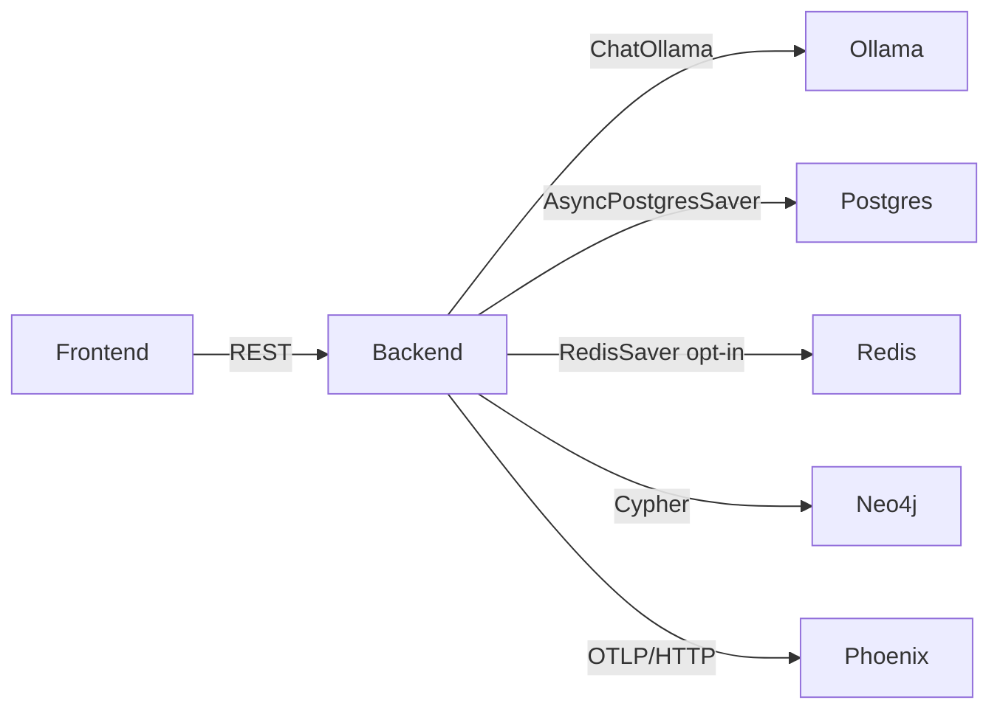

# Local AI Stack (Spec 010)

> Companion to [specs/010-local-ai-stack/](../specs/010-local-ai-stack/). This page is the operator-facing manual for running LawGraph's LangGraph + Ollama + Phoenix substrate locally.

## At a glance

| Component | Image / Module | Purpose | Default endpoint |
|-----------|---------------|---------|------------------|
| Ollama | `ollama/ollama:latest` | Local LLM server | `http://localhost:11434` |
| LangGraph | `app.agents.graphs.legal_workflow` | 3-node `retrieve → analyze → cite_check` | (in-process) |
| Postgres | `postgres:16-alpine` | LangGraph checkpointer + HITL queue | `localhost:5432` |
| Redis | `redis:7-alpine` | Optional checkpointer + cache | `localhost:6379` |
| Neo4j | `neo4j:5-community` | Knowledge graph | `localhost:7687` / UI `7474` |
| Phoenix | `arizephoenix/phoenix:latest` | OTEL collector + trace UI | `localhost:6006` |
| Backend | `backend/lawgraph/asgi.py` (Django ASGI via daphne) | API + agent host | `localhost:8000` |

## Architecture



Every node in `LegalWorkflow` is wrapped by [`@logged_node`](../backend/lawgraph/core/provenance.py#L142). That decorator records to two places:

1. The append-only JSONL audit store at `.audit/provenance.jsonl` (powers `/api/agents/runs`).
2. An OpenTelemetry span exported to Phoenix (when `PHOENIX_COLLECTOR_ENDPOINT` is set).

The trace id is shared across both stores, so any analysis returned from the API can be cross-referenced.

## Quickstart

```bash
# 1. Bring up the stack (pulls models in the background on first boot).
make local-ai-up

# 2. Wait until Phoenix + Ollama report healthy.
make local-ai-health      # hits /api/agents/health/local-ai

# 3. Run a workflow against Ollama.
curl -s -X POST http://localhost:8000/api/analysis \
  -H "content-type: application/json" \
  -d '{"text":"What is the holding of Marbury v. Madison?","use_langgraph":true}' \
  | jq

# 4. Open the Phoenix UI to inspect the trace tree.
open http://localhost:6006
```

The response includes `phoenix_trace_url` and `langgraph_thread_id` — paste either into Phoenix or call `LegalWorkflow.get_state(thread_id)` to resume.

## Environment variables

| Variable | Default | Notes |
|----------|---------|-------|
| `OLLAMA_BASE_URL` | `http://ollama:11434` | Override to `http://localhost:11434` for host runs. |
| `OLLAMA_DEFAULT_MODEL` | `mistral:7b-instruct-q4_K_M` | Bump to `llama3.1:8b-instruct-q4_K_M` on 64 GB+. |
| `OLLAMA_REQUEST_TIMEOUT_S` | `120.0` | Raise for very long contexts. |
| `LANGGRAPH_CHECKPOINTER` | `postgres` | `postgres` \| `redis` \| `memory`. |
| `PHOENIX_COLLECTOR_ENDPOINT` | `http://phoenix:6006/v1/traces` | **Unset disables tracing entirely.** Required no-op for tests. |
| `PHOENIX_UI_URL` | `http://localhost:6006` | Used to build deep-links in API responses. |
| `PHOENIX_PROJECT_NAME` | `lawgraph` | Phoenix tab label. |

## Hardware tiers

| Tier | RAM | Models | Configured today? |
|------|-----|--------|------------------|
| **Apple Silicon laptop** (default) | 32–64 GB unified | `mistral:7b-instruct-q4_K_M`, `llama3.1:8b-instruct-q4_K_M`, `nomic-embed-text` | ✅ |
| Linux + NVIDIA workstation | 64 GB + 24 GB VRAM | + `llama3.1:70b-q4_K_M`, optional vLLM | ❌ — tracked as [BL-20260502-02](../BACKLOG.md) |
| Server / multi-GPU | 128 GB + ≥48 GB VRAM | vLLM-first; Prom + Grafana | ❌ — tracked as [BL-20260502-03](../BACKLOG.md) |

## Licensing

| Component | License | Notes |
|-----------|---------|-------|
| Ollama | MIT | Bundled models carry their own licenses (Llama 3.1 → Llama Community License; Mistral → Apache-2.0). |
| LangGraph + checkpointers | MIT | `langgraph`, `langgraph-checkpoint-postgres`, `langgraph-checkpoint-redis`. |
| Arize Phoenix | Elastic License 2.0 | Self-host + internal use is permitted; redistribution as a service is not. Audit before going commercial. |
| OpenTelemetry SDK / exporters | Apache-2.0 | |

A Langfuse fallback is tracked as [BL-20260502-07](../BACKLOG.md) in case the Phoenix license posture changes.

## Resuming a workflow after a backend restart

```python
from app.agents.graphs import LegalWorkflow

wf = LegalWorkflow()
state = await wf.get_state("lwf-abc123")
print(state.values["answer"])
```

The Postgres checkpointer survives `docker compose restart backend`. Run `Reset Local DBs (Dangerous)` (VS Code task) to wipe.

## Troubleshooting

- **`make local-ai-health` says `ollama.reachable=false`** — first-boot model pull may still be running. Tail with `docker compose logs -f ollama` and wait until `[ollama-bootstrap] all models present`.
- **`phoenix.reachable=false`** — confirm port 6006 is free (`lsof -i :6006`); the Next.js dev server does not collide today, but other Phoenix installs do.
- **`checkpointer.reachable=false` with "langgraph not installed"** — install the optional extra: `cd backend && pip install -e ".[dev,local-ai]"`.
- **Workflow returns `"Insufficient sources to answer confidently"`** — the default retriever returns no passages until the GraphRAG hookup lands ([BL-20260502-04](../BACKLOG.md)). Inject a custom retriever for now.

## Related specs

- [specs/010-local-ai-stack/](../specs/010-local-ai-stack/) — the source spec for everything on this page.
- [specs/002-resolve-citations-to-cases/](../specs/002-resolve-citations-to-cases/) — `cite_check` reuses this resolver.
- [specs/007-analysis-studio/](../specs/007-analysis-studio/) — `/api/analysis` is the public surface that exposes `use_langgraph`.
