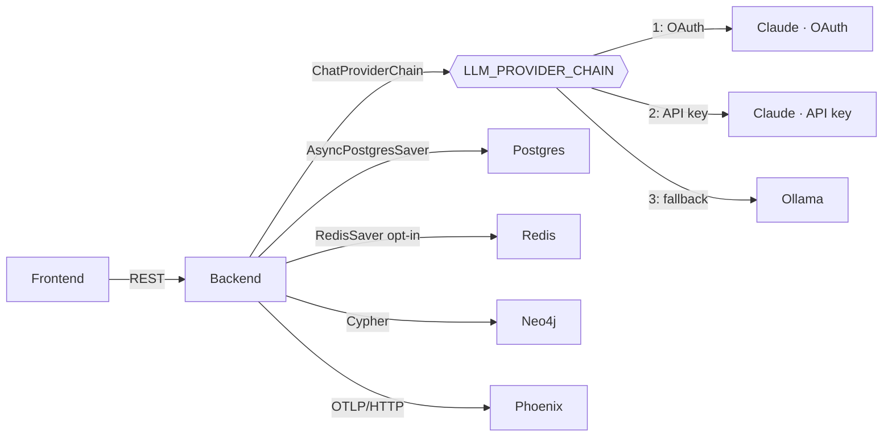

# Local AI Stack (Spec 010)

> Companion to [specs/010-local-ai-stack/](../specs/010-local-ai-stack/). This page is the operator-facing manual for running Law AI's LangGraph + Ollama + Phoenix substrate locally.

**LLM selection note.** This page documents the local *infrastructure* (Neo4j, Postgres, Redis, Ollama, Phoenix). It does not, by itself, determine which model answers a request: `LegalWorkflow`'s LLM is `ChatProviderChain`, which tries the constitution-§1 provider chain — Claude (OAuth), then Claude (API key), then Ollama — in that order (`LLM_PROVIDER_CHAIN`, default `claude_code,anthropic_api,ollama`). Bringing this stack up does **not** make Ollama the default; it makes Ollama *available* as the chain's last tier. To guarantee every request stays local (required for data under a confidentiality obligation that forbids third-party processing — see [docs/constitution.md](constitution.md) §1), pin the chain explicitly:

```dotenv
LLM_PROVIDER_CHAIN=ollama
```

See [docs/claude-code-dev-llm.md](claude-code-dev-llm.md) for the Claude tiers.

## At a glance

| Component | Image / Module | Purpose | Default endpoint |
|-----------|---------------|---------|------------------|
| Ollama | `ollama/ollama:0.12.6` | Local LLM server — chain's last tier (opt in via `LLM_PROVIDER_CHAIN=ollama` for local-only) | `http://localhost:11434` |
| LangGraph | `law_ai.agents_runtime.graphs.legal_workflow` | 3-node `retrieve → analyze → cite_check` | (in-process) |
| Postgres | `postgres:16-alpine` | LangGraph checkpointer (reads `POSTGRES_URL`) + HITL queue | `localhost:5432` |
| Redis | `redis:7-alpine` | Optional checkpointer + cache | `localhost:6379` |
| Neo4j | `neo4j:5-community` | Knowledge graph | `localhost:7687` / UI `7474` |
| Phoenix | `arizephoenix/phoenix:12.9.0` | OTEL collector + trace UI | `localhost:6006` |
| Backend | `backend/law_ai/asgi.py` (Django ASGI via daphne) | API + agent host | `localhost:8000` |

Image tags are deliberately pinned in [docker-compose.yml](../docker-compose.yml) (not `:latest`) so dev and eval runs stay reproducible — bump them on purpose, not by drift.

## Architecture



`LegalWorkflow`'s default LLM factory builds a [`ChatProviderChain`](../backend/law_ai/core/llm/langchain.py) — a real LangChain `BaseChatModel` (spec 035) — rather than talking to Ollama directly. `langchain-core` and `langgraph-checkpoint-{postgres,redis}` are core backend dependencies (`backend/pyproject.toml`), not an optional extra.

Every node in `LegalWorkflow` is wrapped by [`@logged_node`](../backend/law_ai/core/provenance.py). That decorator records to two places:

1. The append-only JSONL audit store at `.audit/provenance.jsonl` (powers `/api/agents/runs`).
2. An OpenTelemetry span exported to Phoenix (when `PHOENIX_COLLECTOR_ENDPOINT` is set).

The trace id is shared across both stores, so any analysis returned from the API can be cross-referenced.

## Quickstart

```bash
# 1. Bring up the stack (pulls models in the background on first boot).
make local-ai-up

# 2. Wait until Phoenix + Ollama report healthy.
make local-ai-health      # hits /api/agents/health/local-ai

# 3. Run a workflow. With no Claude credentials in .env this falls through
#    to Ollama automatically; set LLM_PROVIDER_CHAIN=ollama to guarantee it
#    even when Claude credentials are present.
curl -s -X POST http://localhost:8000/api/analysis \
  -H "content-type: application/json" \
  -d '{"text":"What is the holding of Marbury v. Madison?","use_langgraph":true}' \
  | jq

# 4. Open the Phoenix UI to inspect the trace tree.
open http://localhost:6006
```

The response includes `phoenix_trace_url` and `langgraph_thread_id` — paste either into Phoenix or call `LegalWorkflow.get_state(thread_id)` to resume.

## Environment variables

| Variable | Default | Notes |
|----------|---------|-------|
| `LLM_PROVIDER_CHAIN` | `claude_code,anthropic_api,ollama` | Ordered LLM provider list `ChatProviderChain` reads (constitution §1). Pin to `ollama` to force local-only. See [docs/claude-code-dev-llm.md](claude-code-dev-llm.md) for the Claude tiers. |
| `OLLAMA_BASE_URL` | `http://ollama:11434` | Override to `http://localhost:11434` for host runs. |
| `OLLAMA_DEFAULT_MODEL` | `mistral:7b-instruct-q4_K_M` | Bump to `llama3.1:8b-instruct-q4_K_M` on 64 GB+. |
| `OLLAMA_REQUEST_TIMEOUT_S` | `120.0` | Raise for very long contexts. |
| `LANGGRAPH_CHECKPOINTER` | `postgres` | `postgres` \| `redis` \| `memory`. Postgres reads `POSTGRES_URL` (not `DATABASE_URL`, spec 035). |
| `PHOENIX_COLLECTOR_ENDPOINT` | _(blank in `settings/base.py`; `docker-compose.yml` sets it to `http://phoenix:6006/v1/traces` for the `backend` service)_ | **Unset disables tracing entirely.** Blank it in `.env` to opt out even inside the compose stack. |
| `PHOENIX_UI_URL` | `http://localhost:6006` | Used to build deep-links in API responses (`phoenix_trace_url`). The project segment is resolved to Phoenix's own base64 id via one cached `GET /v1/projects`; if Phoenix is unreachable the field is simply `null` (spec 037 FR-6). |
| `PHOENIX_PROJECT_NAME` | `law_ai` | The Phoenix project traces land in. Set as the `openinference.project.name` resource attribute (spec 037) — before that it was silently ignored and everything landed in `default`. |
| `PHOENIX_TRACE_CONTENT` | `false` in `settings/base.py`, **`true` in `settings/dev.py`** | Whether spans carry prompt and completion **text**. Off keeps span kind, model, latency, and the parent/child tree while dropping content (OpenInference `TraceConfig`). See the warning below. |

> **Trace content is a second copy of client data.** With `PHOENIX_TRACE_CONTENT=true`, every prompt and model completion is written into the Phoenix container's `phoenix:/data` volume in readable form. The `core.provenance` audit trail deliberately does *not* do this — it stores an input hash and a 500-character output summary — so tracing is the more permissive store of the two whenever content capture is on.
>
> The default is therefore off everywhere **except the dev stack**, where `settings/dev.py` turns it on so `make dev` is useful for debugging. The practical consequence: do not point a `make dev` stack at data under a confidentiality obligation. For those matters pin `LLM_PROVIDER_CHAIN=ollama` (above) **and** either run with `DJANGO_SETTINGS_MODULE=law_ai.settings.prod` or set `PHOENIX_TRACE_CONTENT=false` explicitly in `.env`. Blanking `PHOENIX_COLLECTOR_ENDPOINT` disables tracing entirely and is the strongest option.
| `AUTONOMY_ENABLED` | `false` | **Kill-switch** for all scheduled autonomy loops (spec 018 §12 invariant I3). Set to `true` to activate. |
| `AUTONOMY_ALLOWED_SOURCES` | `[]` | Comma-separated list of source adapter names permitted for autonomous ingestion (e.g. `courtlistener,cap`). |
| `AUTONOMY_MAX_INGEST_PER_CYCLE` | `25` | Hard cap on documents ingested per corpus-growth cycle. |
| `AUTONOMY_DIGEST_DIR` | `backend/var/autonomy/` | Directory where daily digest files (`digest-YYYY-MM-DD.md`) are written. |

## Hardware tiers

| Tier | RAM | Models | Configured today? |
|------|-----|--------|------------------|
| **Apple Silicon laptop** (default) | 32–64 GB unified | `mistral:7b-instruct-q4_K_M`, `llama3.1:8b-instruct-q4_K_M`, `nomic-embed-text` | ✅ |
| Linux + NVIDIA workstation | 64 GB + 24 GB VRAM | + `llama3.1:70b-q4_K_M`, optional vLLM | ❌ — tracked as [BL-20260502-02](../BACKLOG.md) |
| Server / multi-GPU | 128 GB + ≥48 GB VRAM | vLLM-first; Prom + Grafana | ❌ — tracked as [BL-20260502-03](../BACKLOG.md) |

## Licensing

| Component | License | Notes |
|-----------|---------|-------|
| Ollama | MIT | Bundled models carry their own licenses (Llama 3.1 → Llama Community License; Mistral → Apache-2.0). |
| LangGraph + checkpointers | MIT | `langgraph`, `langgraph-checkpoint-postgres`, `langgraph-checkpoint-redis`. |
| Arize Phoenix | Elastic License 2.0 | Self-host + internal use is permitted; redistribution as a service is not. Audit before going commercial. |
| OpenTelemetry SDK / exporters | Apache-2.0 | |

A Langfuse fallback is tracked as [BL-20260502-07](../BACKLOG.md) in case the Phoenix license posture changes.

## Resuming a workflow after a backend restart

Run this inside the backend container (`make shell-backend`, then `python manage.py shell -c '...'`, or `docker compose run --rm backend python manage.py shell`) — never on the host:

```python
from law_ai.agents_runtime.graphs import LegalWorkflow

wf = LegalWorkflow()
state = await wf.get_state("lwf-abc123")
print(state.values["answer"])
```

The Postgres checkpointer survives `docker compose restart backend`. Run `Reset Local DBs (Dangerous)` (VS Code task) to wipe.

## Troubleshooting

- **`make local-ai-health` says `ollama.reachable=false`** — first-boot model pull may still be running. Tail with `docker compose logs -f ollama` and wait until `[ollama-bootstrap] all models present`.
- **`phoenix.reachable=false`** — confirm port 6006 is free (`lsof -i :6006`); the Next.js dev server does not collide today, but other Phoenix installs do.
- **`checkpointer.reachable=false`** — `langgraph`, `langchain-core`, and `langgraph-checkpoint-{postgres,redis}` are core backend dependencies (spec 035), so a missing-package error is unlikely under the normal Docker build. If you see an error mentioning "install the local-ai extra," that message text is stale (the extra now only carries Phoenix/OTel packages) — ignore the wording and instead check that Postgres is actually reachable and that `POSTGRES_URL` is correct (`make ps`, `docker compose logs postgres`). Never `pip install` on the host to fix this — rebuild the image instead (`docker compose build backend`).
- **Workflow returns `"Insufficient sources to answer confidently"`** — as of spec 028, `LegalWorkflow`'s default retriever is a real hybrid GraphRAG lookup ([`agents_runtime/tools/graph_rag.py`](../backend/law_ai/agents_runtime/tools/graph_rag.py), lexical fulltext + `CITES` graph expansion; [BL-20260810-01](../BACKLOG.md)), not the old `[]` stub. This message now means Neo4j is unreachable, or the query genuinely matched nothing in the corpus — not that retrieval is unimplemented. Confirm Neo4j is up (`make local-ai-health`) before assuming a code gap.

## Autonomy Loop

Spec 018 adds a scheduled autonomy loop that runs inside the same Docker stack. It is **disabled by default** (`AUTONOMY_ENABLED=false`). Operators activate it by setting `AUTONOMY_ENABLED=true` in their environment.

Three beat entries are registered in `law_ai/celery.py`:

| Beat entry | Schedule | Kind | Notes |
|---|---|---|---|
| `autonomy-content-sweep` | every 6 h | `corpus_growth` | Fetches new docs via allowed source adapters; routes through `IngestionScout`. |
| `autonomy-nightly-tests` | 06:00 UTC daily | `test_pillar` | Synthesises proposed tests via `TestSynthesizer`; writes `*.proposed.py` files pending human review. |
| `autonomy-daily-digest` | 07:00 UTC daily | `digest` | Aggregates last 24 h of `autonomy_*` audit events into `var/autonomy/digest-YYYY-MM-DD.md`. |

Every cycle passes through `law_ai.core.autonomy.run_cycle`, which emits paired `autonomy_cycle.start` / `autonomy_cycle.end` provenance events and enforces the kill-switch. See [ADR 0003](../docs/adr/0003-autonomy-orchestrator.md) and [docs/constitution.md](constitution.md) §12 for the full set of invariants (I1–I6).

```bash
# Trigger a cycle manually (dry-run to preview without side-effects)
make autonomy-run KIND=corpus_growth  # or test_pillar / digest
make manage CMD='run_autonomy --kind digest --dry-run'
```

## Related specs

- [specs/010-local-ai-stack/](../specs/010-local-ai-stack/) — the source spec for the infrastructure on this page (Ollama, Postgres/Redis checkpointers, Neo4j, Phoenix).
- [specs/034-claude-default-runtime/](../specs/034-claude-default-runtime/) — makes Claude the default LLM tier in `LLM_PROVIDER_CHAIN`; Ollama is the fallback documented here.
- [specs/035-langchain-first-class/](../specs/035-langchain-first-class/) — makes LangChain/LangGraph core dependencies and introduces `ChatProviderChain`, the LLM `LegalWorkflow` actually runs.
- [specs/028-real-graphrag-retrieval/](../specs/028-real-graphrag-retrieval/) — the hybrid retriever referenced in Troubleshooting.
- [specs/002-resolve-citations-to-cases/](../specs/002-resolve-citations-to-cases/) — `cite_check` reuses this resolver.
- [specs/007-analysis-studio/](../specs/007-analysis-studio/) — `/api/analysis` is the public surface that exposes `use_langgraph`.
