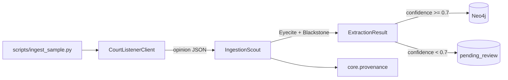

# Plan: Ingest CourtListener Opinions

> Companion to [spec.md](spec.md). Describes **how** we satisfy each `FR-*` / `NFR-*` / `AC-*`.

## 1. Architecture Overview



The CLI is a thin orchestrator: fetch → extract → branch on confidence → commit. The agent (`IngestionScout`) is reusable from a future API/UI trigger without changes.

## 2. Component Changes

| Layer | File / Module | Change |
|-------|---------------|--------|
| Ingestion | `backend/app/ingestion/courtlistener.py` | new — `CourtListenerClient` (FR-1) |
| Ingestion | `backend/app/ingestion/scout.py` | new — `IngestionScout` agent (FR-2, FR-3) |
| Models | `backend/app/models/extraction.py` | new — `ExtractionResult`, `Citation`, `Entity` Pydantic models (FR-2) |
| DB | `backend/app/db/neo4j.py` | new — async driver singleton + `commit_case` helper |
| DB | `backend/app/db/queries.py` | new — `MERGE`-based Cypher for `Case`, `Citation`, `CITES` (FR-3, NFR-IDEMPOTENT-1) |
| DB | `backend/app/db/neo4j_migrations/001_case_constraints.cypher` | new — uniqueness constraint on `Case.id` and `Citation.normalized` |
| DB | `backend/app/db/postgres_migrations/001_pending_review.sql` | new — `pending_review` table (NFR-HITL-1) |
| Agents | `backend/app/agents/registry.py` | register `IngestionScout` (FR-6) |
| API | `backend/app/api/health.py` | extend response with `last_ingest_at` (AC-4) |
| CLI | `backend/scripts/ingest_sample.py` | new — argparse entry point (FR-4) |
| Make | `Makefile` | new `ingest` target (FR-5) |
| Tests | `backend/tests/ingestion/test_courtlistener.py` | new — `respx`-mocked HTTP tests |
| Tests | `backend/tests/ingestion/test_scout.py` | unit + integration (AC-3, AC-5) |
| Tests | `backend/tests/api/test_health.py` | extend for `last_ingest_at` (AC-4) |
| Docs | `docs/data-model.md` | new — Neo4j schema reference (mentioned in spec §7) |
| Docs | `docs/data-sources.md` | new — CourtListener entry |
| Docs | `docs/agent-roles.md` | flip `IngestionScout` from stub to live |

## 3. Data & Schema Migrations

Forward-only, idempotent.

`backend/app/db/neo4j_migrations/001_case_constraints.cypher`:

```cypher
CREATE CONSTRAINT case_id_unique IF NOT EXISTS
  FOR (c:Case) REQUIRE c.id IS UNIQUE;
CREATE CONSTRAINT citation_normalized_unique IF NOT EXISTS
  FOR (x:Citation) REQUIRE x.normalized IS UNIQUE;
```

`backend/app/db/postgres_migrations/001_pending_review.sql`:

```sql
CREATE TABLE IF NOT EXISTS pending_review (
  id           text PRIMARY KEY,
  source       text NOT NULL,
  payload      jsonb NOT NULL,
  confidence   double precision NOT NULL,
  created_at   timestamptz NOT NULL DEFAULT now()
);
```

`backend/scripts/init-db.sh` is updated to apply both on startup.

## 4. Tech Choices & Alternatives

| Decision | Chosen | Alternatives Considered | Why |
|----------|--------|-------------------------|-----|
| Citation extraction | **Eyecite** | Blackstone-only, regex | Eyecite is the de-facto standard, MIT-licensed, already in `pyproject.toml`. |
| Entity / holding extraction | **Blackstone (spaCy)** | Spacy `en_core_web_lg` only | Blackstone is legal-domain-tuned and already in `pyproject.toml`. |
| HTTP client | **`httpx.AsyncClient` + `tenacity`** | `requests`, `aiohttp` | Constitution §8 mandates `httpx` + `tenacity`. |
| HTTP test mocking | **`respx`** | `pytest-httpx` | Already in `pyproject.toml` `[dev]`. |
| Cypher write strategy | **`MERGE` on stable IDs** | `CREATE` + dedupe | Required for NFR-IDEMPOTENT-1. |
| Pending-review store | **Postgres table, JSONL fallback** | Neo4j with `archived_at` | Keeps "pending" out of the audited graph; fallback keeps the dev loop green when Postgres is down. |

No constitution deviation — no ADR needed.

## 5. Provenance & Audit Hook-up

`IngestionScout.__init__` records `agent_version` (read from `app.__version__`). Every call site logs through `core.provenance.ProvenanceLogger`:

- `client.fetch_opinion(id)` → `log_event("ingestion.fetch", source="courtlistener", source_url=...)`.
- `scout.extract(payload)` → `log_event("ingestion.extract", confidence=..., n_citations=...)`.
- `scout.run_and_commit(payload)` → `log_event("ingestion.commit", case_id=..., n_edges=...)` on success, `log_event("ingestion.pending", reason="low_confidence")` otherwise.

Cypher writes set `source`, `source_url`, `ingest_timestamp`, `agent_version`, `confidence` on every `Case` and `CITES` (per `docs/constitution.md` §4).

## 6. HITL Gates

- **Spec gate**: this spec must be approved (Level 2 default).
- **PR gate**: standard.
- **Runtime gate (NFR-HITL-1)**: low-confidence extractions land in `pending_review`. A future spec will add a UI to triage them.
- The agent's `BaseLawAIAgent.requires_human_approval` is `False` for the ingestion *call itself* (high-volume), but each item carries `confidence` so downstream agents can re-gate.

## 7. Test Strategy

- **Unit** (mocked Neo4j, mocked HTTP via `respx`):
  - `test_courtlistener.py`: client retries on 5xx, respects rate-limit header, surfaces typed errors.
  - `test_scout.py::test_extract_high_confidence`: fixture opinion → `ExtractionResult` with ≥ 1 citation, confidence ≥ 0.7.
  - `test_scout.py::test_low_confidence_routes_to_pending` (AC-5).
- **Integration** (real Neo4j + Postgres via service containers from [.github/workflows/ci.yml](../../.github/workflows/ci.yml)):
  - `test_scout.py::test_run_and_commit_creates_case_and_edge` (AC-3).
  - `test_scout.py::test_idempotent_recommit` (AC-2).
- **API**:
  - `test_health.py::test_last_ingest_at_after_commit` (AC-4).
- **LegalBench**: not run by this spec (no reasoning change). Do not apply the `reasoning-change` PR label.

## 8. Rollout

- Local: `make dev` then `make ingest` works out of the box.
- Spacy model: `init-db.sh` runs `python -m spacy download en_core_web_sm` (idempotent).
- Feature flag: none. Ingestion is opt-in (CLI-only).
- Backfill: not applicable; this is the first ingest.

## 9. Risks & Mitigations

| Risk | Likelihood | Impact | Mitigation |
|------|------------|--------|------------|
| CourtListener API rate-limit during dev | medium | medium | `respx` cassettes for tests; `--limit` defaults small; document API token in `.env.example`. |
| Eyecite mis-parses obscure citation forms | medium | low | Confidence < 0.7 routes to `pending_review` (NFR-HITL-1); never silently committed. |
| Neo4j constraint conflict on re-run | low | medium | `MERGE` strategy + uniqueness constraints ensure idempotency (AC-2). |
| spaCy model download bloats CI image | medium | low | Cache the model in the backend image layer; don't re-download in tests (mock Blackstone). |

## 10. Estimated Effort

~6 agent-tasks (see [tasks.md](tasks.md)); roughly 1–2 developer-days with pairing on the Neo4j migration.
