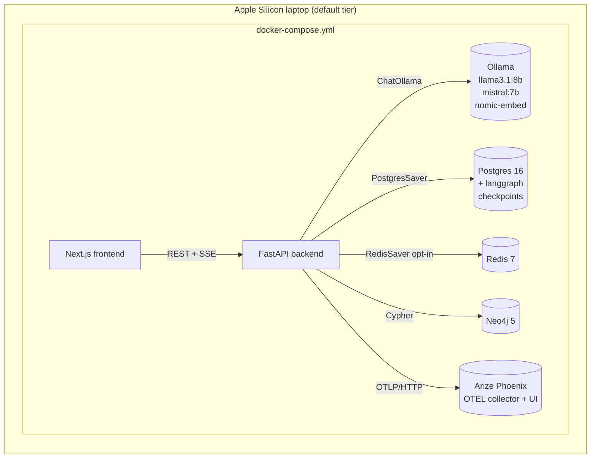

# Plan: Local AI Stack (Ollama + LangGraph + Checkpointers + Phoenix)

> Companion to [spec.md](spec.md). Describes **how** we will satisfy FR-1 … FR-10, NFR-*, AC-*.

## 1. Architecture Overview

`LegalWorkflow` is a 3-node LangGraph (`retrieve → analyze → cite_check`). Each node is wrapped by `@logged_node(...)` (FR-5) which hits both `app.core.provenance` and the OTEL tracer registered in `app.core.telemetry` (FR-4).

## 2. Component Changes

| Layer        | File / Module                                            | Change |
|--------------|----------------------------------------------------------|--------|
| Deps         | `backend/pyproject.toml`                                 | FR-1: add `langchain-ollama`, `langgraph-checkpoint-postgres`, `langgraph-checkpoint-redis`, `arize-phoenix-otel`, `opentelemetry-instrumentation-{fastapi,httpx}`; new `[project.optional-dependencies].local-ai` extra |
| Settings     | `backend/app/core/config.py`                             | Add `OLLAMA_DEFAULT_MODEL`, `LANGGRAPH_CHECKPOINTER`, `PHOENIX_COLLECTOR_ENDPOINT`, `PHOENIX_UI_URL` |
| Telemetry    | `backend/app/core/telemetry.py` (new)                    | FR-4: `init_tracing(app)`; FastAPI + httpx instrumentation; LangChain OTEL callback |
| Provenance   | `backend/app/core/provenance.py`                         | FR-5: add `@logged_node(name)` decorator; back-compat wrapper for existing CrewAI logger |
| Graphs       | `backend/app/agents/graphs/__init__.py` (new)            | Re-export `legal_workflow`, `build_checkpointer` |
| Graphs       | `backend/app/agents/graphs/runtime.py` (new)             | FR-2: `build_checkpointer()` factory |
| Graphs       | `backend/app/agents/graphs/legal_workflow.py` (new)      | FR-3: 3-node graph + `LegalWorkflowOutput` Pydantic model |
| DB           | `backend/app/db/checkpointer.py` (new)                   | `ensure_schema()` calling `PostgresSaver.setup()` idempotently |
| API          | `backend/app/api/agents.py`                              | FR-9: `GET /api/agents/health/local-ai` |
| API models   | `backend/app/models/analysis.py`                         | Additive: `phoenix_trace_url`, `langgraph_thread_id` on response models |
| Crew         | `backend/app/agents/crews/legal_analyst.py`              | Add `use_langgraph: bool = False` flag delegating to `LegalWorkflow.invoke` |
| Lifespan     | `backend/app/main.py`                                    | Call `init_tracing(app)` and `await ensure_schema()` on startup |
| Compose      | `docker-compose.yml`                                     | FR-6: add `phoenix` service; FR-7: mount `ollama-bootstrap.sh`; wire `PHOENIX_COLLECTOR_ENDPOINT` env |
| Scripts      | `backend/scripts/ollama-bootstrap.sh` (new)              | FR-7: idempotent model pulls |
| Make         | `Makefile`                                               | FR-8: `local-ai-up`, `local-ai-down`, `local-ai-pull` |
| VS Code      | `.vscode/tasks.json`                                     | FR-8: `Start Local AI Stack` task |
| Docs         | `docs/local-ai.md` (new)                                 | FR-10: arch diagram, env matrix, troubleshooting |
| Docs         | `docs/data-model.md`                                     | Append "LangGraph Checkpointer Tables" subsection |
| Docs         | `docs/agent-roles.md`                                    | Append "Stateful Workflows" subsection |
| Env          | `.env.example`                                           | New env vars + sane defaults |

## 3. Data & Schema Migrations

- **Postgres**: `app.db.checkpointer.ensure_schema()` calls `await PostgresSaver.from_conn_string(...).setup()` which is idempotent (the upstream library uses `CREATE TABLE IF NOT EXISTS`). Wrapped in our lifespan handler so a fresh DB self-heals on backend boot.
- **Postgres extension**: `backend/scripts/init-db.sh` gains `CREATE EXTENSION IF NOT EXISTS pg_trgm;` (R-2).
- **Neo4j**: no changes.
- **Vector store**: no changes (Chroma already wired elsewhere).

## 4. Tech Choices & Alternatives

| Decision                       | Chosen                                | Alternatives                          | Why |
|--------------------------------|---------------------------------------|---------------------------------------|-----|
| LLM serving                    | Ollama (already in stack)             | LM Studio, vLLM                       | Already configured; runs on Apple Silicon without GPU passthrough; OpenAI-compatible. vLLM deferred to Linux+GPU tier (BACKLOG). |
| LangChain ↔ Ollama bridge      | `langchain-ollama`                    | `langchain-community.llms.Ollama`     | New dedicated package; better streaming + tool-call support; future-proof. |
| Checkpointer (default)         | `PostgresSaver`                       | `RedisSaver`, `MemorySaver`           | Durability per G1; Postgres already in stack. Redis offered via env switch for queue-heavy workloads (FR-2). |
| Observability                  | Arize Phoenix (self-hosted)           | Langfuse, OpenLLMetry, none           | User-selected. Apache-2.0 / Elastic-2.0 OSS image; native LangChain + OTEL integration; runs in one container. |
| OTEL exporter                  | OTLP/HTTP to `phoenix:6006`           | gRPC OTLP                             | HTTP keeps the compose network simple; Phoenix accepts both. |
| New deps location              | base `dependencies` for runtime, `[local-ai]` extra optional for dev tools | All in extras | Runtime tracing must always load; pulling in OTEL into a new extra would fragment installs. |
| LangGraph API + Studio host    | **Deferred** (BACKLOG)                | `langchain/langgraph-api` container    | Heavy image, not required for any AC; explicit non-goal NG1. |
| IDE coding agents              | **Removed**                           | Continue.dev / PearAI / Aider          | Forbidden by [AGENTS.md](../../AGENTS.md). GitHub Copilot only. |

No constitution deviation; no ADR required.

## 5. Provenance & Audit Hook-up

`@logged_node(name)` decorates each LangGraph node function. Inside, before returning, it:

1. Computes `input_hash = blake2b(json.dumps(state, sort_keys=True).encode()).hexdigest()[:16]` (and same for output state diff).
2. Writes a row through the existing `app.core.provenance.record(...)` API with the schema in FR-5.
3. Emits an OTEL span `legal_workflow.<node>` with the same fields as attributes.
4. Pulls `trace_id` from the active OTEL span context so Phoenix and provenance rows share an id (AC-4).

Existing CrewAI provenance contract is unchanged; new column `trace_id` is nullable + additive.

`LegalWorkflow.invoke(...)` returns the trace id and a Phoenix UI URL constructed as `f"{settings.PHOENIX_UI_URL}/projects/lexgraph/traces/{trace_id}"` so users can deep-link from the analysis UI.

## 6. HITL Gates

- `cite_check` node sets `human_approval_required=True` whenever any candidate citation lacks a matching Neo4j `:Case` node (uses the existing `app.db.citation_resolver` from spec 002). Surfaces in the response payload (FR-3, AC-6).
- No new ingestion-side HITL gates are introduced; existing `IngestionScout` HITL paths (spec 004) keep working and will now appear in Phoenix automatically.

## 7. Test Strategy

- **Unit**:
  - `tests/agents/graphs/test_legal_workflow.py` — fake `ChatOllama` (returns canned JSON), `MemorySaver`, asserts node order, output schema, HITL flag (AC-5, AC-6).
  - `tests/core/test_telemetry.py` — assert tracer registered, FastAPI middleware installed, exporter pointed at `PHOENIX_COLLECTOR_ENDPOINT`.
  - `tests/core/test_provenance_logged_node.py` — decorator records the right fields, plays nicely with sync + async nodes.
  - `tests/core/test_local_ai_privacy.py` — monkey-patches `httpx.AsyncClient.send`; asserts only `localhost`, `ollama`, `phoenix` hosts hit during a full `LegalWorkflow.invoke` (NFR-PRIVACY-1, AC-7).
- **Integration** (marked `@pytest.mark.integration`, requires docker compose):
  - `tests/agents/graphs/test_legal_workflow_postgres.py` — real `PostgresSaver`, real Ollama (skips if `OLLAMA_BASE_URL` unreachable), restart-resume scenario (NFR-RESILIENCE-1, AC-3).
  - `tests/api/test_local_ai_health.py` — hits `/api/agents/health/local-ai` against a live stack.
- **Frontend**: no changes in scope (BL follow-up to surface `phoenix_trace_url` in `AgentTrace.tsx`).
- **LegalBench**: run `Run LegalBench Eval` task with `use_langgraph=False` (baseline) and `=True` (new path); record delta in PR per spec §11.

## 8. Rollout

- `make local-ai-up` brings up the stack; `ollama-bootstrap.sh` pulls models in the background; `/api/agents/health/local-ai` reports per-subsystem readiness.
- **Feature flag**: `use_langgraph: bool` on `/api/analysis` request body, default `False`. Frontend keeps using the legacy path until BL follow-up wires the toggle.
- **Backfill**: none. Old analyses stored in Postgres remain valid.
- **Reset**: `Reset Local DBs (Dangerous)` task already drops Postgres volumes; new checkpointer schema is recreated automatically by `ensure_schema()`.

## 9. Risks & Mitigations

| Risk | Likelihood | Impact | Mitigation |
|------|------------|--------|------------|
| Phoenix license drift | low | med | Pin image tag; document license in `docs/local-ai.md`; fallback Langfuse path tracked as BL follow-up. |
| Postgres migration race on cold boot | med | med | `ensure_schema()` runs in lifespan startup before router registration; idempotent. |
| Apple Silicon Ollama OOM with 8b + 7b models simultaneously loaded | med | med | Bootstrap pulls but does not preload; `OLLAMA_KEEP_ALIVE=5m` so unused models unload. |
| OTEL instrumentation breaks existing tests via global state | med | high | `init_tracing` is a no-op when `PHOENIX_COLLECTOR_ENDPOINT` is unset; tests run with it unset by default. |
| `langgraph-checkpoint-postgres` major-version churn | med | med | Pin minor version; integration test in CI matrix catches breakage early. |

## 10. Estimated Effort

~4 agent-days. Heaviest task is FR-3 (`legal_workflow.py` + tests). FR-7 / FR-8 are mechanical. Human pairing recommended for the Phoenix license check and the LegalBench delta review.
