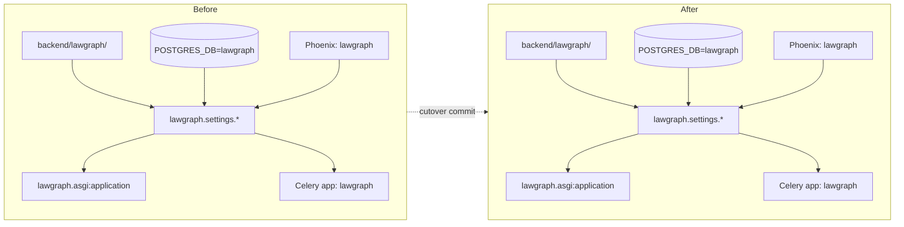

# Plan: Rebrand from LawGraph AI to LawGraph AI

> Companion to [spec.md](spec.md). Resolves **how** we satisfy FR-1 → FR-10
> with minimum risk to running stacks. **Blocked on OQ-1 → OQ-5** in spec
> § 13 — do not start `/tasks` until those are answered.

## 1. Architecture Overview

This is a **mechanical rename + ops-config sweep**, not an architectural
change. No new components; nothing is added or deleted from the runtime
graph. The only structural change is a single-directory `git mv` of the
Python package.



## 2. Replacement Map (canonical, FR-1)

The rebrand has exactly **four** case-preserving substitutions, applied in
this order to avoid transitive errors:

| Order | Find             | Replace          | Notes                                          |
| ----- | ---------------- | ---------------- | ---------------------------------------------- |
| 1     | `LawGraph`       | `LAWGRAPH`       | env-var prefixes, ALL-CAPS comments            |
| 2     | `LawGraph`       | `LawGraph`       | PascalCase prose, class names                  |
| 3     | `LawGraph`       | `Lawgraph`       | sentence-case prose (Django app verbose names) |
| 4     | `lawgraph`       | `lawgraph`       | package paths, lowercase identifiers, URLs     |

**Order matters**: substituting lowercase first would corrupt the
PascalCase form (`LawGraph` would become `Lawgraph` when the inner
`lawgraph` matched).

**Excluded paths** (never touched):

- `backend/.venv/**`, `frontend/node_modules/**`, `frontend/.next/**`
- `**/__pycache__/**`, `**/.mypy_cache/**`, `**/.pytest_cache/**`,
  `**/.ruff_cache/**`
- `backend/staticfiles/**`, `frontend/coverage/**`, `backend/htmlcov/**`
- `**/.coverage`, `**/.coverage.*`
- `frontend/package-lock.json` (would mass-edit hashes — handled
  separately by re-running `npm install`)

**Quote-preservation carve-outs** (FR-5 / FR-6):

- `docs/adr/0001-adopt-django-backend.md` — historical ADR keeps every
  occurrence of "FastAPI" + "LawGraph" intact.
- `docs/adr/0002-rebrand-lawgraph-ai.md` (new) — explicitly mentions
  both names in the "Decision" + "Context" sections.
- `LawGraph_AI_Proposal.md` (renamed file) — keeps the original brand in
  one banner header that points to ADR-2.

## 3. Component Changes

| Layer        | File / Module                                                      | Change                                                                            |
| ------------ | ------------------------------------------------------------------ | --------------------------------------------------------------------------------- |
| Python pkg   | `backend/lawgraph/` → `backend/lawgraph/`                          | `git mv` directory; rewrite all imports (FR-2)                                    |
| Settings     | `backend/lawgraph/settings/{base,dev,test,prod}.py`                | brand strings; `WSGI_APPLICATION`, `ASGI_APPLICATION`                             |
| ASGI         | `backend/lawgraph/asgi.py`, `wsgi.py`, `manage.py`                 | `DJANGO_SETTINGS_MODULE` default                                                  |
| Celery       | `backend/lawgraph/celery.py`, `__init__.py`                        | `Celery("lawgraph")`; `app.config_from_object(...)` arg unchanged                 |
| URLs         | `backend/lawgraph/urls.py` + every `*/urls.py`                     | brand strings in browsable-API titles                                             |
| Tests        | `backend/tests/**/*.py`                                            | import-path sweep                                                                 |
| Frontend     | `frontend/{app,components,lib}/**/*.{tsx,ts,css}`                  | brand strings in `<title>`, nav, footer, alt text; `metadata.title` in `layout.tsx` |
| Frontend     | `frontend/package.json`                                            | `name` field if it currently embeds brand                                          |
| Container    | `backend/Dockerfile`, `frontend/Dockerfile`                        | image labels, ENV defaults                                                         |
| Compose      | `docker-compose.yml`                                               | service env vars, `DATABASE_URL`, `POSTGRES_*`, Celery `-A lawgraph`              |
| Env          | `.env.example`                                                     | every var (PHOENIX project, Postgres URL, Neo4j password)                         |
| Make         | `Makefile`                                                         | any `cd backend && python -m lawgraph...` style targets                           |
| pytest       | `pytest.ini`                                                       | `--ds=lawgraph.settings.test --cov=lawgraph`                                      |
| CI           | `.github/workflows/*.yml`                                          | env vars, comments, job names                                                     |
| Copilot      | `.github/copilot-instructions.md`                                  | brand prose                                                                       |
| Specs        | `specs/001/...` through `specs/011/...`                            | brand sweep (preserve quoted historical ADR-1 wording)                            |
| Docs         | `docs/*.md` (excluding ADR-1)                                      | brand sweep                                                                       |
| Constitution | `docs/constitution.md`                                             | brand sweep + footnote linking ADR-2                                              |
| ADRs         | `docs/adr/0002-rebrand-lawgraph-ai.md` (new)                       | author per FR-6                                                                   |
| Backlog      | `BACKLOG.md`                                                       | brand sweep on prose; `BL-*` ids stay                                             |
| Ops          | `scripts/launchd/com.lawgraph.evolve.plist` → `com.lawgraph.evolve.plist` | rename file; rewrite Label, ProgramArguments, log paths                       |
| Scripts      | `scripts/*.py`, `backend/scripts/*.{sh,py}`                        | brand sweep                                                                       |
| Memory       | `/memories/repo/*.md` (this workspace)                             | sweep notes for the next agent cycle                                              |
| Doc (new)    | `docs/operator-rebrand-runbook.md`                                 | author per FR-9                                                                   |
| Historical   | `LawGraph_AI_Proposal.md` → `LawGraph_AI_Proposal.md`              | rename + add 1-line preservation banner                                           |

## 4. Data & Schema Migrations

**No Django migrations.** Table names (`pending_review`, `audit_event`,
`api_token`) are deliberately preserved — they were chosen brand-neutrally
in spec 011 and renaming them would break the spec-011 BL-19 contract.

**Optional operator-controlled SQL** (documented in FR-9 runbook, never
auto-applied):

```sql
-- Run as a Postgres superuser, with no active connections to lawgraph DB.
ALTER ROLE lawgraph RENAME TO lawgraph;
ALTER DATABASE lawgraph RENAME TO lawgraph;
-- Update the password too if rotating:
ALTER ROLE lawgraph WITH PASSWORD 'lawgraph-dev';
```

**Neo4j**: only the `NEO4J_PASSWORD` env-var default changes. The
operator either keeps their existing password (override the env var) or
runs the documented `neo4j-admin set-initial-password` flow.

**LangGraph checkpointer** (`langgraph.checkpoints` schema): unchanged —
not a brand artifact.

## 5. Tech Choices & Alternatives

| Decision | Chosen | Alternatives Considered | Why |
| -------- | ------ | ----------------------- | --- |
| Rename strategy | **Single cutover commit on a feature branch** with green CI per task | Long-lived dual-name shim with deprecation period | The repo is pre-1.0 with no public PyPI package, no public API consumers locked to the brand string; a clean cut is lower-risk than a multi-week shim. |
| Substitution tool | **`grep -RIl ... | xargs sed -i ''`** scripted into one re-runnable shell helper at `scripts/rebrand.sh` (deleted after merge) | `ast-grep` / IDE refactor / Copilot per-file | sed handles every text format (Python, MD, YAML, JSON, SH, plist, Dockerfile) uniformly; we don't trust language-specific tools for a sweep that crosses 7 file types. The four-case-preserving order from § 2 is enforced by sed running passes in order. |
| Package rename | **`git mv backend/lawgraph backend/lawgraph`** then sed sweep over imports | Add `lawgraph` as alias, deprecate `lawgraph` | Same reasoning as cutover-vs-shim: pre-1.0, no external importers. |
| `BaseLawGraphAgent` symbol | TBD per OQ-4 — default plan: rename | Keep symbol stable | LangGraph checkpoints in dev are wipeable; no production consumers. Will be revisited if OQ-4 surfaces a stability requirement. |
| Brand-preservation in ADR-1 | **Keep verbatim** | Edit historical ADR | An ADR is a historical record by definition. Edit-in-place would falsify the audit trail (constitution §4). |

**No constitution deviation beyond the brand text itself.** ADR-2 is the
required amendment vehicle.

## 6. Provenance & Audit Hook-up

- Brand text in `agent_name`, `model`, and `source` fields is unchanged
  (those carry technical identifiers, not brand strings).
- The `service` label emitted in OTEL spans changes from `"lawgraph"` →
  `"lawgraph"` — flagged in OQ-3 for monitor consumers.
- Every new ADR / runbook / doc carries `source_url` references in
  `docs/` so the rebrand decision is audit-recoverable.

## 7. HITL Gates

- **Spec gate**: maintainer approves spec.md after answering OQ-1 → OQ-5
  (Level-2 default).
- **ADR gate**: maintainer signs off on `docs/adr/0002-rebrand-lawgraph-ai.md`
  before the cutover task lands.
- **PR gate**: standard Copilot Code Review + maintainer review.
- **Cutover gate** (final task, equivalent to spec-011 T-016): explicit
  maintainer sign-off; do not auto-merge.
- **Runtime gate**: none — this rebrand introduces no new high-stakes
  paths.

## 8. Test Strategy

- **Unit / integration**: re-run the entire backend suite (`pytest`) and
  frontend suite (`npm test -- --run`) after each task; a passing-tests
  trend is the parity proof per NFR-PARITY-1.
- **Static**: a CI guard step runs the `grep` from AC-1 and fails the
  build if any forbidden brand string remains outside the carve-out
  files.
- **Smoke**: `make dev` against a fresh `pgdata` volume; `curl
  localhost:8000/health`; load `/` and `/agents` in the browser.
- **Deploy check**: `manage.py check --deploy` under
  `lawgraph.settings.prod` (AC-7).
- **LegalBench**: re-run the eval task post-rebrand to confirm 0.0 pp
  delta. No reasoning logic should move.
- **Validators**: `python scripts/spec_validator.py` and
  `python scripts/backlog_lint.py` exit 0.

## 9. Rollout

- **Branch model**: long-lived `feat/012-rebrand-lawgraph-ai` with green
  CI per task; final task is the cutover commit (delete `scripts/rebrand.sh`
  helper, flip the AC-1 grep gate to "no exceptions allowed except
  the carve-outs").
- **No feature flag** — a rebrand cannot be partially shipped.
- **No backfill / re-ingest** required; data tables keep their current
  names.
- **Operator notice**: announce in release notes pointing at
  `docs/operator-rebrand-runbook.md` (FR-9); operators with greenfield
  installs do nothing.
- **Memory hygiene**: the final task updates `/memories/repo/*.md` so the
  next `/evolve` cycle inherits the new identifiers.

## 10. Risks & Mitigations

| Risk | Likelihood | Impact | Mitigation |
| ---- | ---------- | ------ | ---------- |
| sed sweep accidentally rewrites ADR-1 history | low | high (audit-trail integrity) | sed helper script reads an explicit `KEEP_VERBATIM` allowlist before each pass; AC-1 grep allows ADR-1 explicitly so violations show up. |
| `LawGraph` → `LawGraph` mis-orders and corrupts PascalCase strings | med | med | Pass order locked in § 2; CI grep gate catches stragglers. |
| Operator runs `make dev` against an existing `lawgraph`-named Postgres and fails to connect | high | low (dev-only) | FR-9 runbook documents either the ALTER SQL or env-var override (`POSTGRES_USER=lawgraph` etc. still works). |
| External consumer relies on the literal `service: "lawgraph"` field in `/health` | unknown | low-med | OQ-3 forces an explicit human decision; default plan is "no alias". |
| Pickled LangGraph checkpoint state references `BaseLawGraphAgent` qualified name | low | med | OQ-4 forces an explicit human decision; default plan is "wipe checkpointer in dev, no prod data exists yet". |
| New name "LawGraph" collides with an existing trademark / PyPI / GitHub org | unknown | high (legal / publication) | OQ-2 — **STOP CONDITION**: agent does not proceed past `/clarify` until maintainer answers. |
| `git mv` history loss on `backend/lawgraph` → `backend/lawgraph` | low | low | Use `git mv` (not delete + add); review with `git log --follow`. |
| `package-lock.json` and lockfiles drift after rename | low | low | Re-run `npm install` and commit the updated lockfile in the same task. |
| CI workflow YAMLs reference the old package path in cached keys | med | low | Cache keys include the package name; bumping forces a cache miss which is fine. |

## 11. Estimated Effort

- **T-001 ADR + constitution**: ~2 hours (HUMAN-PAIRED for sign-off).
- **T-002 sed helper + replacement-map dry-run**: ~1 hour.
- **T-003 Python package `git mv` + import sweep + tests green**: ~2 hours.
- **T-004 settings / asgi / wsgi / celery / manage.py / pytest.ini**: ~1 hour.
- **T-005 docker-compose + env + Dockerfile + Makefile**: ~1 hour.
- **T-006 frontend brand sweep + tests green**: ~1 hour.
- **T-007 docs / specs / BACKLOG / copilot-instructions sweep**: ~2 hours.
- **T-008 launchd plist rename + ops scripts**: ~30 min.
- **T-009 author `docs/operator-rebrand-runbook.md`**: ~1 hour.
- **T-010 CI grep gate addition**: ~30 min.
- **T-011 memory updates + final cutover commit**: ~30 min (HUMAN-PAIRED).

Total: ~12 hours of agent + ~2 hours of human review. All tasks are
small and reversible until T-011.

---

**Blocked on**: OQ-1 → OQ-5 in [spec.md § 13](spec.md#13-open-decisions-block-plan-and-beyond-until-resolved).
Run `/clarify` once the human answers them.
