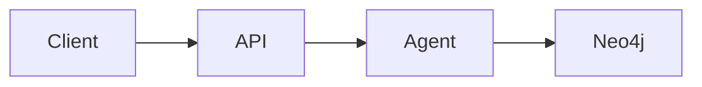

# Plan: {Feature Name}

> Companion to `spec.md`. Describes **how** we will satisfy the requirements.

## 1. Architecture Overview

Short prose + Mermaid diagram if useful. Reference existing components from [docs/architecture.md](../../docs/architecture.md).

## 2. Component Changes

| Layer | File / Module | Change |
|-------|---------------|--------|
| API | `backend/lawgraph/{agentsapi,analysis,graph,lsat}/...` | new route `POST /...` |
| Agent | `backend/lawgraph/agents_runtime/crews/...` | new crew member |
| DB | `backend/lawgraph/core/...` | migration + queries |
| Frontend | `frontend/app/...` | new page / component |

## 3. Data & Schema Migrations

Neo4j Cypher migrations under `backend/lawgraph/core/neo4j/migrations/`; Postgres SQL under `backend/lawgraph/core/postgres_migrations/`. Migrations must be idempotent and forward-only.

## 4. Tech Choices & Alternatives

| Decision | Chosen | Alternatives Considered | Why |
|----------|--------|-------------------------|-----|
| … | … | … | … |

If any choice deviates from [docs/constitution.md](../../docs/constitution.md) §2, write an ADR under `docs/adr/`.

## 5. Provenance & Audit Hook-up

How every new LLM call / tool call / DB write logs through `app.core.provenance`. Confirm node-creation paths set `source`, `confidence`, `ingest_timestamp`, `agent_version`.

## 6. HITL Gates

List every approval gate (spec, PR, deploy, ingestion). Map to the `human_approval_required` flag in agent outputs.

## 7. Test Strategy

- Unit tests: paths, mocks.
- Integration: which docker services required.
- LegalBench subset to run before/after.
- Frontend: Vitest + RTL files.

## 8. Rollout

- Local docker compose: works after `make dev`.
- Feature flag (if any) and default.
- Backfill / re-ingest needed? If yes, script path.

## 9. Risks & Mitigations

| Risk | Likelihood | Impact | Mitigation |
|------|------------|--------|------------|
| … | low/med/high | low/med/high | … |

## 10. Estimated Effort

Story points / agent-hours; flag any task that needs human pairing.
