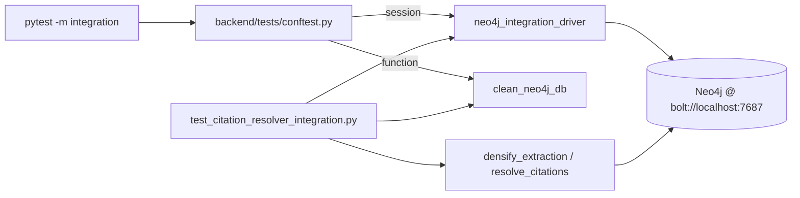

# Plan: Docker-Backed Integration Tests for `densify_extraction`

> Companion to [spec.md](spec.md). Describes **how** we will satisfy FR-1…FR-4
> and the AC-1…AC-5 acceptance criteria.

## 1. Architecture Overview

The new tests live alongside the existing unit tests and reuse the session-scoped Docker fixtures introduced by spec 013 (`neo4j_integration_driver`, `clean_neo4j_db`). No new infrastructure, no new fixtures, no production-code changes — this is a pure test addition that exercises the Cypher in `backend/law_ai/core/neo4j/citation_resolver.py` against a real Neo4j.



## 2. Component Changes

| Layer | File / Module | Change |
|-------|---------------|--------|
| Tests | `backend/tests/db/test_citation_resolver_integration.py` | **new** — three `@pytest.mark.integration @pytest.mark.asyncio` tests (FR-1) |
| Fixtures | `backend/tests/conftest.py` | **none** — reuses spec-013 fixtures (FR-2) |
| Production | `backend/law_ai/core/neo4j/citation_resolver.py` | **none** (NG3) |
| Markers | `backend/pyproject.toml` `[tool.pytest.ini_options].markers` | **none** — `integration` marker already declared |

## 3. Data & Schema Migrations

None. Tests CREATE/DETACH DELETE `Case` nodes within the per-test `clean_neo4j_db` lifecycle.

## 4. Tech Choices & Alternatives

| Decision | Chosen | Alternatives Considered | Why |
|----------|--------|-------------------------|-----|
| Test runner | `pytest -m integration` (existing marker) | Separate tox env; standalone script | Keeps one entry point; CI already wired by spec 013 |
| Fixture scope | Session-scoped driver, function-scoped DB wipe | Per-test driver | Driver setup is ~1s; wipe is <50ms — matches spec 013 contract |
| Seed data | In-test `CREATE` Cypher inside `clean_neo4j_db` | YAML fixture loader | Three small cases — inline Cypher is more readable than indirection |

No deviation from [docs/constitution.md](../../docs/constitution.md) §2.

## 5. Provenance & Audit Hook-up

`densify_extraction` already calls `provenance.log_graph_query` for each Cypher round-trip (verified in `backend/law_ai/core/neo4j/citation_resolver.py`). Tests assert that `target_case_id` is populated correctly; provenance is emitted as a side-effect and is not the system-under-test.

## 6. HITL Gates

None. `densify_extraction` is a deterministic graph utility — no LLM call, no agent decision, no `human_approval_required` flag.

## 7. Test Strategy

- **Unit tests**: unchanged — `backend/tests/db/test_citation_resolver.py` continues to use `FakeAsyncSession` for fast, hermetic coverage.
- **Integration tests**: new file `test_citation_resolver_integration.py`, three tests — see FR-1 in spec.md.
- **Docker services required**: Neo4j only (Postgres/Redis not used by
`densify_extraction`). The shared `docker_services` fixture brings up all three but that's a no-op cost when only Neo4j is touched.
- **LegalBench subset**: none — no reasoning logic touched (NFR-LegalBench).
- **Frontend**: none.

Test outline (see FR-1):

```python
@pytest.mark.integration
@pytest.mark.asyncio
async def test_resolve_citations_hits_real_neo4j_alias_match(
    neo4j_integration_driver, clean_neo4j_db
):
    async with neo4j_integration_driver.session() as session:
        await session.run(
            "CREATE (:Case {id: 'brown', aliases: ['347 U.S. 483']})"
        )
        mapping = await resolve_citations(session, ["347 U.S. 483"])
    assert mapping == {"347 U.S. 483": "brown"}
```

## 8. Rollout

- Local: `make test-integration` runs the new tests automatically.
- CI: `.github/workflows/integration-tests.yml` (added by spec 013) already triggers on backend changes — no workflow edits required.
- No feature flag, no backfill, no env-var changes.

## 9. Risks & Mitigations

| Risk | Likelihood | Impact | Mitigation |
|------|------------|--------|------------|
| Neo4j flake (timeout on connect) | low | low | `verify_connectivity()` in `neo4j_integration_driver` fails fast; CI retries are not configured (single failure = red, by design) |
| Test bleed between cases | low | med | Function-scoped `clean_neo4j_db` runs `MATCH (n) DETACH DELETE n` before each test (NFR-ISOLATION-1) |
| `RESOLVE_CITATIONS_CYPHER` schema drift | low | high | This *is* the test we want to fail when drift happens (G1) |

## 10. Estimated Effort

- ~1 agent-hour: write three tests, run locally with `make test-integration`, push, watch CI.
- No human pairing required.
