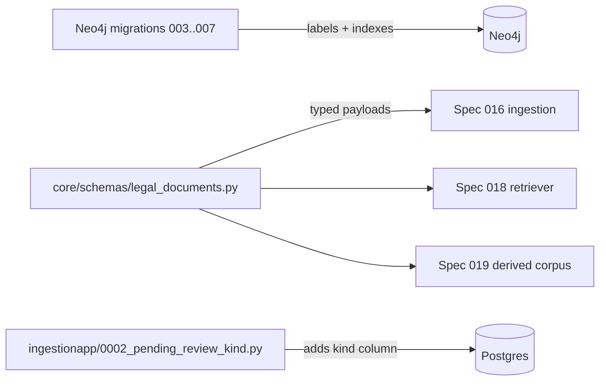

# Plan: Legal Corpus Schema

> Companion to [spec.md](spec.md). Describes **how** we satisfy FR-1…FR-7.

## 1. Architecture Overview

Schema-only change. No new services, no new dependencies. Three pieces:

## 2. Component Changes

| Layer    | File / Module                                                              | Change                                        |
| -------- | -------------------------------------------------------------------------- | --------------------------------------------- |
| Neo4j    | `backend/law_ai/core/neo4j/migrations/003_statute_constraints.cypher`    | new — constraints on Statute / Section / Code / Jurisdiction / Court |
| Neo4j    | `backend/law_ai/core/neo4j/migrations/004_ordinance_regulation.cypher`   | new — constraints on Ordinance / OrdinanceSection / Regulation       |
| Neo4j    | `backend/law_ai/core/neo4j/migrations/005_temporal_indexes.cypher`       | new — range indexes on `effective_from`                              |
| Neo4j    | `backend/law_ai/core/neo4j/migrations/006_derived_document.cypher`       | new — DerivedDocument constraint + property existence                |
| Neo4j    | `backend/law_ai/core/neo4j/migrations/007_fulltext_indexes.cypher`       | new — fulltext on opinions + statute sections                        |
| Schema   | `backend/law_ai/core/schemas/legal_documents.py`                         | new — Pydantic v2 models for every label                             |
| Schema   | `backend/law_ai/core/schemas/__init__.py`                                | re-export the new models                                             |
| Postgres | `backend/law_ai/ingestionapp/models.py`                                  | add `kind` field (CharField, default `"case"`, db_index=True)        |
| Postgres | `backend/law_ai/ingestionapp/migrations/0002_pending_review_kind.py`     | new — `SeparateDatabaseAndState`-wrapped column add (Postgres + SQLite portable) |
| Postgres | `backend/law_ai/ingestionapp/quarantine_kinds.py`                        | new — `KIND_CASE = "case"` etc. constants                            |
| Docs     | `docs/data-model.md`                                                       | extend with new node tables + edges + quarantine-kinds subsection    |
| Tests    | `backend/tests/core/test_neo4j_migrations.py`                              | new — walks `*.cypher` files, asserts idempotency + key constraints  |
| Tests    | `backend/tests/models/test_legal_document_schemas.py`                      | new — Pydantic instantiation + validator boundary tests              |
| Tests    | `backend/tests/ingestion/test_pending_review_kind.py`                      | new — column exists, default back-fill, index present                |

## 3. Data & Schema Migrations

**Neo4j** — five new files under `backend/law_ai/core/neo4j/migrations/`. All use `CREATE CONSTRAINT … IF NOT EXISTS` / `CREATE INDEX … IF NOT EXISTS` / `CREATE FULLTEXT INDEX … IF NOT EXISTS`. No `MATCH … SET` mutations (additive only).

**Postgres** — `0002_pending_review_kind.py` follows the spec 011 pattern (`/memories/repo/django-migrations.md`):
- Postgres branch: `ALTER TABLE pending_review ADD COLUMN IF NOT EXISTS kind text NOT NULL DEFAULT 'case';` then `CREATE INDEX IF NOT EXISTS pending_review_kind_created_at_idx ON pending_review (kind, created_at DESC);`
- SQLite branch: `ALTER TABLE pending_review ADD COLUMN kind TEXT NOT NULL DEFAULT 'case';` (SQLite supports the simple form) plus the index.
- `state_operations` = `AddField(name="kind", field=models.CharField(max_length=32, default="case", db_index=True))`.

## 4. Tech Choices & Alternatives

| Decision | Chosen | Alternatives | Why |
| -------- | ------ | ------------ | --- |
| Discriminator on quarantine | Single `pending_review` table + `kind` column | Per-kind tables (`pending_statute`, `pending_ordinance`) | Single admin pane (BL-20260503-10), no schema explosion as kinds grow. |
| `DerivedDocument` lifetime | Separate node label, never a flag on existing labels | Add `derived: bool` to `Case` etc. | Filterable in Cypher (`MATCH (d:DerivedDocument)`); zero risk of polluting authoritative results. |
| `Court` & `Jurisdiction` | First-class nodes now | Keep as string properties on `Case` (status quo) | Spec 016 needs jurisdiction filtering; cheaper to land the labels in this schema-only spec than retrofit later. |
| Migration runner | Existing shell loop (broken paths noted in Follow-ups) | New Python runner with applied-migration tracking | Out of scope; idempotency keeps this spec safe. |

No deviation from [docs/constitution.md](../../docs/constitution.md) — no ADR required.

## 5. Provenance & Audit Hook-up

Every Pydantic model in `legal_documents.py` requires the four constitution §4 fields (`source`, `source_url`, `confidence`, `ingest_timestamp`, `agent_version`) the same way `ExtractionResult` does today. No write paths change in this spec, so there are no new `ProvenanceLogger` call-sites.

## 6. HITL Gates

The `kind` field exists so spec 016 / 019 can route low-confidence statutes / derived docs to the same `PendingReview` queue. No new gates fire in this spec.

## 7. Test Strategy

- **Unit**:
  - `test_neo4j_migrations.py` reads each `.cypher` file, asserts (a) every `CREATE` statement contains `IF NOT EXISTS`, (b) the file set covers the constraints listed in FR-1…FR-4.
  - `test_legal_document_schemas.py` instantiates each new model, asserts validators reject `confidence < 0` / `> 1` and missing required provenance fields.
- **Integration / DB**:
  - `test_pending_review_kind.py` runs against the Django test DB (SQLite per `pytest.ini`): creates rows with `kind="case"` (default) and `kind="statute"`; introspects `connection.introspection.get_constraints` for the index.
- **LegalBench**: not run (no reasoning changed).
- **Frontend**: none (no UI surface).

## 8. Rollout

- `make dev` works unchanged: new Neo4j migrations are additive + idempotent so an existing dev volume picks them up cleanly when the operator next runs `init-db.sh` (which will need its paths fixed — separate Follow-up).
- No feature flag — schema is dormant until spec 016/019 starts writing to it.
- No back-fill: existing `Case` / `Citation` / `pending_review` rows keep their shape; new column defaults to `'case'`.

## 9. Risks & Mitigations

| Risk                                                            | Likelihood | Impact | Mitigation                                                                 |
| --------------------------------------------------------------- | ---------- | ------ | -------------------------------------------------------------------------- |
| `init-db.sh` references stale `app/db/` paths and never runs the new files | high (already broken) | low | File backlog item; spec 016 will need a real runner anyway.               |
| Pydantic v2 strict-mode breakage for callers that omit provenance | low      | low    | Provenance has been mandatory since spec 001; same pattern as `ExtractionResult`. |
| Adding labels but not enforcing usage (dormant schema rot)      | low        | low    | Spec 016 lands within the same epic and exercises everything declared here. |

## 10. Estimated Effort

Single agent-session. ~6 files of code, ~3 test files, ~2 doc updates. No human pairing required.
