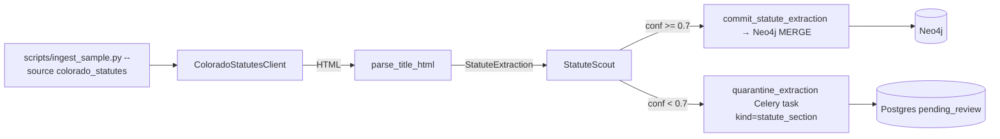

# Plan: Colorado Statute Ingestion (CRS Title 18, MVP slice)

> Companion to [spec.md](spec.md). Describes **how** we satisfy FR-1…FR-8.

## 1. Architecture Overview

The `StatuteScout` mirrors the existing `IngestionScout` (same `extract` / `run_and_commit` shape, same provenance hooks, same JSONL fallback for the quarantine path) so the CLI and any future orchestrator can treat the two scouts as siblings.

## 2. Component Changes

| Layer    | File / Module                                                                      | Change                                                                          |
| -------- | ---------------------------------------------------------------------------------- | ------------------------------------------------------------------------------- |
| Schema   | `backend/lawgraph/core/schemas/statute_extraction.py`                              | new — `StatuteSectionPayload` + `StatuteExtraction` Pydantic v2 models          |
| Schema   | `backend/lawgraph/core/schemas/__init__.py`                                        | re-export the two new models                                                    |
| Client   | `backend/lawgraph/ingestionapp/services/colorado_statutes.py`                      | new — `ColoradoStatutesClient` (httpx + tenacity) + `parse_title_html`          |
| Crew     | `backend/lawgraph/ingestionapp/services/statute_scout.py`                          | new — `StatuteScout.extract` + `run_and_commit`, mirrors `IngestionScout`       |
| Neo4j    | `backend/lawgraph/core/neo4j/statute_queries.py`                                   | new — Cypher constants + `commit_statute_extraction`                            |
| Tasks    | `backend/lawgraph/ingestionapp/tasks.py`                                           | extend `quarantine_extraction` to honor `payload["kind"]`                       |
| CLI      | `backend/scripts/ingest_sample.py`                                                 | extend `--source` choices + `--titles` + dispatch                               |
| Docs     | `docs/data-sources.md`                                                             | new CRS row + detail block                                                      |
| Tests    | `backend/tests/ingestion/fixtures/co/title_18_article_3.html`                      | new — checked-in fixture (Article 3, ~25 sections)                              |
| Tests    | `backend/tests/ingestion/test_colorado_statutes_parser.py`                         | new — parser unit tests against the fixture                                     |
| Tests    | `backend/tests/ingestion/test_statute_scout.py`                                    | new — scout extract / commit / quarantine + idempotency                         |
| Tests    | `backend/tests/ingestion/test_quarantine_task.py`                                  | extend / verify `kind` is persisted                                             |
| Tests    | `backend/tests/ingestion/test_ingest_cli_colorado.py`                              | new — CLI dry-run against fixture, asserts non-zero committed                   |

## 3. Data & Schema Migrations

None. All schema landed in spec 015. This spec only **writes** to existing labels.

## 4. Tech Choices & Alternatives

| Decision                   | Chosen                                          | Alternatives                                | Why                                                                                              |
| -------------------------- | ----------------------------------------------- | ------------------------------------------- | ------------------------------------------------------------------------------------------------ |
| Source for v1              | Justia HTML (`law.justia.com/codes/colorado/`)  | LexisNexis PDFs, leg.colorado.gov bill text | Cleanest HTML structure; underlying text is uncopyrightable government work. PDF support deferred. |
| Parser                     | `beautifulsoup4` + small regex pack             | `lxml` direct, full XPath, LLM-driven       | bs4 already in stack; deterministic, fast, easy to fixture-test.                                 |
| New Pydantic surface       | Separate `StatuteExtraction` (not extending `ExtractionResult`) | Reuse `ExtractionResult` with optional fields | Statute payloads are tree-shaped (statute + N sections); shoehorning into the case schema would force every consumer to handle two flavors. |
| Scout split                | New `StatuteScout` class in its own module       | Add `extract_statute` to `IngestionScout`   | Keep single-responsibility; mirror is easier to evolve and to test in isolation.                 |
| Commit Cypher              | New `statute_queries.py` module                  | Add to existing `queries.py`                | `queries.py` is opinion-centric; keeping statute Cypher separate matches the schema split.       |
| Quarantine `kind` plumbing | Extend the existing `quarantine_extraction` task | New `quarantine_statute_extraction` task    | Spec 015 already shipped the `kind` column for exactly this; one task = one writer (FR-6).       |
| HTTP mocking               | `respx` (already in dev deps)                   | `httpx-mock`, manual transport stub         | Project precedent — the CourtListener tests use respx.                                           |

No deviation from [docs/constitution.md](../../docs/constitution.md) — no ADR required for v1.

## 5. Provenance & Audit Hook-up

- `ColoradoStatutesClient._get` calls `provenance.log_graph_query(cypher=f"GET {url}", …)` (mirroring `CourtListenerClient`).
- `StatuteScout.extract` calls `provenance.log_agent_call(agent_name="StatuteScout", …, confidence=avg_section_conf)`.
- Each `Statute` and `StatuteSection` node carries `source="colorado_statutes"`, `source_url`, `confidence`, `ingest_timestamp`, `agent_version`.
- Quarantine path uses the existing `AuditEvent(kind="ingestion_quarantine", payload={"kind":"statute_section", …})`.

## 6. HITL Gates

- Per-section confidence threshold (`0.7`) routes low-confidence sections to `PendingReview` with `kind="statute_section"`. The statute / code / jurisdiction administrative metadata always commits when at least one of its sections commits — no separate HITL gate (they are not extracted content, only structural anchors).
- An operator can flip future sections to "needs review" by lowering the constant; no code change needed in spec 018.

## 7. Test Strategy

- **Unit (parser)**: `test_colorado_statutes_parser.py` — load fixture HTML, assert `StatuteExtraction.statute.id == "us-co/crs/title-18"`, ≥ 5 sections parsed, each carries citation `C.R.S. § 18-…`, no `<script>` content leaks into `text`.
- **Unit (client)**: covered by `test_statute_scout.py` via a `respx` mock that returns the fixture HTML for the Title 18 URL.
- **Unit (scout + commit)**: `test_statute_scout.py` — `extract` returns the expected payload; `run_and_commit` against an `AsyncMock` Neo4j session asserts (a) one MERGE per node + per edge, (b) the second invocation produces *the same* MERGE call signatures (NFR-IDEMPOTENT-1), (c) low-confidence sections trigger `quarantine_extraction.delay(payload)` with `payload["kind"] == "statute_section"`.
- **Unit (quarantine)**: `test_quarantine_task.py` is extended (or re-asserted) to verify `payload["kind"]` is persisted to `PendingReview.kind`; default remains `"case"` for legacy callers.
- **CLI**: `test_ingest_cli_colorado.py` — calls `main(["--source","colorado_statutes","--titles","18","--dry-run"])` with a respx mock; asserts exit 0 and a non-zero committed count.
- **LegalBench**: not run — opinion-centric corpus.
- **Coverage**: target ≥ 75% on the new files; relax via per-file pragmas only on the explicit failure-fallback branches (`_quarantine_jsonl` of the new scout).

## 8. Rollout

- No DB migrations. Operator runs `make ingest -- --source colorado_statutes --titles 18` once spec ships to populate a real Neo4j instance.
- Default CLI `--source courtlistener` keeps existing behavior; spec 013 integration tests untouched.
- No feature flag.
