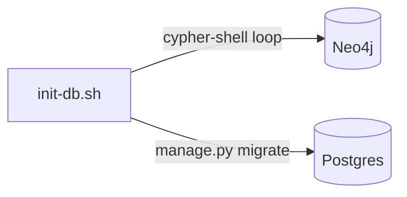

# Plan: Fix init-db.sh — Correct Migration Paths + Delegate Postgres DDL to Django

> Companion to [spec.md](spec.md). Describes **how** we satisfy FR-1…FR-5.

## 1. Architecture Overview

This is a pure operator-script fix. No new services or APIs are introduced.

On startup, `docker-compose.yml` runs `init-db.sh` inside the `backend` container (after a brief sleep to let Neo4j and Postgres healthchecks pass). After this fix the script will:
1. Discover `*.cypher` files under `backend/lawgraph/core/neo4j/migrations/` (correct path).
2. Apply them in lexicographic order via `cypher-shell`.
3. Call `python manage.py migrate --noinput` (replaces the dead `psql` loop).

## 2. Component Changes

| Layer | File | Change |
|-------|------|--------|
| Infra script | `backend/scripts/init-db.sh` | Fix `NEO4J_MIGRATIONS` path; remove Postgres `psql` loop; add `manage.py migrate` call |
| Tests | `tests/test_configs.py` or `tests/test_init_db.py` | Assert old paths absent; assert `manage.py migrate` present; assert `bash -n` valid |

## 3. Data & Schema Migrations

No new migrations. The script will now correctly apply the seven existing Cypher migration files (`001`–`007`).

## 4. Tech Choices & Alternatives

- **Alternative A**: Delete `init-db.sh` and move Neo4j migration application into a Django management command. Rejected: adds complexity; `init-db.sh` is the documented operator entry-point in `Makefile` and `docker-compose.yml`.
- **Chosen approach**: Minimal in-place fix — correct the path variable and replace the dead SQL loop with `manage.py migrate`.

| Decision | Chosen | Alternatives Considered | Why |
|----------|--------|-------------------------|-----|
| … | … | … | … |

If any choice deviates from [docs/constitution.md](../../docs/constitution.md) §2, write an ADR under `docs/adr/`.

## 5. Provenance & Audit Hook-up

How every new LLM call / tool call / DB write logs through `app.core.provenance`. Confirm node-creation paths set `source`, `confidence`, `ingest_timestamp`, `agent_version`.

## 6. HITL Gates

List every approval gate (spec, PR, deploy, ingestion). Map to the `human_approval_required` flag in agent outputs.

## 7. Test Strategy

- Unit tests: paths, mocks.
- Integration: which docker services required.
- LegalBench subset to run before/after.
- Frontend: Vitest + RTL files.

## 8. Rollout

- Local docker compose: works after `make dev`.
- Feature flag (if any) and default.
- Backfill / re-ingest needed? If yes, script path.

## 9. Risks & Mitigations

| Risk | Likelihood | Impact | Mitigation |
|------|------------|--------|------------|
| … | low/med/high | low/med/high | … |

## 10. Estimated Effort

Story points / agent-hours; flag any task that needs human pairing.
