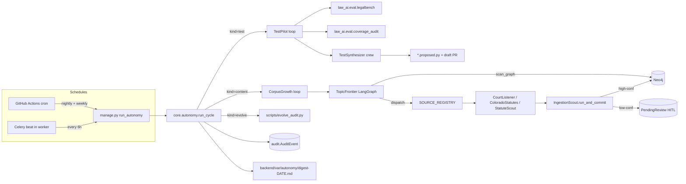

# Plan: Autonomous Testing & Recursive Content-Generation Framework

> Companion to [spec.md](spec.md). Strict AO-SDLC Level 2 retained — every loop ends in a draft PR (code) or a `PendingReview` row (data).

## 1. Architecture Overview

Two cooperating loops layered on the existing `/evolve` infrastructure, both invoked through a single `AutonomyOrchestrator`:

Reuses the same `peter-evans/create-pull-request` action and the `gh issue create` pattern already used by `.github/workflows/evolve.yml`.

## 2. Component Changes

| Layer | File / Module | Change |
|-------|---------------|--------|
| Eval | `backend/law_ai/eval/__init__.py`, `legalbench.py`, `loaders.py`, `scoring.py`, `report.py`, `coverage_audit.py` | new package — fills the empty directory referenced by `make test-legalbench` and [docs/legalbench.md](../../docs/legalbench.md) |
| Crew | `backend/law_ai/agents_runtime/crews/test_synthesizer.py` | new `TestSynthesizer` crew member |
| Prompt | `backend/law_ai/agents_runtime/prompts/test_synthesizer.v1.md` | versioned prompt |
| Graph | `backend/law_ai/agents_runtime/graphs/topic_frontier.py` | new LangGraph workflow |
| Ingestion | `backend/law_ai/ingestionapp/sources/__init__.py`, `base.py`, `courtlistener.py`, `colorado_statutes.py`, `statute_scout.py` | new `SOURCE_REGISTRY` package; existing `services/*` files become thin delegates |
| Orchestrator | `backend/law_ai/core/autonomy.py` | new `run_cycle` + `AutonomyRun` dataclass |
| Mgmt cmd | `backend/law_ai/core/management/commands/run_autonomy.py`, `list_sources.py` | new |
| Settings | `backend/law_ai/settings/base.py` | add `AUTONOMY_ENABLED`, `AUTONOMY_ALLOWED_SOURCES`, `AUTONOMY_DIGEST_DIR` |
| Celery | `backend/law_ai/celery.py` | beat schedule entries `autonomy-content-sweep` (kind=`corpus_growth`), `autonomy-nightly-tests` (kind=`test_pillar`), `autonomy-daily-digest` (kind=`digest`) |
| Provenance | `backend/law_ai/core/provenance.py` | add `log_autonomy_cycle` + `log_policy_violation` helpers |
| CI | `.github/workflows/nightly-tests.yml` | new (clone of `evolve.yml` with cron `0 6 * * *`) |
| Audit | `scripts/evolve_audit.py` | extend `_scan_coverage` to use new `coverage_audit.py`; add `_scan_legalbench` |
| Make | `Makefile` | new targets `autonomy-up`, `autonomy-status`, `autonomy-stop` |
| ADR | `docs/adr/0003-autonomy-orchestrator.md` | new — records loop topology + Level-2 reaffirmation |
| Constitution | `docs/constitution.md` | add §12 "Autonomy Loop Invariants" |
| Docs | `docs/local-ai.md`, `docs/agent-roles.md`, `docs/legalbench.md` | document `AUTONOMY_ENABLED` + new agents + baseline policy |
| Tests | `backend/tests/eval/`, `backend/tests/agents/test_test_synthesizer.py`, `backend/tests/agents/graphs/test_topic_frontier.py`, `backend/tests/core/test_autonomy.py`, `backend/tests/core/management/test_run_autonomy.py`, `backend/tests/core/management/test_list_sources.py` | new |
| Data | `backend/var/legalbench/LICENSES.md`, later `backend/var/legalbench/baseline.json` | new (LICENSES gates baseline commit) |

## 3. Data & Schema Migrations

No Neo4j or Postgres schema migrations. `AutonomyRun` is persisted as `audit.AuditEvent` rows with `event_type='autonomy_cycle'`. A future spec may promote it to its own Postgres table (recorded as a follow-up).

LegalBench dataset is pulled from the upstream HazyResearch repo (HuggingFace mirror) at first-run and cached under `backend/var/legalbench/cache/`. Per-task licenses recorded in `backend/var/legalbench/LICENSES.md` BEFORE `baseline.json` is committed.

## 4. Tech Choices & Alternatives

| Decision | Chosen | Alternatives Considered | Why |
|----------|--------|-------------------------|-----|
| Where the orchestrator runs | GitHub Actions cron for the nightly `test_pillar` run (`nightly-tests.yml`) and the weekly evolve audit (`evolve.yml`); local Celery beat for `autonomy-content-sweep` (`corpus_growth`) and `autonomy-daily-digest` (`digest`) | Self-hosted runner; pure-local cron | Matches existing `evolve.yml` pattern; CI runners can't keep Ollama state hot for content sweeps; user confirmed in scope question. |
| TestSynthesizer trust level | Propose-only — `*.proposed.py` + `@pytest.mark.skip("autonomy-proposed")` | Append into real test file; comment on existing PR | Safest: every proposal is opt-in, cannot break CI, easy to delete. User confirmed. |
| LegalBench baseline gating | Commit `LICENSES.md` first, then `baseline.json` | Commit baseline immediately | LegalBench is mixed-license per task; constitution §8 requires license note for new deps/data. User confirmed. |
| Source-registry shape | `dict[str, SourceAdapter]` with Pydantic `SourceAdapter` base | Plugin entry-points (`importlib.metadata`); class registration via decorator | Simplest possible; matches the small (currently 3) registered set; trivially testable. |
| Recursion strategy | Walk Neo4j for orphan citations / under-cited jurisdictions, dispatch known adapters | LLM-generated free-form queries | Constitution §5: no new data sources without HITL. Recursion expands within a closed registry. |
| Kill-switch | `AUTONOMY_ENABLED` settings flag, default `False` | Feature flag service; per-cycle env var | Simplest; reversible without redeploy; default-deny aligns with constitution §1 (privacy/safety first). |

No deviations from constitution §2 (tech stack). The new code uses Django + Celery + LangGraph + Pydantic + httpx + tenacity already in the lock-file. ADR `docs/adr/0003-autonomy-orchestrator.md` records the orchestrator design and the explicit Level-2 reaffirmation per constitution §10.

## 5. Provenance & Audit Hook-up

Every `run_cycle` invocation:

1. Creates an `audit.AuditEvent` with `event_type='autonomy_cycle.start'` carrying `{cycle_id, kind, started_by, settings_snapshot: {AUTONOMY_ENABLED, AUTONOMY_ALLOWED_SOURCES}}`.
2. Wraps every adapter `fetch` and every LLM call in `provenance.log_*` helpers (existing functions).
3. Records `event_type='autonomy_cycle.end'` with `{cycle_id, status, summary}` on successful completion.
4. On policy violation (unknown source, disabled flag, exceeded budget), emits `event_type='policy_violation'` with `{cycle_id, reason, attempted_source}` and exits non-zero.

Every Neo4j write still goes through `IngestionScout.run_and_commit`, which already enforces `source` / `confidence` / `ingest_timestamp` / `agent_version` per constitution §4. The orchestrator NEVER calls Neo4j writers directly — covered by an integration test (AC-4).

## 6. HITL Gates

| Gate | Where | Enforced by |
|------|-------|-------------|
| New external data source | `/specify` cycle | constitution §5; this spec adds zero new sources |
| Low-confidence ingestion | `IngestionScout._quarantine` → `PendingReview` | existing logic, untouched |
| Adapter with `requires_human_approval=True` | `Orchestrator.dispatch` forces all results to `PendingReview` regardless of confidence | new code, NFR-HITL-1 |
| Code change | Draft PR via `peter-evans/create-pull-request` | new `nightly-tests.yml` + existing `evolve.yml` |
| Auto-merge | **disabled** | NG1; no workflow has `merge` permission |
| Kill-switch | `AUTONOMY_ENABLED=false` | FR-16 |

## 7. Test Strategy

- **Unit (Docker, mocked):**
  - `tests/eval/test_legalbench_cli.py` — argparse contract, report shape.
  - `tests/eval/test_coverage_audit.py` — fixture `coverage.xml`.
  - `tests/agents/test_test_synthesizer.py` — mock Ollama, assert `ProposedTest` shape and skip-decorator.
  - `tests/agents/graphs/test_topic_frontier.py` — mocked Neo4j + adapter, assert dispatch always routes through `IngestionScout`.
  - `tests/core/test_autonomy.py` — `AUTONOMY_ENABLED=False` short-circuit, idempotency on `cycle_id`, policy-violation events.
  - `tests/core/management/test_run_autonomy.py` + `test_list_sources.py` — CLI exit codes.
- **Integration (`@pytest.mark.integration`):**
  - `tests/agents/graphs/test_topic_frontier_integration.py` — real Neo4j + `respx`-mocked adapter HTTP, assert AC-4 invariant (every new `:Case` carries `IngestionScout` `agent_version`).
  - `tests/eval/test_legalbench_integration.py` — runs harness against Ollama with `--limit 1` and asserts JSON report exists.
- **LegalBench:** `make test-legalbench` itself becomes the regression gate; first green run produces `baseline.json` (gated on `LICENSES.md`).
- **Frontend:** none in this MVP (dashboard is a follow-up).

## 8. Rollout

- Local docker compose: `make autonomy-up` starts Celery beat in the existing `worker` service. `make autonomy-stop` halts it. `make autonomy-status` prints the next scheduled run.
- Feature flag: `AUTONOMY_ENABLED` default `False`. Operators must explicitly set `True` in their `.env`. Production must additionally populate `AUTONOMY_ALLOWED_SOURCES`.
- Backfill: not applicable (no schema change).
- CI: `.github/workflows/nightly-tests.yml` runs the test/eval loop in CI; the existing `.github/workflows/evolve.yml` is left as-is.

## 9. Risks & Mitigations

| Risk | Likelihood | Impact | Mitigation |
|------|------------|--------|------------|
| LegalBench latency exceeds nightly budget | med | low | `--limit 20` default; full set monthly. |
| Adapter hammers external API | low | high | Per-adapter `rate_limit`; orchestrator `--budget` cap; `AUTONOMY_ALLOWED_SOURCES` default `[]`. |
| TestSynthesizer pollutes PR queue with noise | med | low | Propose-only `*.proposed.py` + `@pytest.mark.skip`. |
| Operator forgets `AUTONOMY_ENABLED=True` | low | low | `make autonomy-status` surfaces the flag; digest task no-op when disabled. |
| LegalBench dataset license drift | low | med | `LICENSES.md` manifest reviewed at every spec touching harness. |
| `cycle_id` collision (idempotency) | low | low | UUID4 default; orchestrator returns the prior `AutonomyRun` on duplicate. |

## 10. Estimated Effort

Roughly partitioned by phase (each phase = one or two commits):

- Phase 0 (spec + ADR + constitution §12): ~1h
- Phase A1 (LegalBench harness): ~3-4h (most work in `loaders.py` + caching)
- Phase A2 (coverage_audit + TestSynthesizer + nightly-tests workflow): ~3h
- Phase B1 (SOURCE_REGISTRY + adapter wrappers): ~2h
- Phase B2 (TopicFrontier LangGraph): ~3h
- Phase C (autonomy.py + run_autonomy + beat + digest): ~3h

Several phases are parallelizable (A1 ⫽ B1, then A2 ⫽ B2). No human pairing required beyond the standard PR review per constitution §10.
