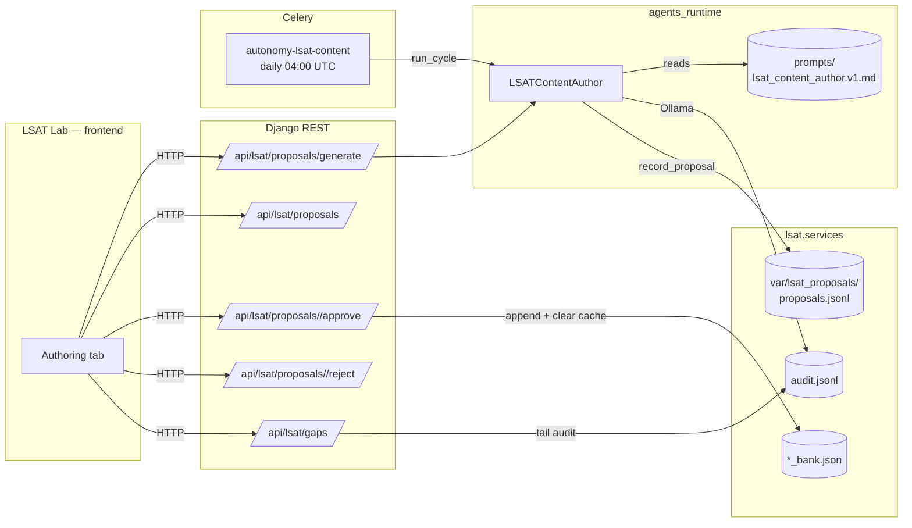

# Plan: LSATContentAuthor — Autonomous LSAT Content Generation & Refinement

> Implementation plan for [spec.md](spec.md). One section per architectural decision; one row per file touched in §2.

## 1. Architecture Overview

## 2. Component Changes

| File | Module | Change |
|------|--------|--------|
| `backend/lawgraph/agents_runtime/crews/lsat_content_author.py` | new | `LSATContentAuthor` crew + `GenerateQuestionsInput` / `GenerateQuestionsOutput` / `DraftQuestion` Pydantic models + Ollama integration + offline fallback. |
| `backend/lawgraph/agents_runtime/prompts/lsat_content_author.v1.md` | new | Versioned prompt template. |
| `backend/lawgraph/agents_runtime/registry.py` | edit | Register `LSATContentAuthor`. |
| `backend/lawgraph/lsat/services/proposals.py` | new | `record_proposal`, `list_proposals`, `set_status`, `gap_analysis`, `promote_to_bank` helpers. |
| `backend/lawgraph/lsat/urls.py` | edit | Add 5 new `APIView`s + url patterns under existing router. |
| `backend/lawgraph/core/tasks.py` | edit | Dispatch `kind="lsat_content"` to new `_run_lsat_content` sub-runner. |
| `backend/lawgraph/core/management/commands/run_autonomy.py` | edit | Add `--kind lsat_content` choice + `_run_lsat_content(context, *, budget)` sub-runner. |
| `backend/lawgraph/celery.py` | edit | New beat entry `autonomy-lsat-content` (daily 04:00 UTC, budget 5). |
| `backend/var/lsat_proposals/.gitkeep` | new | Reserve directory in git. |
| `backend/tests/agents/test_lsat_content_author.py` | new | Unit tests: schema validation, Ollama mocking, offline fallback, provenance call. |
| `backend/tests/lsat/test_proposals.py` | new | Unit tests: record/list/set_status round-trip, gap_analysis, promote_to_bank. |
| `backend/tests/lsat/test_proposals_api.py` | new | API tests: generate / list / approve / reject / gaps endpoints. |
| `frontend/lib/api.ts` | edit | Add typed `fetchLsatProposals`, `generateLsatProposals`, `approveLsatProposal`, `rejectLsatProposal`, `fetchLsatGaps`. |
| `frontend/components/LsatLab.tsx` | edit | Add `'authoring'` tab + `AuthoringPanel` component. |
| `BACKLOG.md` | edit | Append new `BL-20260527-NN` entries for follow-ups (rotation thresholds, ORM promotion, IRT calibration). |
| `specs/019-lsat-content-autogen/{spec,plan,tasks}.md` | new | This spec package. |

## 3. Data & Schema Decisions

- **No new tables.** The proposals JSONL store mirrors the `audit_jsonl` pattern already used by the autonomy framework — append-only, tail-based reads, simple file rotation as a follow-up.
- **Promotion writes** the parsed-and-re-serialised section bank file via a single `Path.write_text`. Atomicity is acceptable because every approval is a synchronous reviewer click — no concurrent writers.
- **Cache invalidation**: after promotion, call `load_bank.cache_clear()` so the next `GET /api/lsat/questions/<id>` picks up the new row without a restart.

## 4. Tech Choices & Alternatives

| Decision | Choice | Alternative considered | Why |
|----------|--------|------------------------|-----|
| Storage for proposals | JSONL append-only | New Postgres table | Matches `audit_jsonl` pattern; no migration burden; ORM promotion is a follow-up. |
| LLM client | Existing `tutor._ollama_generate` pattern (httpx + `format:"json"`) | LangChain | Already proven in `lsat/services/tutor.py`; avoids extra dep; constitution §1 prefers minimal layers. |
| Failure mode | Always return HTTP 200 with `degraded=true` proposal | Return HTTP 503 when Ollama down | Mirrors `tutor.py` UX — keeps the authoring loop predictable; the reviewer can still triage offline drafts. |
| Approval surface | Reuse existing LSAT Lab page (`/lsat`) with new tab | Standalone `/lsat/admin` page | Lower scope, lower navigation cost; reviewer is the same persona as the learner power-user today. |
| Beat cadence | Daily 04:00 UTC, budget 5 | Hourly with budget 1 | Same low-volume cadence as `autonomy-content-sweep`; keeps Ollama load predictable. |
| HITL gate | Class-level `requires_human_approval=True` + no auto-promote path | Confidence-threshold auto-promote | Explicit gate matches constitution §5; no automated path to the live bank. |

## 5. Risks & Mitigations

See [spec.md](spec.md) §12. All mitigations land in code below; none of them require a follow-up spec for this MVP.

## 6. Out of Scope (Explicit)

- IRT-based difficulty calibration → follow-up.
- ORM promotion of `LsatProposal` → follow-up.
- Auto-approval ladder (e.g. high-confidence drafts auto-promote when reviewer absent for N days) → follow-up.
- JSONL rotation threshold tuning → follow-up.
