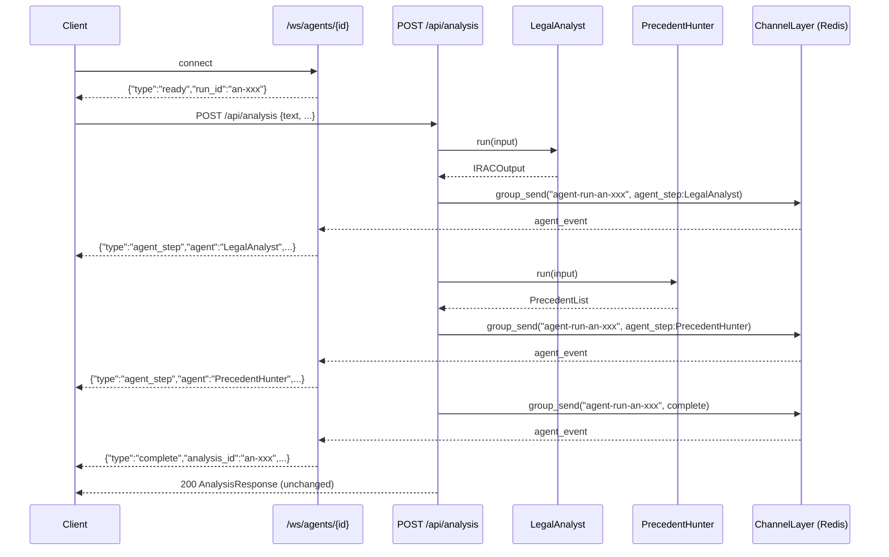

# Plan: Agent WebSocket Streaming — Live Progress from LegalAnalyst & PrecedentHunter

> Companion to `spec.md`. Describes **how** we will satisfy the requirements.

## 1. Architecture Overview

The analysis pipeline (`_run_analysis` in `lawgraph/analysis/urls.py`) already
calls `LegalAnalyst.run()` then `PrecedentHunter.run()` in sequence. After each
agent call completes we emit a fire-and-forget channel group message. Clients
that connected to `/ws/agents/{analysis_id}` before the POST arrives receive
these as JSON frames via `AgentRunConsumer.agent_event`.

## 2. Component Changes

### 2.1 `backend/lawgraph/analysis/urls.py`

`_run_analysis` is already `async def`. Add a helper `_emit_ws_event` that
wraps `channel_layer.group_send` and catches/logs any exception without
raising. Call it at two injection points:

1. After `await irac_coro` returns → emit `agent_step:LegalAnalyst`.
2. After `await prec_coro` returns → emit `agent_step:PrecedentHunter`.
3. After both complete → emit `complete`.

The channel layer instance is obtained via
`channels.layers.get_channel_layer()`. If it returns `None` (Redis not
configured), `_emit_ws_event` short-circuits without error.

### 2.2 `backend/tests/api/test_analysis.py`

Add `test_agent_ws_events_emitted` that:
- Patches `channels.layers.get_channel_layer` to return a `MagicMock` layer.
- Calls the analysis endpoint.
- Asserts `layer.group_send` was called 3× with the correct payloads.

## 3. Testing Strategy

| Layer | Test file | What it tests |
|-------|-----------|---------------|
| Unit (mocked channel layer) | `backend/tests/api/test_analysis.py` | FR-1, FR-2, FR-3, FR-4, FR-6, AC-1, AC-2 |
| Integration (consumer skeleton) | `backend/tests/agentsapi/test_consumer.py` | FR-7, AC-4 (unchanged; must stay green) |

No new integration test fixtures needed — channel layer mock is sufficient.

## 4. Deployment Notes

No new services, environment variables, or migrations. Requires Redis running
(`CHANNEL_LAYERS` already configured in `lawgraph/settings/base.py` to use
`channels_redis`). The `make dev` stack includes Redis.
