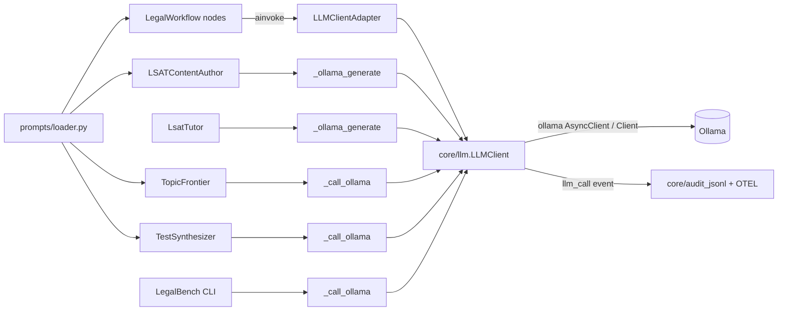

# Plan: Unified LLM Client & Prompt Registry

> Companion to `spec.md`. Describes **how** we will satisfy the requirements.

## 1. Architecture Overview

A single `core/llm` package becomes the only road to Ollama. Agents keep their existing shapes; only the transport underneath their module-level seams changes.

## 2. Component Changes

| Layer | File / Module | Change |
|-------|---------------|--------|
| Core | `backend/lawgraph/core/llm/{__init__,client,adapter}.py` | new package: `LLMClient`, error hierarchy, `LLMClientAdapter`, `get_llm_client` |
| Agent | `backend/lawgraph/agents_runtime/graphs/legal_workflow.py` | `_default_llm_factory` → adapter; inline prompts → loader |
| Agent | `backend/lawgraph/agents_runtime/crews/lsat_content_author.py` | `_ollama_generate` + `_load_prompt_template` delegate to client/loader; catch `LLMError` |
| Agent | `backend/lawgraph/agents_runtime/crews/test_synthesizer.py` | `_call_ollama` + `_load_prompt_template` delegate; drop urllib |
| Agent | `backend/lawgraph/agents_runtime/graphs/topic_frontier.py` | `_call_ollama` + `_load_prompt` delegate; drop urllib |
| Service | `backend/lawgraph/lsat/services/tutor.py` | `_ollama_generate` delegates; catch `LLMError` |
| Eval | `backend/lawgraph/eval/legalbench.py` | `_call_ollama` delegates via `generate_sync` |
| Prompts | `backend/lawgraph/agents_runtime/prompts/loader.py` (new), `prompts/legal_workflow/{retrieve,analyze}.md` (templated) | versioned registry; metadata in HTML comment, body is the literal template |
| Settings | `backend/lawgraph/settings/base.py` | add `OLLAMA_MAX_RETRIES`, `OLLAMA_EMBED_MODEL` |
| Docs | `docs/roadmap-framework-ai-integration.md` (new) | 6-phase roadmap this spec opens |

## 3. Data & Schema Migrations

None.

## 4. Tech Choices & Alternatives

| Decision | Chosen | Alternatives Considered | Why |
|----------|--------|-------------------------|-----|
| Transport | official `ollama` package | raw httpx; keep LangChain `ChatOllama` | already a base dep; httpx underneath (pooling); native `stream=True` + `embed()`; drops the LangChain surface from the hot path |
| Retry | small in-house exponential backoff | tenacity | trivial logic; avoids coupling core to a decorator API; tenacity stays where it's already used (CourtListener client) |
| Error contract | `LLMError` hierarchy, classified by `status_code` | leak transport exceptions | callers keep one fallback `except`; 4xx never retried |
| Prompt placeholders | `{{name}}` string replace | `str.format` / Jinja2 | JSON braces in prompt bodies need no escaping; zero new deps |
| Sync path | `ollama.Client` via `generate_sync` | `asyncio.run` wrapper | TopicFrontier's prioritize node calls synchronously from inside a running loop — `asyncio.run` would crash |

## 5. Provenance & Audit Hook-up

`LLMClient._record` writes an `llm_call` event per call (endpoint, model, caller, blake2b prompt/response hashes via `core.provenance._stable_hash`, latency, retries, ok/error, optional prompt id+version) through `core/audit_jsonl.record` — same dual-persistence path the rest of the platform uses. An OTEL span (`llm.generate` / `llm.chat` / `llm.embed`) wraps each call when opentelemetry is installed. The full rendered prompt is hashed, so loader-driven prompts are pinned even though `@logged_node` only carries static version strings.

## 6. HITL Gates

Unchanged. `LSATContentAuthor.human_approval_required = True` and TopicFrontier's quarantine routing are untouched; the spec is transport-only.

## 7. Test Strategy

- Unit: `backend/tests/core/test_llm_client.py` — fakes injected via `async_client_factory`/`sync_client_factory`; covers AC-1..AC-4 (success, retry, 4xx no-retry, exhaustion, stream, chat, embed, sync, adapter, singleton).
- Unit: `backend/tests/agents/test_prompt_loader.py` — AC-5 (version resolution, metadata strip, render parity with legacy inline strings).
- Regression: existing suites for LSATContentAuthor, tutor/proposals, TopicFrontier, TestSynthesizer, LegalBench CLI keep their patch seams; `test_topic_frontier.TestCallOllama` updated from urllib-patching to the new seam.
- Integration: none required (no schema/service changes).
- LegalBench: not run — transport-only (spec §11).

## 8. Rollout

- No flag: the client is a drop-in behind existing seams; offline fallbacks preserve degraded behavior.
- Local docker compose unaffected (`make dev`); no new services.
- No backfill.

## 9. Risks & Mitigations

| Risk | Likelihood | Impact | Mitigation |
|------|------------|--------|------------|
| ollama lib response-shape drift | low | med | `_extract` reads attr or mapping key |
| retry latency on outages | med | low | bounded (`OLLAMA_MAX_RETRIES=2`, ~1.5 s worst case); fallbacks unchanged |
| prompt render drift vs legacy strings | low | med | parity asserted in `test_prompt_loader.py` |

## 10. Estimated Effort

~1 agent-day. No human pairing required; CI gates (lint, mypy --strict on new code, pytest ≥75% coverage) verify.
