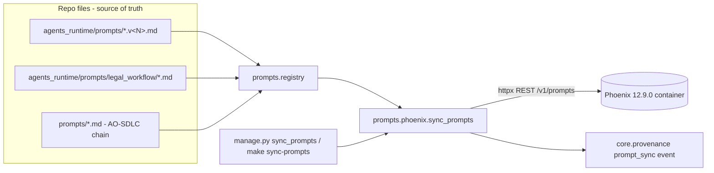

# Plan: Phoenix Prompt Registry & Sync

> Companion to `spec.md`. Describes **how** we will satisfy the requirements.

## 1. Architecture Overview

The prompt files stay exactly where they are; two new modules sit beside them. A registry enumerates the files; a sync client mirrors them into the Phoenix container that spec 010 already ships. Operators drive it through a management command wrapped by `make sync-prompts`.

Verified live against the running `arizephoenix/phoenix:12.9.0` container before implementation: `POST /v1/prompts` rejects `STR` templates ("Only CHAT template type is supported"), so each markdown file is published as a `CHAT` template holding a single `system` message with `template_format: NONE`; `POST /v1/prompt_versions/{id}/tags` returns 204; `GET /v1/prompts/{identifier}/tags/{tag}` round-trips the content string byte-identically.

## 2. Component Changes

| Layer | File / Module | Change |
|-------|---------------|--------|
| Agents runtime | `backend/law_ai/agents_runtime/prompts/__init__.py` | new — makes the prompt data dir a package, re-exports registry API |
| Agents runtime | `backend/law_ai/agents_runtime/prompts/registry.py` | new — `LocalPrompt` + `iter_local_prompts()` discovery (FR-1, FR-2) |
| Agents runtime | `backend/law_ai/agents_runtime/prompts/phoenix.py` | new — `sync_prompts()` idempotent REST sync (FR-3) |
| Management | `backend/law_ai/agents_runtime/management/commands/sync_prompts.py` | new command, `--dry-run` / `--base-url` (FR-4) |
| Config | `backend/law_ai/settings/base.py` | new `PHOENIX_BASE_URL` env + setting (FR-5) |
| Config | `.env.example` | document `PHOENIX_BASE_URL` |
| Tooling | `Makefile` | `sync-prompts` target + help line (FR-4) |
| Docs | `docs/architecture.md` | note the prompt-registry → Phoenix path |
| Tests | `backend/tests/agents/prompts/` | registry + sync + command tests (NFR-TEST-1) |

## 3. Data & Schema Migrations

None. No Neo4j or Postgres migrations; Phoenix stores prompt records in its own `phoenix:/data` volume.

## 4. Tech Choices & Alternatives

| Decision | Chosen | Alternatives Considered | Why |
|----------|--------|-------------------------|-----|
| Phoenix client | raw REST via `httpx` | `arize-phoenix-client` PyPI package | zero new deps (NFR-SEC-1); the schema was verified live against the deployed 12.9.0; the client package tracks newer Phoenix versions and would drift from the pinned container |
| Template shape | `CHAT` + single `system` message, `template_format: NONE` | `STR` string template; MUSTACHE/F_STRING | 12.9.0 rejects `STR` at runtime; our files contain literal braces/JSON examples, so any placeholder format would mis-parse — `NONE` keeps content verbatim |
| Idempotency | compare content via `GET .../tags/v<N>` (versioned) or `.../latest` (unversioned) before POST | store Phoenix version ids locally; hash-only tags | keeps Phoenix itself as the comparison source; no local state file to drift |
| Direction | one-way repo → Phoenix | two-way sync | files are the constitutional source of truth; Phoenix edits must not silently change runtime behavior |
| Sync trigger | explicit command | app-startup hook, CI job | offline/local-first deployments must not fail or slow boot when Phoenix is absent; CI job recorded as follow-up |
| Model metadata | provider derived from first entry of `LLM_PROVIDER_CHAIN`; Anthropic model name from `ANTHROPIC_MODEL` (fallback literal), Ollama from `OLLAMA_DEFAULT_MODEL` | hardcode one provider | Phoenix requires `model_provider`/`model_name`/`invocation_parameters` on every version; deriving from the chain keeps playground defaults truthful for both Claude-first and Ollama-pinned deployments |

## 5. Provenance & Audit Hook-up

`sync_prompts()` writes one `prompt_sync` event per non-dry run via `ProvenanceLogger.log_event`, carrying the target base URL and the per-prompt outcome list (name, tag, sha256 prefix, outcome). No LLM calls are made anywhere in this feature, so the `law_ai.core.llm` chain is not involved. No graph nodes are created (no `source`/`confidence` obligations).

## 6. Test Strategy

- `test_registry.py` — discovery: known runtime prompts present with correct versions (`lsat_content_author` v1+v2), `legal_workflow_*` mapping, `sdlc_*` family tolerant of a missing root dir, every name matches Phoenix's identifier regex, hashes stable.
- `test_phoenix_sync.py` — respx-mocked Phoenix: fresh sync creates + tags; unchanged re-sync skips (no POSTs); edited file creates exactly one version and re-points the tag; HTTP 5xx yields `error` outcome and `ok=False`; `dry_run` never POSTs.
- `test_sync_prompts_command.py` — command plumbing: missing base URL → `CommandError` (AC-4); `--dry-run` prints outcomes without writes; success path prints summary.
- Live check (manual, part of this cycle): run `make sync-prompts` against the running stack and verify via `GET /v1/prompts` + spot tag fetch (AC-1/AC-2/AC-3).

## 7. Rollout / Ops

Purely additive; no behavior change for any existing code path. Deployments without Phoenix simply never run the command (and get a clear error if they do). `.env.example` documents the new optional `PHOENIX_BASE_URL`.
