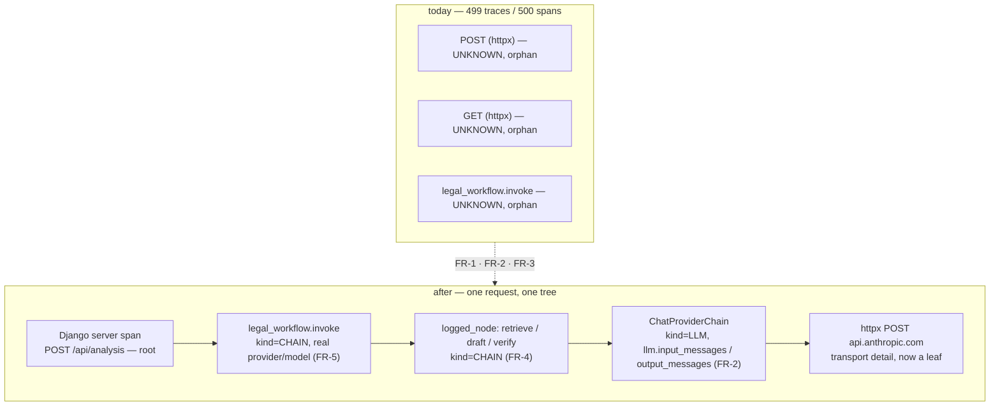

# Plan: OpenInference Tracing Fidelity (Phoenix)

> Companion to [spec.md](spec.md) (status: clarified — OQ-1…OQ-4 resolved 2026-08-12). Describes **how** we satisfy FR-1…FR-8 and NFR-*.

## 0. Pre-flight findings (run before writing this plan)

Two spec-mandated checks were executed against the real image, not assumed:

- **NFR-COMPAT-1 — resolved, not a blocking finding.** `pip install --dry-run --report -` for `openinference-instrumentation-langchain` inside the backend image resolves to **exactly one** new distribution, `openinference-instrumentation-langchain==0.1.70`, and upgrades nothing. Its `requires_dist` (`openinference-instrumentation>=0.1.51`, `openinference-semantic-conventions>=0.1.31`, `opentelemetry-api`, `opentelemetry-instrumentation`, `opentelemetry-semantic-conventions`, `wrapt`) is already satisfied by the installed set: `openinference-instrumentation 0.1.57`, `openinference-semantic-conventions 0.1.32`, `opentelemetry-{api,sdk} 1.34.1`, `opentelemetry-instrumentation-django 0.55b1`. The `<1.35.0` / `<0.56` pins hold unchanged. No pin bump is proposed, so §14's one-new-direct-dependency statement stands as written.
- **Every API the spec names exists in the installed versions.** Verified by introspection in the image: `phoenix.otel.register(*, endpoint, project_name, batch, set_global_tracer_provider, headers, protocol, verbose, auto_instrument, api_key, **kwargs)` (FR-1, and note `auto_instrument` defaults to `False`, which is what OQ-3 wants); `openinference.instrumentation.TraceConfig` carries `hide_inputs`, `hide_outputs`, `hide_input_messages`, `hide_output_messages`, `hide_input_text`, `hide_output_text` (FR-7); `openinference.semconv.resource.ResourceAttributes.PROJECT_NAME == "openinference.project.name"` (RC-3).

One live observation refines FR-6. `GET http://localhost:6006/v1/projects` on the running stack returns:

```json
{"data":[{"name":"playground","description":"Traces from prompt playground","id":"UHJvamVjdDoy"},
         {"name":"default","description":"Default project","id":"UHJvamVjdDox"}],"next_cursor":null}
```

This confirms RC-3 live (no `law_ai` project exists — spec 036's prompt work created `playground`, and everything the backend emits still lands in `default`) and fixes the shape the resolver parses: `data[].name` → `data[].id`.

## 1. Architecture Overview

Nothing moves; one module gains real behavior. `core/telemetry.py` stops hand-building a `TracerProvider` and instead delegates registration to `phoenix.otel.register`, then installs three named instrumentors. The spans that result nest naturally because Django's server span becomes the root of the request context that LangGraph, LangChain, and httpx all inherit.



The reason this is cheap: `ChatProviderChain` is a real `BaseChatModel` ([`core/llm/langchain.py:55`](../../backend/law_ai/core/llm/langchain.py#L55)) whose `_agenerate` returns an `AIMessage` with `response_metadata["model_label"]`. LangChain's callback manager already fires around it; `LangChainInstrumentor` subscribes to those callbacks. No provider code, no request construction, and no audit path changes — which is also why §13's "no LegalBench run required" assessment survives (see §7).

## 2. Component Changes

| Layer | File / Module | Change | Satisfies |
|-------|---------------|--------|-----------|
| Deps | `backend/pyproject.toml` | Add `openinference-instrumentation-langchain>=0.1.70` to the **`local-ai` extra** (not core `dependencies`) — it sits beside the other Phoenix/OTel packages that `core.telemetry` lazy-imports, so a build without the extra still boots (FR-8). | FR-2, NFR-COMPAT-1 |
| Config | `backend/law_ai/settings/base.py` | `PHOENIX_TRACE_CONTENT=(bool, False)` in the env block + `PHOENIX_TRACE_CONTENT: bool = env.bool(...)` export, beside the other `PHOENIX_*` settings. | FR-7 |
| Config | `backend/law_ai/settings/dev.py` | `PHOENIX_TRACE_CONTENT = True` with a comment naming OQ-2 — the file is three lines today, so the override is visible. | FR-7 |
| Config | `.env.example` | Document `PHOENIX_TRACE_CONTENT=false` (safe value) with the dev-override note. | FR-7 |
| Telemetry | `backend/law_ai/core/telemetry.py` | The substance of the spec. Rewrite `init_tracing()` (no `app` arg) around `phoenix.otel.register`; install `DjangoInstrumentor`, `LangChainInstrumentor`, `HTTPXClientInstrumentor` explicitly; build the `TraceConfig` from `PHOENIX_TRACE_CONTENT`; add `_resolve_project_id()` + rewrite `phoenix_trace_url`; delete the `FastAPI` `TYPE_CHECKING` import and the dead branch; refresh the module docstring (it still says "auto-instrument FastAPI + httpx" and references `app.core.*`). | FR-1, FR-2, FR-3, FR-6, FR-7, FR-8, NFR-SEC-1, NFR-PERF-1 |
| Boot | `backend/law_ai/core/apps.py` | `init_tracing(None)` → `init_tracing()` ([line 38](../../backend/law_ai/core/apps.py#L38)). The surrounding `try/except Exception` log-only guard stays — it is what makes FR-8's "missing package logs a warning" true at boot. | FR-3, FR-8 |
| Provenance | `backend/law_ai/core/provenance.py` | `logged_node` opens `tracer.start_as_current_span(f"node.{name}")` around the wrapped call, sets `openinference.span.kind=CHAIN` + `model`/`prompt_id`/`prompt_version`, and `record_exception` + `set_status(ERROR)` on raise. Unconditional (OQ-4). Both the sync and async wrapper get it — they are separate closures. `_record_node_event` is untouched and still runs in the same order (NG2). | FR-4, NFR-AUDIT-1 |
| Workflow | `backend/law_ai/agents_runtime/graphs/legal_workflow.py` | [line 452](../../backend/law_ai/agents_runtime/graphs/legal_workflow.py#L452): replace `settings.OLLAMA_DEFAULT_MODEL` with the label the chain actually served, and add `openinference.span.kind=CHAIN`. | FR-5 |
| Docs | `docs/local-ai.md`, `docs/architecture.md` | `PHOENIX_TRACE_CONTENT` row in the env table next to the `LLM_PROVIDER_CHAIN=ollama` pin; architecture row for the tracing path. | FR-7, constitution §9 |
| Tests | `backend/tests/core/test_telemetry.py`, `backend/tests/core/test_provenance_spans.py` (new) | See §7. | all AC-* |

### FR-5 in detail — where the served model comes from

`legal_workflow.invoke` sets `legal_workflow.model` *before* `graph.ainvoke` runs, so at that point nothing has been served yet. Two options, and the plan picks the second:

1. Read `settings.LLM_PROVIDER_CHAIN`'s head and report the *intended* provider. Cheap, but it lies whenever tier 1 fails over to tier 2 or 3 — which is precisely the failure the attribute would be most useful for.
2. **Set the attribute after `ainvoke` returns**, from the label the chain recorded. `ChatProviderChain._agenerate` already puts `model_label` (e.g. `claude_code/claude-opus-5`) into `response_metadata` ([`langchain.py:124`](../../backend/law_ai/core/llm/langchain.py#L124)); the workflow state must carry it out of the nodes so `invoke` can stamp it. Attributes may be set on an open span at any point before it closes, and the `with` block already spans `ainvoke`.

Option 2 is what "must report the provider and model that actually served the call, matching the `llm_call` provenance event" requires. If the state plumbing turns out to be more than a couple of lines, the fallback is to set the attribute inside the node that owns the model call rather than in `invoke` — same truthfulness, different span. What is **not** acceptable is keeping a hard-coded `OLLAMA_DEFAULT_MODEL` on a stack whose default tier is Claude.

### FR-6 in detail — resolver contract

```
phoenix_trace_url(trace_id):
    if not trace_id or not is_enabled():        -> None      # unchanged
    pid = _resolve_project_id()                 # lazy, cached, bounded
    if pid is None:                             -> None      # never raises
    return f"{PHOENIX_UI_URL}/projects/{pid}/spans/{trace_id}"
```

`_resolve_project_id()` reuses spec 036's `phoenix_base_url()` ([`agents_runtime/prompts/phoenix.py:63`](../../backend/law_ai/agents_runtime/prompts/phoenix.py#L63)) rather than re-deriving the REST base from the collector endpoint — one derivation, already tested. It `GET`s `{base}/v1/projects` with an explicit `httpx.Timeout(2.0)`, scans `data[]` for `name == PHOENIX_PROJECT_NAME`, caches the `id` on a module global for the process lifetime, and on any failure (timeout, connect error, non-200, name absent) logs at `debug`, records a monotonic cooldown timestamp, and returns `None`. A subsequent call inside the cooldown returns `None` immediately without touching the network — that is what keeps NFR-PERF-1 true when Phoenix is down (AC-7), and it is the part a naive lazy-cache gets wrong.

**Open verification item (not an open question):** the spec's §1 census observed the UI route as `/projects/<id>/spans/<trace_id>`. Because Phoenix is an SPA returning 200 for every path, no automated check can confirm the segment (`spans` vs `traces`) — AC-4 says as much. T-008 pins it by opening the real URL in a browser against the live stack; if the segment differs, the constant changes and nothing else does.

## 3. Data & Schema Migrations

**None.** No Neo4j migration, no Postgres migration, no vector collection. Trace data lives in the `phoenix:/data` volume, which is outside the application data model (spec §8). The `AuditEvent` table is written exactly as today.

## 4. Tech Choices & Alternatives

| Decision | Chosen | Alternatives considered | Why |
|----------|--------|-------------------------|-----|
| Provider registration | `phoenix.otel.register(...)` | Keep hand-built `TracerProvider` + set `openinference.project.name` on the `Resource` manually | The manual route works and is one line, but `register()` is the vendor-supported path, already a declared dependency, and additionally handles endpoint/protocol normalization. Coupling cost is one call site (R-3). |
| Instrumentor loading | Explicit, three named instrumentors | `register(auto_instrument=True)` | OQ-3. Entry-point discovery would let a future transitive dep start emitting spans nobody reviewed against NFR-SEC-1. |
| Content suppression | `TraceConfig(hide_inputs=…, hide_outputs=…)` passed to each instrumentor | `OPENINFERENCE_HIDE_INPUTS` env vars; a custom span processor that strips attributes | FR-7 names `TraceConfig`. Env vars would put the switch outside Django settings, splitting configuration across two systems. A custom processor is a bespoke scrubber the spec forbids. |
| `PHOENIX_TRACE_CONTENT` default | `False` in `base.py`, `True` in `dev.py` | Same value in both (repo convention) | OQ-2, decided by @bamr87. Deviation is deliberate and documented in spec §6; `dev.py` is the only settings module where retention has no deployed consequence. |
| Django instrumentation | `DjangoInstrumentor().instrument(tracer_provider=…)` | ASGI middleware; `opentelemetry-instrumentation-asgi` | `opentelemetry-instrumentation-django` is already a declared, unused dependency (§14) and produces the named-route server span Phoenix expects. |
| Project ID resolution | Lazy + cached + negative-cached | Eager at boot; local base64 derivation | OQ-1. |

No deviation from constitution §2 — OpenTelemetry/OpenInference are the existing observability layer and no framework is added. **No ADR required.**

## 5. Provenance & Audit Hook-up

This is the section the constitution cares most about, and the correct answer here is mostly *what does not change*:

- **No new LLM call, tool call, or retrieval is introduced.** This spec adds zero call sites to `law_ai.core.llm`; §4's choke-point rule is untouched. The `llm_call` event is still written by `core/llm/router.py` and nowhere else.
- **`logged_node`'s audit write stays unconditional and first-class.** The new span wraps the existing body; `_record_node_event` is neither moved into the span's success path nor made conditional on tracing. Concretely, the span must not swallow the exception path: if the node raises, the span records the exception and re-raises, and the existing behavior (no event on raise) is preserved exactly — AC-9 asserts the disabled-tracing case and a new test asserts the enabled case writes the identical event.
- **`_current_trace_id()` becomes more useful without changing.** It already reads `trace.get_current_span()` ([`provenance.py:265`](../../backend/law_ai/core/provenance.py#L265)); once FR-3 gives requests a root span, the `trace_id` on `langgraph_node` audit events becomes the *same* ID as the Phoenix trace, so an auditor can pivot from an audit row to a trace. That is a free win from FR-3, and it is the one place where tracing improves the audit surface rather than merely sitting beside it.
- **No node-creation path is touched**, so `source` / `confidence` / `ingest_timestamp` / `agent_version` invariants are unaffected.
- **NFR-SEC-1 is enforced by omission plus a test.** `HTTPXClientInstrumentor` is instrumented without request/response hooks, so it captures URL/method/status only — the current span census is the evidence (no header attribute appears anywhere in 500 spans). AC-8's test asserts no exported attribute value contains the configured credential.

## 6. HITL Gates

- **No new gate, and no gate removed.** `human_approval_required: false` (spec NFR-HITL-1). This adds no ingestion source (§5's ingestion gate is untouched), no schema migration, and no new agent output path; `ENABLE_HUMAN_APPROVAL_GATES` behavior is byte-identical before and after.
- The one human decision in this cycle — OQ-2's retention default — was taken by @bamr87 during `/clarify` and is recorded in spec §6, which is the review record for it.
- Standard AO-SDLC gates still apply: spec review, PR review, and the §11 follow-up loop.

## 7. Test Strategy

All tests are unit tests under `backend/tests/core/`, run via `make test-backend`. The technique that makes AC-1/AC-6/AC-8 testable without a Phoenix container is an **`InMemorySpanExporter`** (`opentelemetry.sdk.trace.export.in_memory_span_exporter`) attached to a locally-built provider — assert on exported span attributes, exactly as NFR-PRIVACY-1 demands ("verified by a test asserting on the exported span attributes, not by inspection").

| Test | Asserts | Covers |
|---|---|---|
| `test_telemetry.py::test_phoenix_trace_url_enabled_builds_link` (**rewritten, not deleted** — R-1) | With a stubbed resolver returning `UHJvamVjdDox`, the URL is `{UI}/projects/UHJvamVjdDox/spans/abc123`. The old assertion encoded RC-4; the new one is a regression guard on FR-6. | FR-6, AC-4 |
| `test_telemetry.py::test_project_id_resolution_caches` | Two `phoenix_trace_url` calls issue **one** HTTP request (respx). | FR-6, NFR-PERF-1 |
| `test_telemetry.py::test_project_id_resolution_failure_returns_none_and_backs_off` | Phoenix returning 500 / timing out ⇒ `None`, no raise, and a second call inside the cooldown issues no request. | FR-6, AC-7 |
| `test_telemetry.py::test_project_absent_returns_none` | `data[]` without `law_ai` ⇒ `None` (today's live state). | FR-6 |
| `test_telemetry.py::test_disabled_by_default` (kept) + `test_init_tracing_sets_no_provider_when_disabled` | Endpoint unset ⇒ `init_tracing()` is `False`, `trace.get_tracer_provider()` is still the default no-op provider (asserted by type, not by `is`), `phoenix_trace_url` is `None`. | FR-8, AC-5 |
| `test_telemetry.py::test_init_tracing_handles_missing_optional_deps` (kept, extended to the new imports) | Missing package ⇒ warning + `False`, never raise. | FR-8 |
| `test_provenance_spans.py::test_logged_node_emits_chain_span` | Under an in-memory provider, a decorated node exports one span named for the node with `openinference.span.kind == "CHAIN"` and the `model`/`prompt_id`/`prompt_version` attributes. Async and sync wrappers both. | FR-4 |
| `test_provenance_spans.py::test_logged_node_records_exception_and_reraises` | Node raises ⇒ span has the exception event and ERROR status, exception propagates, no audit event written (unchanged behavior). | FR-4 |
| `test_provenance_spans.py::test_audit_event_identical_with_and_without_tracing` | The `langgraph_node` payload (minus `trace_id`) is byte-identical tracing-on vs tracing-off. | AC-9, NFR-AUDIT-1 |
| `test_telemetry.py::test_trace_config_hides_content_when_disabled` | `PHOENIX_TRACE_CONTENT=False` ⇒ the built `TraceConfig` has `hide_inputs`/`hide_outputs` set; `True` ⇒ not set. Plus an end-to-end assertion over exported LLM-span attributes that no prompt text appears while `llm.model_name` and structure survive. | FR-7, AC-6, NFR-PRIVACY-1 |
| `test_telemetry.py::test_no_credential_in_span_attributes` | With a credential set in settings, no exported attribute value contains it. | AC-8, NFR-SEC-1 |
| `test_telemetry.py::test_no_fastapi_references` | `grep`-equivalent over `core/` source: no `FastAPIInstrumentor`, no `from fastapi`. Cheap and keeps AC-10 from rotting. | AC-10, FR-3 |
| Dependency check (T-001 verify step, not a test) | `pip install --dry-run` resolves without upgrading any `opentelemetry-*`. | NFR-COMPAT-1 |
| Live verification (T-008, manual, transcript in PR) | AC-1, AC-2, AC-3 against `make dev`: `GET /v1/projects` shows `law_ai`; the analysis request's spans share one `trace_id` with exactly one `parent_id == null`; an LLM span carries non-empty `llm.input_messages`. AC-4 by opening the returned URL. | AC-1, AC-2, AC-3, AC-4 |

**Integration services required:** none for the unit suite. The live verification needs the full `make dev` stack (backend, phoenix, postgres, neo4j, redis) plus a working `LLM_PROVIDER_CHAIN` head.

**Frontend:** no Vitest changes — NG5, `AnalysisStudio.tsx` renders the field verbatim.

**LegalBench:** no run required. Spec §13 conditions that on `/plan` finding no change to request construction; §1 and §2 above confirm the instrumentation subscribes to LangChain callbacks and touches neither `ChatProviderChain._agenerate`'s request assembly nor any decoding parameter. Expected delta 0 pp; harness stays Ollama-pinned. No `legalbench` marker is added.

**NFR-PERF-1** is a design constraint discharged by construction (`batch=True` ⇒ `BatchSpanProcessor`; the only synchronous Phoenix call is FR-6's bounded, cached, negative-cached lookup), not by a p95 benchmark in this cycle. A latency benchmark is recorded as a follow-up rather than claimed as measured.

## 8. Rollout

- **Local:** works after `make dev` — the compose `backend` service already sets `PHOENIX_COLLECTOR_ENDPOINT`, and `dev.py` turns content capture on, so a developer gets full traces with no extra configuration. Requires a rebuilt backend image for the new dependency (`docker compose build backend`), which is the normal `make dev` path.
- **Feature flag:** `PHOENIX_COLLECTOR_ENDPOINT` (existing, unset ⇒ entirely off) and `PHOENIX_TRACE_CONTENT` (new, off in `base.py`). No flag is added to the request path.
- **Backfill / re-ingest:** none. Existing spans in the `default` project stay there and are not migrated; the `law_ai` project starts empty and fills from the first traced request. Operators who want the old orphan spans gone can drop the `phoenix` volume — optional, and not part of this change.
- **Rollback:** blank `PHOENIX_COLLECTOR_ENDPOINT`. Reverting the commit is also safe — nothing persists state that survives it.

## 9. Risks & Mitigations

| Risk | Likelihood | Impact | Mitigation |
|------|------------|--------|------------|
| `LangChainInstrumentor` does not recognize `ChatProviderChain` (custom `BaseChatModel`, not a vendor integration) and emits `CHAIN` spans without `llm.*` content | med | high — AC-1 fails and the spec's central promise with it | This is the plan's single load-bearing assumption. T-004 verifies it in isolation, **before** the rest of the work builds on it: instrument, invoke `ChatProviderChain` once under an in-memory exporter, assert a span with `kind == LLM` and non-empty `llm.input_messages`. If it fails, the fallback is emitting the OpenInference LLM span directly from `core/llm/router.py` — which the spec already lists as a §15 follow-up, and which would then be promoted into this cycle rather than deferred. Ordering T-004 early is deliberate so this is discovered on day one. |
| Phoenix UI route segment is `traces`, not `spans` | low | low | T-008 opens the real URL; one constant changes if wrong. AC-4 already forbids satisfying this with a status-code check. |
| `DjangoInstrumentor` under daphne/ASGI produces no server span (it is primarily WSGI-oriented) | low-med | high — AC-2 fails | T-005 asserts the root span exists for a real request through the Django test client. If ASGI is the gap, `opentelemetry-instrumentation-asgi` on the Channels application is the fallback; note this changes §14's dependency table and must be recorded, not slipped in. |
| Content capture accidentally on in a deployed environment | low | high (privacy, R-5) | `base.py` default is `False`; AC-6 tests the *unconfigured* posture specifically so a regression in the default is a test failure, not a code review miss. |
| FR-5's model label needs state plumbing through the graph | med | low | Documented fallback in §2 (stamp the attribute in the node that owns the call). Either way the hard-coded Ollama constant goes. |
| `register()` sets the global tracer provider and fights the test suite's own providers | med | low | `init_tracing` stays idempotent via `_INITIALIZED`; tests build local providers and never call `init_tracing` with an endpoint set, matching the existing test style. |

## 10. Estimated Effort

~2–3 agent-hours across 9 tasks; no human pairing required beyond the OQ-2 decision already taken. T-004 (the LangChain-instrumentor spike) gates the rest and should be run first — if it fails, re-plan before continuing rather than pressing on.
