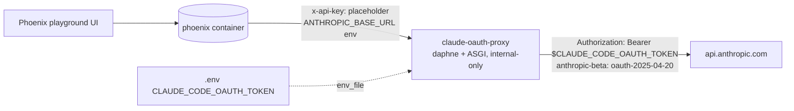

# Plan: Phoenix Playground on the Claude OAuth Tier

> Companion to `spec.md`. Describes **how** the requirements are satisfied.

## 1. Architecture Overview

A stateless header-translating sidecar sits between Phoenix and the Anthropic API. Phoenix believes it is talking to Anthropic with an ordinary API key; the proxy swaps the credential shape in flight.

Decisive facts established empirically before building (2026-08-11, live stack):

- Phoenix 12.9.0's GraphQL `GenerativeModelInput` supports `baseUrl`/`customHeaders`, but its server-side Anthropic client **also honors the SDK-level `ANTHROPIC_BASE_URL` env var** — so container-level routing needs no UI configuration at all. Both routing modes were exercised live via the `chatCompletion` mutation.
- The forwarded requests were answered by the real API with org-attributed `rate_limit_error` + `request_id` (the subscription's usage window was exhausted at verification time by this very dev session). That is positive proof of successful authentication — an invalid credential yields 401 `authentication_error` before any rate limiting.
- The OAuth pair (`Bearer` + `oauth-2025-04-20`) mirrors `law_ai/core/claude_code.py:_build_headers` exactly.

## 2. Component Changes

| Layer | File / Module | Change |
|-------|---------------|--------|
| Sidecar | `backend/scripts/claude_oauth_proxy.py` | new — pure-ASGI streaming passthrough (FR-1, FR-2, FR-4) |
| Infra | `docker-compose.yml` | new `claude-oauth-proxy` service (backend image, `env_file: .env`, `expose: 8080`, healthcheck); `phoenix` gains `ANTHROPIC_BASE_URL` + placeholder `ANTHROPIC_API_KEY` + `depends_on` (FR-3, FR-4) |
| Docs | `docs/architecture.md`, `.env.example` | describe the playground credential path |
| Tests | `backend/tests/scripts/test_claude_oauth_proxy.py` | new — 8 tests over ASGITransport + respx (NFR-TEST-1) |

## 3. Data & Schema Migrations

None.

## 4. Tech Choices & Alternatives

| Decision | Chosen | Alternatives Considered | Why |
|----------|--------|-------------------------|-----|
| Bridge mechanism | sidecar proxy | (a) hand the OAuth token to Phoenix as `ANTHROPIC_API_KEY`; (b) per-model `customHeaders` in the playground UI | (a) is a guaranteed 401 — wrong header pair; (b) works per-config but puts the raw token into Phoenix's UI/DB and every user's model config, and must be repeated per model — violates G1/G2 |
| Server | `daphne` serving a hand-rolled ASGI app | FastAPI/Starlette; nginx header rewrite | fastapi is not installed (kept out deliberately); nginx would need a new image + envsubst templating and cannot merge `anthropic-beta` values; daphne + httpx are existing deps (NFR-SEC-2) |
| Phoenix routing | container env `ANTHROPIC_BASE_URL` | per-model `baseUrl` in playground configs | env routing is zero-config for every user and survives prompt/model-config churn; per-model `baseUrl` remains available as an escape hatch |
| Placeholder key | `ANTHROPIC_API_KEY=oauth-via-claude-oauth-proxy` on phoenix | leave unset | Phoenix marks Anthropic "configured" only when the env var exists; the value is inert (stripped by the proxy) and self-documenting in `docker inspect` |
| Beta-header handling | merge caller flags after `oauth-2025-04-20` | overwrite | Phoenix/SDK may legitimately request beta features; clobbering them would silently change model behavior |

## 5. Provenance & Audit Hook-up

Deliberate, recorded exception: playground calls bypass `law_ai.core.llm` and write no `llm_call` provenance events (the playground is observability tooling, not a product feature path — the "never call a provider transport directly" rule targets feature modules). Request lines (method, path, status — never the token or bodies) go to the proxy's stdout. Closing the gap properly is BL-20260811-33.

## 6. Test Strategy

- Unit (shipped): header swap, beta merge, status/`retry-after`/SSE relay, 502/503 degradation — respx-mocked upstream, full ASGI path.
- Live (performed): compose up → both services healthy; `chatCompletion` mutation through Phoenix → proxy log shows the forward → API answers with authenticated org-level responses. A content-bearing 200 could not be captured at verification time because the subscription usage window was exhausted (429) — the auth handshake itself is what this spec had to prove, and unit tests pin the relay behavior. Compose-wiring lock-in test is BL-20260811-35.

## 7. Rollout / Ops

Fresh clones without `.env` still boot: the proxy starts, reports 503/unhealthy, and Phoenix simply has a non-functional Anthropic provider until a token is added. `docker compose logs claude-oauth-proxy` is the debugging surface. Rotating the token = edit `.env`, `docker compose restart claude-oauth-proxy`.
