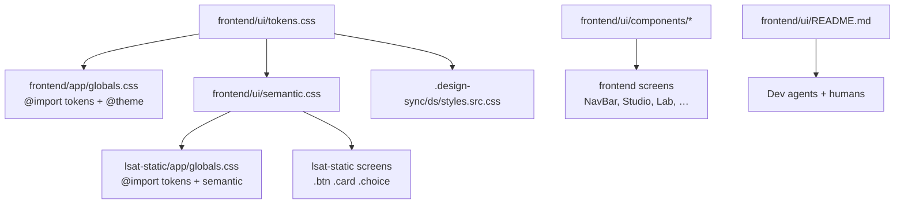

# Plan: First-party design system

> Companion to `spec.md`. Describes **how** we will satisfy the requirements.

## 1. Architecture Overview

Keep both Next apps. Introduce a **shared CSS + primitive layer** owned by the platform app so AGENTS.md's layout stays canonical. The static LSAT app imports CSS only.



`.design-sync/` remains a preview converter. It must import the same tokens/semantic files; it must not define colors.

## 2. Component Changes

| Layer | File / Module | Change |
|-------|---------------|--------|
| Tokens | `frontend/ui/tokens.css` (new) | Palette + type + space + max-width custom properties |
| Semantic CSS | `frontend/ui/semantic.css` (new) | Lift `.btn`, `.card`, `.choice`, `.pill`, `.empty`, `.wrap`, focus ring, sr-only from `lsat-static/app/globals.css` |
| Catalog | `frontend/ui/README.md` (new) | Primitive table + accent roles + "do not import shadcn" |
| Platform CSS | `frontend/app/globals.css` | `@import` tokens; `@theme` maps; keep `@import "tailwindcss"` |
| Static CSS | `lsat-static/app/globals.css` | `@import` tokens + semantic; keep page-specific layout (drill-grid, passage, stats) that is not a primitive |
| Primitives | `frontend/ui/components/*.tsx` (new) | Button, Card, Input, Badge, Pill, Empty, Choice, disclaimer pair |
| Proof migration | `frontend/components/NavBar.tsx`, `LegalDisclaimer.tsx`, `lsat-static/components/QuestionCard.tsx` | Compose primitives; no raw hex |
| Re-exports | `frontend/components/LegalDisclaimer.tsx` | Re-export from `frontend/ui` so existing imports keep working |
| Docs | `docs/ui-ux.md`, `docs/constitution.md` §2/§9, `AGENTS.md`, `README.md`, `docs/adr/README.md` | FR-7 |
| Design-sync | `.design-sync/ds/styles.src.css`, `.design-sync/NOTES.md`, `.design-sync/conventions.md` | Consume `frontend/ui/` |
| Tests | `frontend/__tests__/ui/*.test.tsx`, `tests/test_docs.py` | FR-9, NFR-DOCS-1 |
| ADR | `docs/adr/0006-first-party-design-system.md` | Status `proposed` → `accepted` in the implementing PR after human review |

Page-specific LSAT CSS (`.drill-grid`, `.passage`, `.stat-hero`, `.qcard-*` layout) stays in `lsat-static/app/globals.css` until a later extraction. Semantic **atoms** move; **templates** can wait.

### Token names (locked)

| CSS variable | Tailwind `@theme` | Role |
|--------------|-------------------|------|
| `--bg` | `--color-canvas` | Page |
| `--bg-elev` | `--color-surface` | Card |
| `--bg-elev-2` | `--color-surface-2` | Hover |
| `--border` | `--color-line` | Border |
| `--text` | `--color-fg` | Body |
| `--text-muted` | `--color-fg-muted` | Secondary |
| `--accent-brand` | `--color-accent-brand` | Platform blue `#3b82f6` |
| `--accent-practice` | `--color-accent-practice` | LSAT amber `#fbbf24` |
| `--ok` / `--warn` / `--no` | `--color-ok` / `--color-warn` / `--color-no` | Status |
| `--radius` | `--radius-card` | 12px |
| `--page-max` | — | 80rem (`max-w-7xl`) |
| `--prose-max` | — | 60rem (960px wrap) |

`--accent` in current lsat-static CSS aliases `--accent-practice` so existing `var(--accent)` rules do not break.

### lsat-static import strategy (R-2)

Next 16 can `@import` a relative path outside the app directory if the file is on the compiler's CSS pipeline. Prefer:

```css
@import "../../frontend/ui/tokens.css";
@import "../../frontend/ui/semantic.css";
```

If the static export build rejects that, T-002 falls back to a `make lsat-export` copy step into `lsat-static/app/vendor-ui/` (generated, gitignored, documented). AC-2 decides. Do not duplicate token *values* by hand.

## 3. Data & Schema Migrations

None.

## 4. Tech Choices & Alternatives

| Decision | Chosen | Alternatives Considered | Why |
|----------|--------|-------------------------|-----|
| Kit | First-party `frontend/ui/` | shadcn/ui, keep lying, `packages/ui` | ADR 0006 |
| Token format | CSS custom properties | JS theme object, Tailwind-only `@theme` | Static app has no Tailwind |
| Catalog | README + Vitest | Storybook | Storybook is a new framework (§2) |
| Proof migration | NavBar, disclaimer, QuestionCard | Big-bang all screens | God components are follow-ups |
| Dual accent | Named brand + practice | Force one hue | Both products already shipped those hues |

Deviates from constitution §2 as written — **requires ADR 0006**.

## 5. Provenance & Audit Hook-up

No new LLM, tool, or graph writes. UPL primitives are UX, not `AuditEvent`s. Constitution §4 is N/A.

## 6. HITL Gates

- Spec + PR (Level 2).
- ADR 0006 acceptance by a human maintainer before constitution §2 is edited (constitution last line).
- No runtime `human_approval_required`.

## 7. Test Strategy

- Unit: `frontend/__tests__/ui/Button.test.tsx`, `Choice.test.tsx`,
`LegalDisclaimer.test.tsx`, plus a `tokens.test.ts` that reads `tokens.css` and asserts required variable names exist.
- Structural: extend `tests/test_docs.py` `REQUIRED_DOCS` with
`docs/ui-ux.md`. Optional grep test under `tests/` for raw hex in the proof files (AC-4).
- Integration: none (no DBs). `lsat-static` build is the AC-2 check —
`docker compose run` / Makefile target if one exists for the static app; otherwise document `npm run build` inside the frontend/lsat containers per Docker-first rule.
- LegalBench: skip.
- Visual: do not add Playwright screenshots in 039 (harness gap is [BL-20260811-16](../../BACKLOG.md)). Proof is RTL + CSS contract.

## 8. Rollout

- No feature flag. Tokens land first (additive `@theme`), then semantic CSS, then primitives, then proof migration, then docs/ADR.
- Unmigrated screens keep working because Tailwind ramps stay compiled.
- `.design-sync` stylesheet regenerate is operator-run (existing NOTES) after tokens land; not a Docker gate.
- No backfill.

## 9. Risks & Mitigations

| Risk | Likelihood | Impact | Mitigation |
|------|------------|--------|------------|
| lsat-static cannot import across app dirs | med | med | Copy fallback in T-002 |
| `@theme` names unused, screens keep `bg-slate-950` forever | med | low | Proof migration + follow-up BLs for god components |
| ADR rejected | low | high | Tokens still ship; §2 edit is last task |
| Focus rings clash with unmigrated pages | low | low | Proof set is chrome + one control |
| design-sync 915 KB CSS stays stale | high | low | FR-8 retargets source; compiled file is operator-regen |

## 10. Estimated Effort

~8–12 agent-hours. T-007 (ADR/constitution) needs human pairing. T-005 (QuestionCard) needs careful a11y parity. No backend pairing.
