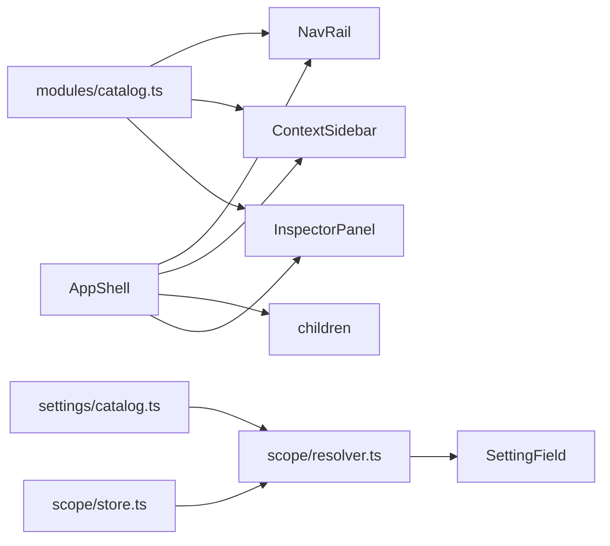

# Plan: App shell + scoped settings

> Companion to `spec.md`.

## 1. Architecture Overview

Engine (`frontend/lib/scope`, `frontend/lib/settings`) has zero React imports. Shell (`frontend/components/shell`) has zero product-screen imports.

## 2. Component Changes

| Layer | File | Change |
|-------|------|--------|
| Engine | `frontend/lib/scope/{types,resolver,store,instance}.ts` | new |
| Settings | `frontend/lib/settings/{define,catalog}.ts` | new |
| Modules | `frontend/lib/modules/{define,catalog}.ts` | new |
| Shell | `frontend/components/shell/*.tsx` | new |
| Routes | `frontend/app/(app)/{layout,@sidebar,@inspector,settings}` | new; move existing pages under `(app)` |
| Chrome | `frontend/app/layout.tsx`, `NavBar.tsx` | root drops NavBar; NavBar reads module catalog |
| Tests | `frontend/__tests__/lib/resolver.test.ts`, `__tests__/shell/*.test.tsx` | new |
| Docs | `docs/ui-ux.md`, `docs/architecture.md` | shell section |

## 3. Data & Schema Migrations

None.

## 4. Tech Choices & Alternatives

| Decision | Chosen | Alternatives | Why |
|----------|--------|--------------|-----|
| Settings DB | localStorage + memory | Django table now | 036 users not shipped; engine stays React-free either way |
| Hierarchy | Fixed-depth types, instance seeded | Arbitrary ltree in Postgres | 036 NG3; types keep the door open |
| Primitives | First-party Tailwind | shadcn/Radix | ADR 0006 / constitution |
| Validation | `parse` on each definition | Zod | NFR-PERF-1 no new deps |
| Panel state | `searchParams` | React state | Deep-linkable (architecture §4.2) |

## 5. Provenance & Audit Hook-up

N/A for LLM. SettingField provenance is UX (`Effective.source`).

## 6. HITL Gates

PR only.

## 7. Test Strategy

- Unit: resolver truth table (AC-1).
- RTL: SettingField override/reset; NavRail aria-current; AppShell searchParams.
- No integration DB.
- LegalBench: skip.

## 8. Rollout

No flag. URLs unchanged.

## 9. Risks & Mitigations

See spec §13.

## 10. Estimated Effort

6–10 agent-hours. No backend pairing.
