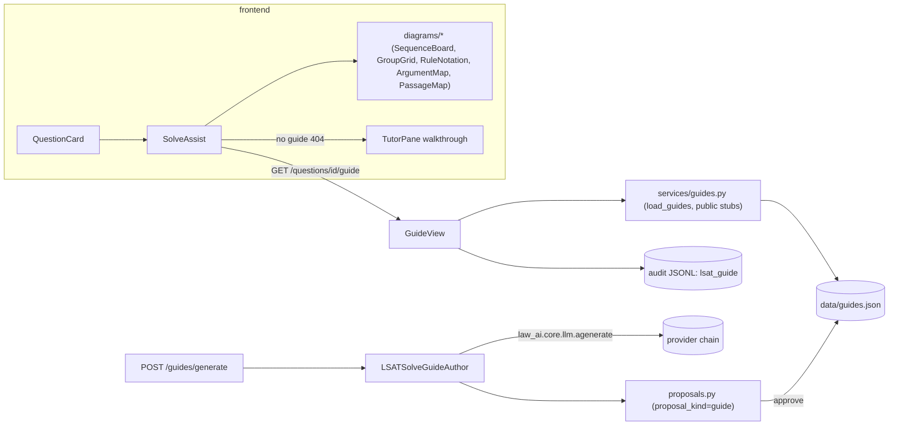

# Plan: Interactive LSAT solving aids — progressive hints + incremental diagrams

> Companion to `spec.md`. Describes **how** we will satisfy the requirements.

## 1. Architecture Overview

Everything follows the established LSAT-app pattern: file-backed Pydantic stores with `@lru_cache` loaders (`bank.py`), DRF `APIView`s inline in `urls.py` behind `RequireLsat`, JSONL audit events via `law_ai.core.audit_jsonl`, LLM drafting HITL-gated through the JSONL proposals store, and a typed `frontend/lib/api.ts` client feeding first-party components. No databases, no new deps.

FR → module map (every FR/NFR named):

| Req | Satisfied by |
|---|---|
| FR-1, FR-2 | `backend/law_ai/lsat/services/guides.py` — `SolveGuide`, `SolveStep`, `SequenceRep`, `GridRep`, `NotationRep`, `ArgumentMapRep`, `PassageMapRep` (discriminated union on `rep_type`) |
| FR-3 | `backend/law_ai/lsat/services/data/guides.json` + `load_guides()` / `reset_guide_cache()` in `guides.py`; cross-validation against `load_bank()` |
| FR-4, FR-5 | `GuideView` in `backend/law_ai/lsat/urls.py` (`questions/<id>/guide`); `GradeRequest.hints_used` + `StatsView` assisted buckets in the same file |
| FR-6 | `frontend/components/lsat/SolveAssist.tsx` (new file, mounted from `QuestionCard` in `LsatLab.tsx`) |
| FR-7 | `frontend/components/lsat/diagrams/{SequenceBoard,GroupGrid,RuleNotation,ArgumentMap,PassageMap}.tsx` + a `Representation.tsx` dispatcher |
| FR-8 | `SolveAssist` 404 branch → existing `TutorPane` with a canned walkthrough `user_question` |
| FR-9 | `backend/law_ai/agents_runtime/crews/lsat_solve_guide_author.py`, `prompts/lsat_solve_guide_author.v1.md`, `registry.py` entry; `proposals.py` gains `proposal_kind` + `promote_guide_to_bank()`; `GuideGenerateView` in `urls.py` |
| FR-10 | `frontend/lib/api.ts` types + `fetchLsatGuide`; `frontend/mocks/server.ts` shared LSAT handlers |
| FR-11 | `validate_guide_quality` in `guides.py`, wired into `load_guides()` (seed gate), `_parse_guide` in the crew (LLM draft gate → degraded fallback), and `promote_guide_to_bank` (promotion gate) |
| FR-12 | `frontend/components/lsat/ConceptRefs.tsx` replacing the `QuestionCard` author-rationale block — post-grade references resolve only to the in-app concept catalog (name/summary/examples), never external URLs |
| NFR-PERF-1 | `@lru_cache` loader; SVG inline; zero new deps in either `package.json` or `pyproject.toml` |
| NFR-SEC-1 | 404 on unknown ids; `hints_used: int = Field(ge=0, le=20)`; `RequireLsat` on both new views |
| NFR-AUDIT-1 | `audit_store.record({"type": "lsat_guide", …})` in `GuideView`; agent LLM call via `llm.agenerate(agent="lsat_guide_author")` (writes `llm_call`) + `provenance.log_agent_call` |
| NFR-HITL-1 | `LSATSolveGuideAuthor.human_approval_required = True`; drafts only ever land as `pending` proposals; FR-4 serves `guides.json` only |
| NFR-TEST-1 | `backend/tests/api/test_lsat_guides.py`, `backend/tests/agents/test_lsat_solve_guide_author.py`, `frontend/__tests__/components/lsat/*` |
| NFR-A11Y-1 | `role="img"` + `aria-label` on SVG renderers; `GroupGrid` as a real `<table>`; reveal buttons with `aria-expanded`; `aria-live` step region |
| NFR-DOCS-1 | `docs/agent-roles.md` new row; note in `specs/005-lsat-lab/spec.md` §13 not required — instead docs cross-link from `docs/architecture.md` LSAT paragraph |

## 2. Component Changes

| Layer | File / Module | Change |
|-------|---------------|--------|
| Domain | `backend/law_ai/lsat/services/guides.py` | **new** — models (FR-1/FR-2), `load_guides()`, `public_guide_view(guide, include_spoilers)`, `reset_guide_cache()` |
| Data | `backend/law_ai/lsat/services/data/guides.json` | **new** — ≥ 9 hand-authored seed guides (3 LG / 3 LR / 3 RC) |
| API | `backend/law_ai/lsat/urls.py` | `GuideView` (GET `questions/<id>/guide`), `GuideGenerateView` (POST `guides/generate`, throttle `llm`), `GradeRequest.hints_used`, `lsat_grade` event enriched, `StatsView` assisted buckets |
| Proposals | `backend/law_ai/lsat/services/proposals.py` | `record_proposal(..., proposal_kind="question")` back-compat field; `promote_guide_to_bank(proposal_id, ...)` writing `guides.json`; `promote_to_bank` rejects `proposal_kind="guide"` rows (guides don't append to question banks) |
| Agent | `backend/law_ai/agents_runtime/crews/lsat_solve_guide_author.py` | **new** crew — mirrors `lsat_content_author.py` (structured-output schema, offline fallback with `confidence=0.0`, provenance parent event) |
| Prompt | `backend/law_ai/agents_runtime/prompts/lsat_solve_guide_author.v1.md` | **new** versioned prompt |
| Registry | `backend/law_ai/agents_runtime/registry.py` | register `LSATSolveGuideAuthor` |
| Frontend lib | `frontend/lib/api.ts` | `LsatSolveGuide` + step/rep types, `fetchLsatGuide(questionId, {spoilers})` (throws typed 404), `gradeLsat` gains optional `hintsUsed` |
| Frontend UI | `frontend/components/lsat/SolveAssist.tsx` | **new** — progressive stepper, locked spoiler stubs, `aria-live` reveal region, tutor fallback CTA |
| Frontend UI | `frontend/components/lsat/diagrams/*.tsx` | **new** — five renderers + `Representation.tsx` dispatcher (exhaustive switch on `rep_type`) |
| Frontend UI | `frontend/components/LsatLab.tsx` | minimal mount: `QuestionCard` renders `<SolveAssist questionId graded onHintsUsedChange>`; header session score shows `· N assisted`; grade call passes `hintsUsed` |
| Mocks | `frontend/mocks/server.ts` | shared LSAT guide handlers + fixtures |
| Tests | see §7 | new backend + frontend test files |
| Docs | `docs/agent-roles.md` | add `LSATSolveGuideAuthor` |

## 3. Data & Schema Migrations

None. No Neo4j, no Postgres. New JSON file `guides.json` follows the `{"items": [...]}` envelope used by every other LSAT data file. Proposals JSONL is append-only and back-compatible: old rows lack `proposal_kind` and replay as `"question"`.

## 4. Tech Choices & Alternatives

| Decision | Chosen | Alternatives Considered | Why |
|----------|--------|-------------------------|-----|
| Guide storage | File-backed `guides.json` + cached loader | New Postgres table; embed steps in bank files | Matches every existing LSAT store; zero migration; HITL promotion pattern already exists for files. Postgres deferred to spec 036 accounts era (BL-20260527-05 precedent) |
| Diagram rendering | First-party inline SVG + semantic DOM | Cytoscape reuse; mermaid; new lib (react-flow) | Constitution §2 lock + NG4; payloads are tiny and typed, SVG is testable with RTL and themable with Tailwind classes |
| Spoiler gating | Server strips step *content*, keeps step skeleton; `?spoilers=1` opt-in | Session state server-side; grade-token handshake | Stateless backend (no accounts yet); identical exposure level to the existing `/grade` endpoint; skeleton lets the UI show "N steps, last one locked" honestly |
| Hint telemetry | `hints_used` on the existing grade event | Separate reveal-by-reveal events | One event per attempt keeps `StatsView`'s replay cheap; per-reveal granularity adds noise without a consumer (follow-up if spaced repetition lands) |
| Guide drafting | New crew + existing proposals queue with `proposal_kind` | Extend `LSATContentAuthor`; generate guides at request time | Request-time generation would serve unreviewed LLM output to learners (violates NFR-HITL-1); a separate crew keeps prompts/schemas single-purpose and the queue UI already exists |

No §2 deviations → no ADR needed.

## 5. Provenance & Audit Hook-up

- `GuideView` mirrors `GradeView`: wraps `audit_store.record({"type": "lsat_guide", "question_id", "section", "spoilers", "step_count"})` in try/except-log (audit failure never blocks UX, matching `urls.py:220-233`).
- `GradeView` adds `hints_used` to the `lsat_grade` event; `StatsView` and `gap_analysis` replay unchanged (unknown keys ignored).
- `LSATSolveGuideAuthor` calls `law_ai.core.llm.agenerate(..., agent="lsat_guide_author")` — the sole choke point writes the `llm_call` event with provider/tier detail — and emits one `provenance.log_agent_call` parent event per run (same shape as `lsat_content_author.py:418`). No direct transport use anywhere.
- Approval writes the existing `lsat_proposal.approved` audit event; the promoted guide row carries `source: "LSATSolveGuideAuthor (approved <date>)"` so provenance survives into `guides.json`.

## 6. HITL Gates

| Gate | Mechanism |
|---|---|
| Spec gate | this package, human PR review (Level 2) |
| Seed content | `guides.json` reviewed line-by-line in the PR (hand-authored, `source: "original (CC0)"`) |
| LLM guide drafts | `LSATSolveGuideAuthor.human_approval_required = True`; output only ever `pending` proposals; `GuideView` reads `guides.json` exclusively, so nothing unapproved can serve; approve → `promote_guide_to_bank` (reviewer + note recorded), reject → existing flow |
| Deploy | none needed — no new service, no flag; endpoint is additive |

## 7. Test Strategy

- **Backend unit** (`docker compose run --rm backend pytest`):
  - `backend/tests/lsat/test_guides.py` — loader validation (AC-1): unknown `question_id` fails, empty steps fail, unknown `rep_type` fails, seed file loads; `public_guide_view` spoiler stripping.
  - `backend/tests/api/test_lsat_guides.py` — endpoint behavior (AC-2, AC-3): default vs `?spoilers=1`, 404 + `has_tutor`, audit event emission (tmp audit dir fixture pattern from `test_lsat.py`), `hints_used` recorded + stats `assisted` split, generate endpoint persists a `proposal_kind="guide"` pending row and never serves it.
  - `backend/tests/lsat/test_proposals.py` — extend: guide promotion writes `guides.json` + cache invalidation; question promotion unaffected by `proposal_kind` backfill.
- **Agent contract** — `backend/tests/agents/test_lsat_solve_guide_author.py` (AC-6): mocked `llm.agenerate` happy path validates `SolveGuide`; unreachable-LLM path degrades with `confidence=0.0`; provenance event logged.
- **Integration**: none needed beyond the existing suite — no real DB touched (constitution §6 integration requirement satisfied by the API tests running against the file stores in the backend container; noted in tasks).
- **LegalBench**: not run — no reasoning-logic change (spec §11).
- **Frontend** (`make test-frontend`): `frontend/__tests__/components/lsat/SolveAssist.test.tsx` (AC-4 reveal flow, locked spoilers, post-grade unlock, tutor fallback on 404); `frontend/__tests__/components/lsat/diagrams.test.tsx` (AC-5, one render assertion per renderer + a11y labels); MSW handlers in shared `mocks/server.ts`.

## 8. Rollout

- Works after `make dev` with no new env vars, flags, or services; endpoint is additive so old clients are unaffected.
- No backfill: questions without guides 404 into the tutor-fallback path by design (FR-8).
- `make lsat-export` untouched (static site out of scope, NG3).

## 9. Risks & Mitigations

| Risk | Likelihood | Impact | Mitigation |
|------|------------|--------|------------|
| Seed guide pedagogy errors teach wrong method | med | med | Schema forces per-rule symbol pairing (reviewable); PR review; guides carry `version` for iteration |
| `LsatLab.tsx` grows further | high | low | All new UI in `components/lsat/`; Lab diff limited to mounts + one prop thread; decomposition stays BL-20260830-02 |
| Discriminated-union types drift between Pydantic and TS | med | med | Field names mirrored 1:1; MSW fixtures copied from real backend responses; endpoint tests assert exact serialized shape |
| Guide/question id drift after bank edits | low | med | `load_guides()` hard-fails on unknown ids at first load (caught by tests + CI, not at user request time) |
| Structured-output schema for nested unions too strict for smaller Ollama models | med | low | Same fallback ladder as content author: parse-then-validate, degraded deterministic draft with `confidence=0.0` reviewers must reject |

## 10. Estimated Effort

- Backend (models + data + endpoints + proposals + tests): ~1 agent-day. Seed guide authoring is the slow part (careful pedagogy, 9 questions).
- Agent + prompt + tests: ~0.5 agent-day.
- Frontend (5 renderers + SolveAssist + Lab wiring + tests): ~1.5 agent-days.
- Human pairing: PR review of `guides.json` content (subject-matter check) — flag for a reviewer comfortable with LSAT method.
