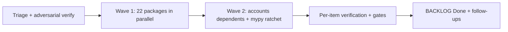

# Plan: Backlog Zero

> Companion to `spec.md`. Describes **how** we will satisfy the requirements.

## 1. Architecture Overview

No new architecture; the sweep lands foundations that existing specs already designed (036 accounts and matter spine, 022 streaming, 044/046 static parity) and then the items that were blocked on them. Work is organised into package groups with one owner per hot file, run in two waves.

## 2. Component Changes

| Layer | File / Module | Change |
|-------|---------------|--------|
| Static site | `lsat-static/` | Vitest + RTL runner, component tests, roving focus, header pin, passage scroll region, chunked guides |
| E2E | `frontend/e2e/`, `frontend/playwright.config.ts` | Playwright harness in a compose service, sticky-shell, a11y, auth, HITL, analysis-stream specs |
| Shell | `frontend/components/shell/`, `frontend/lib/modules/` | Modules menu, layout rows from the catalog, dock widgets as data, cookie-mirrored layout settings, API proxy route |
| LSAT UI | `frontend/components/lsat/` | LsatLab split into panels, timer consolidation, keyboard scheme, WritingPanel, concept deep link |
| LSAT backend | `backend/law_ai/lsat/` | proposals persistence, cross-check sweep, library stemming and picker, synth schemas, shuffle |
| LLM core | `backend/law_ai/core/llm/` | streaming protocol, xAI probes, privileged-data test, executor provenance |
| Agents | `backend/law_ai/agents_runtime/` | real PrecedentHunter, checkpointer wiring, reviewer crews |
| Graph | `backend/law_ai/core/neo4j/` | migrator command, citation resolver, vector index |
| Ingestion | `backend/law_ai/ingestionapp/` | admin actions, beat schedule, statute approval, Denver municipal source |
| Accounts | `backend/law_ai/core/`, `backend/law_ai/analysis/` | user-bound tokens, persisted analyses, share links, settings, matters |
| Autonomy / eval | `backend/law_ai/core/autonomy.py`, `backend/law_ai/eval/` | run persistence, views, LegalBench fetch and baseline |
| CI / infra | `.github/workflows/`, `Makefile`, `docker-compose*.yml` | visual-evidence gate, rulesets, overlays, mypy ratchet |

## 3. Data & Schema Migrations

Django migrations under each app's `migrations/` (core, analysis, lsat, audit, ingestionapp, matters); Neo4j Cypher migrations under `backend/law_ai/core/neo4j/migrations/` applied by the new `migrate_neo4j` command. All forward-only and idempotent.

## 4. Tech Choices & Alternatives

| Decision | Chosen | Alternatives Considered | Why |
|----------|--------|-------------------------|-----|
| Static-site tests | Vitest + RTL in a `node:20-alpine` container with a named node_modules volume | Jest; reuse frontend runner | Same stack as `frontend/`, no compose service needed |
| E2E | Playwright in the official image as a compose service | Cypress | Already a devDependency; matches ux-review docs |
| Streaming | `astream` on the provider protocol, adapters per transport | Per-provider ad hoc streaming | One choke point keeps provenance and the chain semantics |
| mypy | Baseline ratchet | Big-bang strict clean | Keeps CI green while the count burns down |

## 5. Provenance & Audit Hook-up

Every new LLM path (streaming, reviewer crews, factory executors) writes `llm_call` events through `law_ai.core.llm`; new audit event kinds (`lsat_hint`, writing evaluations, autonomy runs) are `AuditEvent` rows via `core.provenance`.

## 6. HITL Gates

Proposal queues stay in front of every bank write; ingestion approval stays in front of every graph commit; new reviewer crews only annotate drafts for the human queue; the shuffle and streaming paths are read-only.

## 7. Test Strategy

- Unit tests: one per item at minimum, in the package's area (`backend/tests/`, `frontend/__tests__/`, `lsat-static/__tests__/`, `tests/`).
- Integration: Postgres + Neo4j via `make test-integration` for migrations, resolver, and checkpointer items.
- LegalBench subset: harness tests only (`tests/eval`), no reasoning change.
- Frontend: Vitest + RTL; Playwright specs run via the new compose service.

## 8. Rollout

- Local docker compose: works after `make dev` and `make migrate`.
- Feature flags: streaming, shuffle, and the direct-write paths default off where they change user-visible behaviour.
- Backfill: guide backfill via the HITL queue (`lsat_guide_backfill`), Neo4j migrations via `make migrate`.

## 9. Risks & Mitigations

| Risk | Likelihood | Impact | Mitigation |
|------|------------|--------|------------|
| Concurrent edits collide on hot files | med | med | Single owner per hot file; additive edits; verification pass |
| Suite time grows past CI limits | med | low | Targeted runs during implementation; full suite per wave |
| Accounts change auth for existing clients | low | high | Token auth stays; user binding is optional until enforced |

## 10. Estimated Effort

24 packages, 217 items; roughly 2 to 3 agent-days of parallel work plus verification. The counsel and owner decisions in spec NG1 need human pairing.
