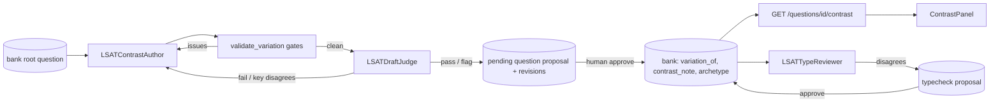

# Plan: LSAT Contrast Variations and the Agent Quality Loop

> Companion to `spec.md`. Describes **how** we will satisfy the requirements.

## 1. Architecture Overview

Two new crews and one generic loop sit on top of the existing HITL queue. `LSATContrastAuthor` drafts; `validate_variation` (deterministic) and `LSATDraftJudge` (adversarial) object; `factory/revise.py` hands the objections back and bounds the rounds; `draft_variation` files the outcome as a pending `question` proposal whose promotion the existing `promote_to_bank` handles, now carrying lineage. `LSATTypeReviewer` is the model-based sibling of the spec 053 classifier: it reads blind, the sweep files disagreements as `typecheck` rows, and `promote_typecheck` restamps on approval. The learner-facing half is one endpoint and one panel.

## 2. Component Changes

| Layer | File / Module | Change |
|-------|---------------|--------|
| Data | `backend/law_ai/lsat/services/bank.py`, `data/lr_bank.json` | `variation_of`, `contrast_note`; three seeded variations |
| Service | `backend/law_ai/lsat/services/contrast.py` | new — shape, gates, public view, `draft_variation` |
| Factory | `backend/law_ai/lsat/factory/revise.py` | new — generic author/gates/judge/revise loop |
| Agent | `backend/law_ai/agents_runtime/crews/lsat_contrast_author.py`, `prompts/lsat_contrast_author.v1.md` | new crew |
| Agent | `backend/law_ai/agents_runtime/crews/lsat_type_reviewer.py`, `prompts/lsat_type_reviewer.v1.md` | new crew + cached `review_type` |
| Agent | `backend/law_ai/agents_runtime/crews/lsat_question_editor.py`, `prompts/lsat_question_editor.v1.md` | new crew (rewrites to a critique) |
| Service | `backend/law_ai/lsat/services/rewrite.py`, `management/commands/lsat_question_review_sweep.py` | judge bank items, rewrite loop, sweep |
| Agent | `backend/law_ai/agents_runtime/crews/lsat_draft_judge.py` | `model_override` for the Fable final review |
| Registry | `backend/law_ai/agents_runtime/registry.py` | two registrations |
| Store | `backend/law_ai/lsat/services/proposals.py` | `typecheck` kind, lineage at promotion, `promote_typecheck` |
| API | `backend/law_ai/lsat/urls.py` | `ContrastView`, `VariationDraftView`, promoter entry |
| Commands | `management/commands/lsat_contrast_sweep.py`, `lsat_type_review_sweep.py`; `Makefile` | new sweeps + targets |
| Frontend | `frontend/components/lsat/ContrastPanel.tsx`, `QuestionCard.tsx`, `LrPanel.tsx`, `LsatLab.tsx`, `lib/shell/viewState.ts`, `lib/api.ts`, `mocks/server.ts` | panel, `?question=` deep link, types |
| Frontend | `frontend/components/lsat/AuthoringPanel.tsx` | typecheck card, lineage badge, `RevisionHistory`, variation form |
| Docs | `docs/agent-roles.md`, `docs/lsat-playbooks.md` | new roles; contrast section |

## 3. Data & Schema Migrations

None. Bank JSON gains optional fields; the proposal mirror stores payloads verbatim.

## 4. Tech Choices & Alternatives

| Decision | Chosen | Alternatives Considered | Why |
|----------|--------|-------------------------|-----|
| Loop shape | Generic callables in `factory/revise.py` | Hard-wire into the crew | Testable with fakes; reusable once the main author takes a critique |
| Blocking rule | `fail` or disagreeing blind key always blocks; a `flag` with concrete issues blocks while rounds remain and is accepted on the final round | Never block on `flag`; block on any non-`pass` | A wrong key is the defect no reviewer should have to catch; a flag's issues are worth one more round while the budget allows, but a reservation that persists belongs to the reviewer, not to an endless loop |
| Degraded author | No draft, nothing filed | Offline placeholder (as `LSATContentAuthor`) | A placeholder claiming kinship with a real question would sit in the learner's contrast panel once approved by mistake |
| Typecheck approval | Restamp | Report-only like cross-check | The stamp is one field and the model's read is the whole proposal; making approval do the work keeps the reviewer's action meaningful |
| Final review | A second `LSATDraftJudge` pass pinned to Fable via `models=` override; blocks only on `fail`/key disagreement, never triggers a round | Same judge model twice; a bespoke reviewer crew | A different model is the point of a final review; another round after it would let the loop argue with its own last word |
| Rewrites | `rewrite` kind promoted in place, identity fields locked | File as a new question | A rewritten question must keep its id so attempts, guides and contrast siblings still resolve |
| Structured output | `distractor_traps` as a list of `{label, trap_id}` pairs | Free-form map | The Messages API rejects `additionalProperties` given as a schema (400) under structured outputs; found on the first live run |
| Variation kind | `question` with `meta.variation_of` | New `variation` kind | Promotion, the question card and the cross-check-on-approve path all already work for `question` |

No deviation from constitution §2.

## 5. Provenance & Audit Hook-up

`LSATContrastAuthor.run`, `LSATTypeReviewer.run` and `LSATDraftJudge.run` each write one `agent_call`; all three call `law_ai.core.llm.agenerate`, which writes `llm_call`. Filing writes `lsat_proposal.create`; decisions write `lsat_proposal_decision`. The revision history is stored on the proposal so the audit of *why* a draft looks the way it does is next to the draft.

## 6. HITL Gates

Every draft and every type check lands `pending`. Approval is a reviewer action on the Authoring tab; the two promoters are the only bank writers.

## 7. Test Strategy

- `backend/tests/lsat/test_contrast.py` — shape, seeded-data integrity, every gate, draft-and-file with faked crews, promotion lineage, typecheck promotion.
- `backend/tests/lsat/test_revise.py` — the loop's rules with fake callables.
- `backend/tests/agents/test_lsat_contrast_author.py`, `test_lsat_type_reviewer.py` — parsing, degradation, caching, registry, provenance.
- `backend/tests/lsat/test_contrast_sweeps.py` — planning, skip rules, filing, degraded never filed.
- `backend/tests/api/test_lsat_contrast.py` — both endpoints.
- Frontend: `ContrastPanel.test.tsx`, additions to `AuthoringPanel.test.tsx`; existing `LrPanel`/`LsatLab`/`QuestionCard` suites re-run.

## 8. Rollout

- Works after `make dev`; no migration.
- `make lsat-export` regenerates `lsat-static/content.json` with the three new items.
- To grow the pairs: `make lsat-contrast-sweep ARGS='--limit 3'` with a provider configured; `make lsat-type-review ARGS='--section LR --limit 10'` to start validating stamps.

## 9. Risks & Mitigations

| Risk | Likelihood | Impact | Mitigation |
|------|------------|--------|------------|
| Author edits the stimulus | med | med | Gate compares normalised text and objects; reviewer sees the draft |
| Loop burns rounds on an irreconcilable objection | med | low | Cap; last draft filed with history |
| Restamp overwrites a correct stamp | low | med | Per-row human decision; card shows stamp, cue read and model read |

## 10. Estimated Effort

One agent session; no human pairing needed beyond reviewing seeded content and the first sweep's output.
