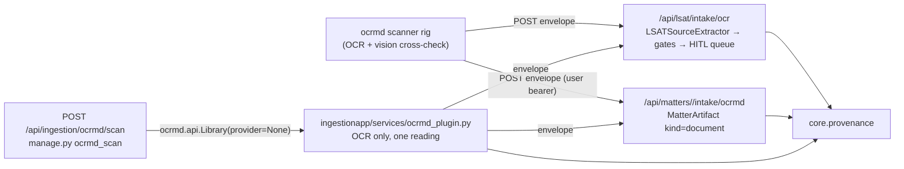

# Plan: ocrmd as a plug-in

> Companion to `spec.md`. Describes **how** the requirements are satisfied.

## 1. Architecture Overview

ocrmd stays a separate program; Law AI meets it at two seams. **Inbound**, Law AI is a *receiver* in ocrmd's sink contract: a URL answers `GET` with a descriptor and takes `POST` with an envelope. **Embedded**, Law AI can `import ocrmd.api` and run the scanner's OCR half on an upload — never its model half.

## 2. Component Changes

| Layer | File / Module | Change |
|-------|---------------|--------|
| Shared | `backend/law_ai/ingestionapp/services/ocrmd_plugin.py` (new) | `Envelope`/`Provenance`/`DocumentMeta` models, `descriptor()`/`option()`, `enabled()`/`installed()`/`status()`/`library()`/`scan_file()` |
| LSAT door | `backend/law_ai/lsat/services/ocr_intake.py`, `lsat/urls.py` | envelope accepted by a before-validator; `INTAKE_DESCRIPTOR`; `summary`/`items`/`warnings`; `GET` on `ScanIntakeView`; WS is a 422 |
| Matter door | `backend/law_ai/matters/services/scanned.py` (new), `matters/urls.py` | `matter_descriptor`, `file_page` (idempotent by page id + bbox), `delivery`; `MatterOcrmdIntakeView` |
| Upload door | `backend/law_ai/ingestionapp/urls.py` | `OcrmdStatusView`, `OcrmdScanView` + helpers |
| CLI | `backend/law_ai/ingestionapp/management/commands/ocrmd_scan.py` (new) | Docker-first batch entry |
| Settings | `backend/law_ai/settings/base.py`, `.env.example` | `ENABLE_OCRMD`, `OCRMD_ROOT`, `OCRMD_MAX_PAGES`, `INSTALL_OCRMD` |
| Packaging | `backend/pyproject.toml`, `backend/Dockerfile`, `docker-compose.yml` | `ocrmd` extra, `INSTALL_OCRMD` build arg, mypy override for `ocrmd.*` |
| Docs | `docs/data-sources.md`, `docs/architecture.md`, `CLAUDE.md` | the plug-in and its posture |

## 3. Data & Schema Migrations

None. `MatterArtifact.body` is a JSONField; the page id is looked up with a `body__provenance__page_id` key transform, which SQLite (tests) and Postgres both support.

## 4. Tech Choices & Alternatives

| Decision | Chosen | Alternatives Considered | Why |
|----------|--------|-------------------------|-----|
| Where scanned pages land for "further analysis" | `MatterArtifact(kind=document)` | a `PendingReview` kind `scanned_page`; a `:SourceDocument` graph node | A scanned book page is the user's material, not a public source: it needs no quarantine and must not enter the graph as authority. The matter is the platform's own container for source material. A graph node is a follow-up with its own spec. |
| How the embedded scanner reads | `provider=None` (OCR only) | ocrmd's own `AnthropicProvider`; a `Provider` shim over `core.llm` | The first would call a vendor from inside a dependency (§4 rejects it). The second needs an image path the chain does not have yet (BL-20260907-21). One honest reading beats a hidden second call. |
| Dependency shape | opt-in build arg + extra | always in the image | opencv needs system libraries and the package is pinned to a git ref; the default image stays byte-identical. The `nlp` extra's precedent is followed for the runtime flag. |
| Receiver contract | ocrmd's descriptor + envelope, legacy body kept | a Law AI-specific body | The scanner draws the options from the descriptor, so section/difficulty vocabulary lives here, not in a scanner. Keeping the legacy body means nothing that posted before breaks. |
| Idempotent matter filing | page id + bbox | always create | "Did that go through?" is answered by pressing the button again — the contract ocrmd's sinks are written against. |

No deviation from constitution §2.

## 5. Provenance & Audit Hook-up

- LSAT door: `provenance.log_event("lsat_ocr_intake", …)` and `audit_store.record({"type": "lsat_intake_ocr"})` unchanged; `LSATSourceExtractor` logs its agent call and its model call goes through `core.llm`.
- Matter door: `provenance.log_event("matter.artifact_added", {…, "source": "ocrmd"})` and `provenance.log_event("ocrmd_intake", {door, matter_id, artifact_id, document, page, page_id, traceable, chars, agreement, status})`.
- Embedded scanner: `provenance.log_event("ocrmd_scan", {file, document, pages, duplicates, rejected, unreadable, engine, llm: "none"})`.
- No node creation anywhere.

## 6. HITL Gates

- Spec gate: this package. PR gate: review.
- LSAT door: every draft is a `pending` proposal behind the spec-024 gates; `human_approval_required: true` (`LSATSourceExtractor`).
- Matter door: none required (user's own document, no analysis, no graph write); the response names the scanner's caveats so the reviewer of the matter sees them.
- Embedded scanner: no output path of its own.

## 7. Test Strategy

- Unit (`backend/tests/lsat/test_ocr_intake_envelope.py`): descriptor shape; envelope → 202 in the contract's terms with the proposal's provenance; legacy shape; WS → 422; duplicate → warning. `llm.agenerate` patched as in the extractor tests.
- Unit (`backend/tests/matters/test_ocrmd_intake.py`): descriptor; filing; idempotency; a region as its own filing; the operator's title; caveats; 401/404; empty text → 422.
- Unit (`backend/tests/ingestion/test_ocrmd_plugin.py`): the models; status; `library()` refusals; `scan_file` driving a fake library OCR-only and closing it; the upload door's 503/422/200 and routing to both doors; the management command.
- Integration: the doors use Postgres through the ORM like every matter/proposal test; no Neo4j involved. A real-engine scan needs the opt-in image and is a follow-up (BL-20260907-25).
- Frontend: none (NG2).

## 8. Rollout

- `make dev` unchanged. The doors are live at once (no flag): a scanner rig configured with `[[sinks]]` reaches them.
- The embedded scanner: `INSTALL_OCRMD=1` in `.env`, `docker compose build backend worker`, `ENABLE_OCRMD=true`, restart.
- No backfill.

## 9. Risks & Mitigations

| Risk | Likelihood | Impact | Mitigation |
|------|------------|--------|------------|
| A scanned page read as authority | low | high | `source=ocrmd`, kind `document`, never in `MatterAuthority` without a human (R-1) |
| Opt-in build breaks when ocrmd `main` moves | med | low | default image unaffected; pin to a release (BL-20260907-24) |
| A slow OCR on the request thread | med | low | `OCRMD_MAX_PAGES`, one file per request, a rig for books |

## 10. Estimated Effort

Backend ~1 agent-day (shipped in this cycle); docs and spec ~0.25; the vision path and the frontend are their own specs.
