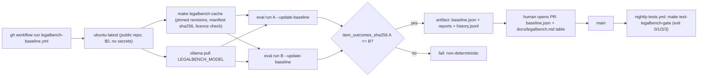

# Plan: Commit the first real LegalBench baseline

> Companion to `spec.md`. Describes **how** we will satisfy the requirements.

## 1. Architecture Overview

The harness itself does not change shape: `law_ai.eval.legalbench` loads cached items, calls one pinned Ollama model over HTTP, scores, writes a report, appends `history.jsonl`, and optionally compares to or writes `baseline.json`. This spec hardens the measurement (pinned options, timeouts, metadata), makes the gate refuse to pass silently, and adds a hosted-runner path that produces a reviewable baseline artifact. A human commits the artifact.

## 2. Component Changes

| Layer | File / Module | Change |
|-------|---------------|--------|
| Eval | `backend/law_ai/eval/legalbench.py` | `num_ctx`/`num_predict` in options; `LEGALBENCH_ITEM_TIMEOUT_S`; catch read `TimeoutError`; collect `model_digest`/`ollama_version` once per run; schema-v2 `update_baseline`; refusals (`--limit`, `errored > 0`); extended `baseline_comparability`; `--require-baseline`; exit code 3; FR-12 event fields; `legalbench.baseline_recorded`; docstring fix |
| Eval | `backend/law_ai/eval/report.py` | report header carries FR-5 fields; per-task counts; per-subset wall-clock; `item_outcomes` + sha256; history rows gain `model_digest`/`data_revision` |
| Eval | `backend/law_ai/eval/fetch.py` | expose `DATA_REVISION`, `PROMPT_REVISION`, the cap and a `manifest_sha256()` helper for the report header (no behaviour change to fetching) |
| Settings | `backend/law_ai/settings/base.py`, `.env.example` | `LEGALBENCH_ITEM_TIMEOUT_S` (default 300), `LEGALBENCH_NUM_CTX`, `LEGALBENCH_NUM_PREDICT`, read through `settings_proxy` |
| Make | `Makefile` | `LEGALBENCH_MODEL ?= mistral:7b-instruct-q4_K_M`; pass `--model $(LEGALBENCH_MODEL)` in the three LegalBench targets; `test-legalbench-gate` adds `--require-baseline` (T-008, after the baseline lands) |
| CI | `.github/workflows/legalbench-baseline.yml` (new) | `workflow_dispatch`, `contents: read`, no secrets, double run, determinism check, artifact upload; `timeout-minutes: 330` |
| CI | `.github/workflows/nightly-tests.yml` | LegalBench steps `if: ${{ !inputs.dry_run && !cancelled() }}`; pull step reads `LEGALBENCH_MODEL`; schedule per OQ-5 |
| Tests | `backend/tests/eval/test_legalbench_cli.py`, `test_legalbench_measurement.py`, new `test_baseline_v2.py` | AC-3..AC-6, AC-10 |
| Tests | `tests/test_legalbench_workflows.py` (new, repo-level) | AC-7..AC-9 (parse YAML / `make -n` output, stdlib only) |
| Data | `backend/var/legalbench/baseline.json` (new, tracked) | committed from the hosted-runner artifact (T-007) |
| Docs | `docs/legalbench.md`, `backend/var/legalbench/LICENSES.md` | baseline table, procedure, exit code 3, attribution and §13 label (FR-10, FR-11) |

## 3. Data & Schema Migrations

None. `baseline.json` schema v2 is a JSON file; the reader accepts v1 (bare `{subset: accuracy}` or the current `model`/`accuracies`/`scorers` shape) and applies only the v1 comparability checks to it.

## 4. Tech Choices & Alternatives

| Decision | Chosen | Alternatives Considered | Why |
|----------|--------|-------------------------|-----|
| Provider | Ollama, pinned model + digest, direct HTTP | Route through `LLM_PROVIDER_CHAIN` pinned to one tier | Constitution §1 forbids LegalBench routing through the chain; a chain fallback would silently change what is measured |
| Baseline host | GitHub-hosted `ubuntu-latest` | Workstation; self-hosted runner | Same hardware class as the nightly gate; $0 on a public repo; no secret; reproducible by anyone (OQ-1) |
| Who commits | Human PR from the artifact | Workflow pushes or opens a PR | I1 forbids loops holding merge-capable permissions; `contents: read` is the least privilege that works |
| Determinism proof | Two runs, compare `item_outcomes_sha256` | Trust `temperature=0` | llama.cpp can vary across threads/CPUs; one extra run is cheap insurance before freezing a number |
| Per-item record | indices + booleans (`item_outcomes`) | Commit full reports | Booleans redistribute no CC BY / CC BY-SA content; full reports stay a 90-day artifact |
| Incomparable baseline | exit 3 | Warn and exit 0 (today) | A gate that passes when it cannot compare is the failure mode this spec exists to remove |
| Subsets | the two gated subsets only | All five fetchable subsets | Keeps the first run inside the CPU budget; more subsets is BL-20261018-01 |

No new dependency, framework or vendor; no ADR needed for this spec (an ADR is needed only if OQ-2 or OQ-3 is answered "yes").

## 5. Provenance & Audit Hook-up

The harness makes no `law_ai.core.llm` call by design (constitution §1 carve-out), so no `llm_call` event is written. Instead every item writes `legalbench.item` through `law_ai.core.audit_jsonl.record` with `run_id`, `model`, `model_digest`, `data_revision`, `subset`, `item_id`, `prompt_sha256`, `response_sha256`, `correct`, `latency_ms`, `source="legalbench"`, `agent_version="law_ai.eval.legalbench.v2"`, `confidence`. A baseline write adds one `legalbench.baseline_recorded` event (baseline sha256 + header). Delta events (`autonomy_legalbench_delta`) are unchanged. No graph writes.

## 6. HITL Gates

- Spec gate: Amr resolves OQ-1..OQ-5 before status moves past `draft`.
- PR gate (implementation): harness changes T-001..T-006 merge first, with no baseline file.
- Baseline gate: T-007's PR (artifact `baseline.json` + docs table) is reviewed and merged by a human; no workflow can merge it (I1).
- `human_approval_required`: not applicable (no ingestion, agent, or migration).

## 7. Test Strategy

- Unit (`make test-backend`): fabricated reports and a stub Ollama HTTP server cover AC-3 (one case per FR-6 field), AC-4 (1.00 vs 1.01 pp), AC-5 (stub/limit/errored refusals), AC-6 (read timeout), AC-10 (event fields).
- Repo-level (root `tests/` suite under `pytest.ini`, run by the ci.yml root-tests tier; stdlib): AC-7 (`make -n` expansion), AC-8 (nightly `if:`), AC-9 (workflow permissions/secrets/push).
- Integration: the hosted-runner dispatch itself is the end-to-end test (AC-1); `make test-integration` is unaffected.
- LegalBench: the full two-subset run, twice, on the hosted runner (T-007).

## 8. Rollout

1. Merge this spec (draft) and answer the OQs.
2. Merge the harness PR (T-001..T-006). The gate's behaviour without a baseline is unchanged until T-008.
3. Dispatch `legalbench-baseline.yml` on `main`; download the artifact; open the baseline PR (T-007).
4. Merge it; then flip `test-legalbench-gate` to `--require-baseline` (T-008) and dispatch nightly once to record the first green scored run (closes BL-20260906-34).

No feature flag; no backfill.

## 9. Risks & Mitigations

| Risk | Likelihood | Impact | Mitigation |
|------|------------|--------|------------|
| CPU run exceeds the job limit | med | med | per-subset timing; OQ-4 fallback; FR-8 timeout |
| Runs are not deterministic on hosted CPUs | low | high | NFR-DET-1 double run; record `runner`; refuse baseline on mismatch |
| Upstream re-pushes the Ollama tag | low | high | `model_digest` in FR-6 makes it exit 3, not a false regression |
| Disk exhaustion on the runner | med | med | reuse nightly cleanup; start only needed services |
| Single-item flips trip `precedent_retrieval` | med | low | item counts beside every delta; OQ-2 |

## 10. Estimated Effort

About one agent-day for T-001..T-006 plus docs, one supervised hosted run (multi-hour, unattended), and a short human review for T-007. T-007 and T-008 need Amr: the baseline PR is his approval.
